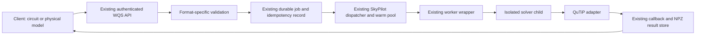

# Integration design

Status: approved by the owner on 2026-10-25. Local capability probes establish library feasibility only.

## Architecture

The dispatcher continues to schedule jobs until placement is exhausted. SkyPilot remains the only compute launcher. No upstream web service or alternate queue is deployed.

## API and schema boundary

Keep the existing circuit Submission model unchanged. Add physics-specific Pydantic models with `extra=forbid`, finite numeric types, bounded collections and an explicit schema version. Generate the served structural JSON Schema from these models; keep cross-field and physical constraints in one semantic validator. Schema documentation must identify checks that JSON Schema cannot express.

The general submit route dispatches validation by the known `input_format`, with missing format retaining the legacy Stim path. A shared validator dependency must preserve the existing circuit error locations and messages rather than exposing new union-branch prefixes. New physics errors add an escaped JSON Pointer under the existing 422 envelope; circuit errors remain unchanged. Normalize the explicit and general physics forms to one canonical request before calling the same `enqueue` function. Preserve old canonicalization bytes and historical reservations.

Use `engine=lindblad`, `input_format=lindblad_model` internally. The explicit route supplies these values; if the generic form specifies a conflicting engine/format pair it is rejected. Physics requests have a `model`, not a dummy `circuit` string. No job-table migration is needed: request JSON already stores the complete envelope.

Keep the current capabilities `engines` mapping and add a `lindblad` entry. Do not replace that mapping with the upstream proposal's list. Add the schema route before broad dynamic job routes, with no authentication or job submission side effects. Public API keys, internal URLs and credentials must not appear in examples or served schemas.

## Worker and dependencies

Pin QuTiP 5.3.1 as a worker dependency and record the resolved NumPy/SciPy versions. Reuse the existing worker image and isolated simulator child first: WQS currently packages its supported engines together, and pool reuse already requires an exact worker-image match. Do not introduce per-engine images or a second image-selection policy merely to follow an upstream deployment suggestion. Revisit image splitting only if measured dependency conflicts or footprint justify it.

The outer worker retains its existing callback credentials. The numerical child receives only the existing sanitized environment; it imports QuTiP only for a Lindblad request. Solver failures produce a bounded physics-specific job failure without echoing a model, token, private path or raw native traceback.

The adapter returns result arrays and metadata to the existing NPZ/summary serializer. No object arrays, Python pickle, arbitrary imports, callbacks from request data or string coefficient compilation are accepted.

## Numerical interpretation

Use QuTiP's maintained tensor, operator, state and solver facilities. A small adapter constructs these native objects directly; there is no new symbolic language or general compiler.

- Tensor factors follow the ordered mode list. `proj:k,l` means `|k><l|`; `x=a+adag`; `y=-i(a-adag)`. An operator product has at most one primitive per named mode, with identity elsewhere.
- Hamiltonian coefficients are linear GHz and are multiplied by 2π once at the native construction boundary. Collapse rates are never multiplied by 2π. Spectrum results divide angular eigenvalues by 2π.
- `hc=true` constructs `c*A + conjugate(c)*A.dag()`. For a complex drive it must also conjugate its time-dependent numeric coefficient. Validate the final Hamiltonian's Hermiticity rather than assuming every allowed primitive is Hermitian.
- Relaxation uses `sqrt(1/T1)*a`; dephasing uses `sqrt(2/Tphi)*n`; thermal loss adds both downward and upward terms. These definitions match the proposed two-level T1/Tphi meanings and must be documented for higher-level modes.
- Pure amplitudes are normalized only after nonzero norm/finite checks. Density matrices require a bounded positivity check before enqueueing. Select and measure the validation dependency/implementation rather than silently importing QuTiP into the API or letting an unbounded eigensolve run there.
- `se` evolves kets without collapse operators. `me` returns density matrices. `mc` uses serial seeded trajectories within one job and reports ensemble expectations; retained states are ensemble density matrices, never an undocumented mixture of trajectory axes and average states. Repeated native seeds must reproduce results within a pinned worker image.
- Propagators act from the first supplied time, consistent with QuTiP. `me` output specifies QuTiP's column-stacking vectorization and tensor order; `se` output is a Hilbert-space unitary. A dissipative model requested with `solver=me` must yield a superoperator even when its collapse list happens to be empty.
- Static spectrum/steady-state operations reject nonempty drives. Degenerate steady states or solver nonconvergence fail explicitly; the service does not invent a preferred stationary state.

## Drive contract requiring resolution

The proposal does not fully define the DRAG `beta` units/sign or `square.rise` edge convention. These must be fixed in the version-1 schema and analytic tests before those shapes are advertised. Proposal: `beta` in ns and `envelope=Gaussian+i*beta*dGaussian/dt`; positive rise means symmetric cosine turn-on/off within the stated support. Owner review may instead defer these two variants while keeping constant, square-without-rise, Gaussian, flattop and sampled envelopes.

Use explicit array coefficients with interpolation `order=1`. Output times and coefficient sample times are separate concepts. The coefficient grid must include requested output times, support boundaries and supplied sample knots, and resolve modulation/analytic envelopes within a published bounded policy. A pulse entirely between two output times must still be simulated. The solver's maximum integration step must respect the narrowest resolved pulse. Discovery must establish a bounded grid policy and convergence checks before defaults are accepted; output-grid-only interpolation is insufficient.

## Memory and result admission

Keep 2 CPU/4 GiB scheduling initially. Treat upstream dimensions as proposed ceilings, not proof that every dense matrix/model fits that profile. Track D, D² and D⁴ growth separately; dissipative propagators and dense custom collapse operators are particularly expensive. Measure adversarial accepted shapes inside the actual CPU/memory-constrained worker image before finalizing caps.

The existing result artifact field accepts at most 12 MiB of base64, equivalent to at most 9 MiB of raw NPZ; the HTTP body is capped at 16 MiB and summary JSON at 2 MiB. Ten million complex128 output cells alone require 160,000,000 bytes, so the proposed count cannot be adopted.

Proposed initial policy: at most 6 MiB of raw numeric array payload across all results, with separate bounded Unicode metadata and ZIP/header accounting and a verified worst-case NPZ/base64 bound. Compute this before allocation for states, propagators, eigenvectors and expectations together. Never rely on compression, and check the actual callback bytes again after serialization. Return 422 for predictable over-budget shapes. The final budget and memory limits are implementation discovery gates, not advertised limits yet.

## Compatibility and rollout

Keep `/api/me`, existing summaries, circuit defaults, existing NPZ member names and current callback fields unchanged. New physics summaries may add fields only for their own jobs. Keep the existing result/deletion/backup validation path; confirm complex numeric NPZ arrays and Unicode metadata pass recovery validation without weakening its object-array checks.

Extend release acceptance to include a small seeded/analytic Lindblad case in addition to all current cases. That requires updating the acceptance evidence contract and tests together, rather than advertising a new engine that CD never verifies. Keep the existing backup gates and existing credentials throughout deployment. The pending controlled rollout is independent operational work; this feature does not change bootstrap flags or perform a production deployment.

## scqubits integration (required in this flow)

scqubits reuses the same request/worker/result boundary with a class-specific numeric constructor allowlist. `export_for_lindblad` emits a numeric matrix mode plus explicit units/tensor basis, tested by comparing spectra across both engines. Pin/version/license and constrained memory checks remain prerequisites.

JoSIM runs a pinned native executable in server-owned scratch with fixed output arguments, no shell, and a positive netlist subset. Validate continuations, case variants, subcircuits, parameter expressions, output directives and all file-access forms before enabling it. A simple `.include`/`.file` blocklist is insufficient. A reproducible SFQ pulse fixture and a safe parser/subset decision are prerequisites. Palace stays outside this flow.

### scqubits API and native mapping

`POST /api/jobs/scqubits` and the generic route normalize to `engine=scqubits`, `input_format=scqubits_model`, `schema_version=1`. Support `spectrum`, `matrix_elements` and `export_for_lindblad`. Use numeric model parameters only. Constructor callback hooks, arbitrary eigensolver method strings, native options dictionaries, `id_str` and symbolic Circuit/YAML inputs are not caller fields.

Define class-specific schemas rather than one permissive parameter dictionary: Transmon uses EJ/EC/ng/ncut; TunableTransmon adds EJmax/d/flux in place of EJ; Fluxonium uses EJ/EC/EL/flux/cutoff; FluxQubit uses its three junction/charging energies, offsets, flux and charge cutoff as verified against the pinned constructor. Bound the full native basis dimension before construction, not just the requested number of output levels. Operator names are a per-class set drawn from the proposed n/phi/cos_phi/sin_phi operations; unsupported class/operator pairs return 422.

Use one native eigensystem for a result and all exported operators, so phases/basis ordering stay consistent. Export `diag(eigenvalues)` and operator matrices in that same eigenbasis, with explicit linear-GHz units and energy reference. A caller can pass the numeric matrix mode to Lindblad; there is no automatic job chaining. Test the round trip and exact direct-library agreement for each class. scqubits 4.3.1 is the discovery candidate, with an exact worker lock and license notices required before implementation completes.

## JoSIM integration (required in this flow)

`POST /api/jobs/josim` and the generic route normalize to `engine=josim`, `input_format=josim_netlist`, `schema_version=1`, `operation=transient`. Keep bounded netlist text as the input; use no dummy circuit field or alternate job store. Device models, transient interval and explicit output traces are validated before enqueueing.

Define a documented positive subset against the pinned native parser: bounded passive elements, junction models and numeric source waveforms sufficient for the JTL/SFQ fixture; fixed allowed analysis/model/output statements; no arbitrary file or control commands. Normalize case, comments and continuations before statement validation. Reject `.control` blocks, include/file aliases, external data references, unsupported parameter expressions and unbounded/recursive subcircuits. Do not write a general SPICE interpreter: the adapter enforces the safe subset and delegates supported electrical semantics to JoSIM. If that subset cannot be enforced before native execution, JoSIM implementation remains incomplete rather than shipping a blocklist bypass.

Run the native executable with a fixed argument vector, without a shell, in server-owned scratch in the already isolated worker child. The server chooses every input/output filename. Convert only explicitly selected native trace output into bounded numeric NPZ arrays. Validate time ordering, finite values, units, trace count and predicted/actual output bytes. A convergence failure is a bounded FAILED job; no automatic precision or circuit change is allowed.

JoSIM's inspected latest upstream release is v2.7 (MIT), while the proposal mentions 2.6.x. Discovery must select and pin an exact source revision/build digest after testing the requested subset and SFQ fixture. This version difference is recorded rather than silently replacing the proposed native version. GPU support is not established for this backend.

## GPU placement and measurement

The owner's GPU request overrides the upstream proposal's CPU-only exclusion. Assess QuTiP's maintained GPU data/solver plugins and scqubits' native GPU diagonalization choices. scqubits documents CuPy and JAX diagonalization; QuTiP has a CuPy backend, but operation/solver coverage must be established for the pinned versions rather than extrapolated from matrix arithmetic. Do not expose arbitrary `esys_method` or plugin names to callers.

Benchmark representative sparse/dense cases across small and larger dimensions on addressable cluster GPUs. Include host-side construction, device transfer, compilation/context setup, numerical solution, CPU result copy and end-to-end cold/warm job latency. Compare the same physical problem, tolerances and output representation, including meaningful float64/complex128 performance and VRAM headroom. A currently advertised GPU is not a reservation or evidence that it is free.

Keep all placements in the existing SkyPilot task and warm-worker lifecycle. If acceleration proves useful, introduce a narrow server-owned engine/operation placement table and pinned GPU worker-image variant rather than another service or scheduler. Resource requests and exact worker-image identity must remain part of pool compatibility. Define whether unavailable GPUs cause queueing or a measured equivalent CPU fallback; record actual backend/device/precision in results. CPU fallback must not accept a problem that exceeds CPU admission bounds. Apply the same safe data boundary to GPU workers; never mount host credentials or broad device access manually.

GPU discovery is required in this flow. Enabling acceleration depends on its evidence; the three engines can ship on validated CPU paths if no tested GPU path provides a useful benefit. No unsupported GPU capability is advertised.

## Decisions for owner review

1. All three backends are confirmed in scope. Deliver them in dependency order through separately reviewable PRs; no further scope approval is needed to include scqubits or JoSIM.
2. Preserve WQS's existing CPU worker baseline. Add a GPU image/profile only when discovery establishes supported operations and useful benefit, keeping placement server-managed through SkyPilot.
3. Use byte-budgeted results and measured memory limits instead of accepting the upstream numeric ceilings unchanged.
4. Defer sweeps and additional progress events; keep client orchestration responsibilities unchanged.
5. Resolve or defer ambiguous pulse shapes before declaring schema version 1 stable.
