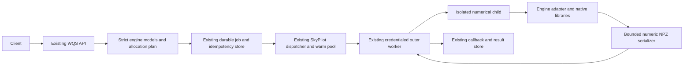

# Integration design

Status: the base design was approved on 2026-10-25. This **complete G1 amendment is proposed for owner review**, not runtime implementation or production activation. The detailed choices, evidence and PHY-001 through PHY-020 traceability are in [decisions.md](decisions.md). Requirements remain unchanged. Approval accepts the proposed pulse deferrals and work policy; later gates still require runtime evidence.

## Overview

Integrate Lindblad/QuTiP, all four required scqubits classes and restricted JoSIM into WQS. Keep the existing authenticated API, durable jobs, idempotency, queue, SkyPilot dispatcher, warm workers, isolated numerical child, callback and NPZ result store. All three CPU backends remain mandatory; GPU discovery is complete for the declared cases, with CPU defaults recommended. Palace, sweeps, job dependencies, persistent state and new solver progress events remain excluded.

## Architecture (components, responsibilities, and boundaries)

[interfaces.json](interfaces.json) freezes the proposed module exports and [module-boundaries.json](module-boundaries.json) their permitted imports. Native libraries load only in the child. API model/schema/capability imports remain solver-free, with bounded NumPy used for density validation. Adapters have no auth, queue, callback or scheduler authority. `physics_results` owns the shared numeric/byte contracts; `physics_submission` normalizes physics routes. No second service, generic plugin framework or execution queue is introduced.

Reuse the combined CPU worker image. Pin QuTiP 5.3.1, scqubits 4.3.1 and the discovered NumPy/SciPy versions, reconciling the existing lock without incidental upgrades. Pin JoSIM v2.7 by source/build digest. JoSIM's LGPL dependency/notices obligations remain a distribution blocker until satisfied. The 6 GB CUDA discovery image is not the proposed CPU release image. Combined-image memory, dependency compatibility, notices and mathematical regression checks are G2 obligations.

## Data Flow (step-by-step; include a Mermaid sequence diagram when useful)

1. Existing authentication/owner scope applies before submission. Explicit physics routes require the existing Idempotency-Key header; the generic route keeps its optional-header behavior.
2. Select the strict version-1 engine model. Apply structural/schema and finite-field checks only at this stage; add a JSON Pointer only to new physics errors. Current physical/resource admission follows the idempotency replay check in step 3.
3. Normalize explicit/generic inputs to one canonical physics envelope. A matching authenticated owner/idempotency reservation replays before applying a changed current admission policy; changed bodies still conflict. Only new jobs receive the current physical validation, `AllocationPlan` and server-resolved execution context. No native object, callable, caller path or credential crosses this boundary.
4. Existing enqueue/idempotency atomically repeats the reservation check, creates the owner-scoped job and persists its execution context. The pure settings policy resolver selects a certified profile without scheduling. Physics canonicalization does not alter any historical circuit identity.
5. Existing dispatcher atomically claims a compatible warm worker or launch intent and persists the resolved execution profile before calling SkyPilot.
6. Outer worker revalidates the stored policy/image/profile, starts a fresh sanitized numerical child and retains all callback credentials outside it.
7. The native adapter reproduces the bounded plan, executes the selected algorithm and returns numeric arrays, finite metadata and honest work observations.
8. Serializer verifies actual NPZ/base64/JSON bytes; the outer worker uses the existing callback, result store and terminal-status logic. Polling, SSE resume, cancellation, deletion and backup behavior remain shared.

## Public Interfaces (APIs, CLIs, schemas, config)

The six new paths are `POST /api/jobs/{lindblad,scqubits,josim}` and `GET /api/schemas/{lindblad,scqubits,josim}/1.json`. Generic `/api/jobs` accepts matching engine/input_format pairs `lindblad/lindblad_model`, `scqubits/scqubits_model` and `josim/josim_netlist`. Schema version is strict integer 1, taking precedence over the upstream string example. Explicit endpoints supply engine/format; conflicting generic values fail. Public discovery preserves the existing `engines` mapping and advertises only implemented/certified cells.

Common physics name fields retain the existing 1-80-character bound, with default `Untitled simulation`; omitted names normalize identically on both submission paths. MC seed is an integer from 0 to 2^63-1, and the request has no shots field. Engine-specific models have `extra=forbid`; no Python, expressions, strings compiled as coefficients, symbolic Circuit/YAML, native options or resource/backend selectors are public fields. No new CLI or public scheduling knob is added. Versioned structural schemas come from the same Pydantic models as validation; their documentation identifies semantic constraints JSON Schema cannot express. Schema routes have no job side effect and are registered before broad dynamic job routes.

Lindblad supports `evolve` with se/me/mc, static `spectrum`, unique `steadystate`, and se/me `propagator`. Increasing finite output times can be an explicit list or bounded `{start, stop, points}` expanded to the same canonical list with exact endpoints; at most 65,536 points, at least two for evolution/propagators. Static operations reject times/drives as inapplicable. High-level `store_states` and `return_vectors` are explicit operation-specific booleans, never native options. Steady state accepts up to 32 named observables and `return_state` (boolean, default true): stationary `expectations` has shape (O,), and `steady_state` (D,D) is present only when requested. With no observables, omit `expectations`. Always compute, charge and validate the unique density internally even when it is not returned. MC alone accepts seed and trajectories; omitted seed becomes 42 and is recorded. Other operations reject inapplicable stochastic controls rather than attaching irrelevant shot counts.

scqubits retains `model.qubit` and `model.params`, with the verified per-class constructor fields, and uses `evals_count` (default 6, at most 32) consistently across spectrum/matrix_elements/export_for_lindblad. The server derives native truncated_dim; it is not a second independent constructor control. `operator` selects one allowed matrix_elements operator; `operators` is the distinct ordered export list. `return_vectors` applies to spectrum. Export uses ground-referenced GHz energies and one shared eigenbasis. Large inline matrix-mode JSON is charged against the 64 KiB metadata bound before work; a worst-case finite-float spelling reserve of 40 ASCII bytes per real component plus delimiters/names makes the preflight conservative. This may admit fewer export levels/operators than spectrum, and predictable excess returns 422. The full raw basis, not evals_count, drives constructor admission.

JoSIM accepts normalized bounded `netlist` text for transient only. Its grammar, quantity bounds, rows/traces and fixed native argv are normative in G1-09. No noise/temperature/seed directive, file path, subcircuit, expression or control block is public in v1. Results preserve SI times, voltages, currents and phase radians.

### Numerical interpretation

Use QuTiP's maintained tensor, operator, state and solver facilities. A small adapter constructs these native objects directly; there is no new symbolic language or general compiler.

- Tensor factors follow the ordered mode list. `proj:k,l` means `|k><l|`; `x=a+adag`; `y=-i(a-adag)`. An operator product has at most one primitive per named mode, with identity elsewhere.
- Hamiltonian coefficients are linear GHz and are multiplied by 2π once at the native construction boundary. Collapse rates are never multiplied by 2π. Spectrum results divide angular eigenvalues by 2π.
- `hc=true` constructs `c*A + conjugate(c)*A.dag()`. For a complex drive it must also conjugate its time-dependent numeric coefficient. Validate the final Hamiltonian's Hermiticity rather than assuming every allowed primitive is Hermitian.
- Relaxation uses `sqrt(1/T1)*a`; dephasing uses `sqrt(2/Tphi)*n`; thermal loss adds both downward and upward terms. These definitions match the proposed two-level T1/Tphi meanings and must be documented for higher-level modes.
- Pure amplitudes are normalized only after nonzero norm/finite checks. Density matrices require a bounded positivity check before enqueueing. Select and measure the validation dependency/implementation rather than silently importing QuTiP into the API or letting an unbounded eigensolve run there.
- `se` evolves kets without collapse operators. `me` returns density matrices. `mc` requires a pure state and at least one nonzero collapse channel, and uses serial seeded trajectories within one job and reports ensemble expectations; retained states are ensemble density matrices, never an undocumented mixture of trajectory axes and average states. Repeated native seeds must reproduce results within a pinned worker image.
- Propagators act from the first supplied time, consistent with QuTiP. `me` output specifies QuTiP's column-stacking vectorization and tensor order; `se` output is a Hilbert-space unitary. A dissipative model requested with `solver=me` must yield a superoperator even when its collapse list happens to be empty.
- Static spectrum/steady-state operations reject nonempty drives. Degenerate steady states or solver nonconvergence fail explicitly; the service does not invent a preferred stationary state.

### Pulses, work and results

G1-04 chooses constant, plain square, truncated Gaussian, flattop_cosine and sampled envelopes, exact discontinuity segmentation and certified piecewise-linear grids. DRAG and positive square.rise are proposed deferrals. The detailed phase/edge definitions and 1e-6 coefficient-error budget are in [decisions.md](decisions.md). G1-05 selects native vern7, server-owned tolerances, per-call native bounds and cumulative honest work accounting, without a new job-wide work cutoff or wall-time cap. Results use the fixed array shapes and complete uncompressed NPZ/base64/JSON bound in G1-07/12. Solver tolerances, coefficient approximation and MC sampling errors are distinct quantities.

### Boundary Artifact Schemas

`interfaces.json` has `version` and a `modules` mapping. Each module declares `description`, `public_exports` entries (`name`, `kind`, `signature`) and `internal_only` names. Existing-module entries describe additive exports without removing legacy exports. Signatures are declarative Python interface descriptions, not executable schemas; JsonValue means recursive finite JSON.

`module-boundaries.json` has `version` and `boundaries`, each containing `module`, `description`, `allowed_imports_from` and `forbidden_imports_from`. These are Python module prefixes; no caller can alter them. Worker/API/controller integration imports are reviewed at the existing integration points rather than granting adapters lifecycle access.

## Data Model & Storage (including migrations and idempotency)

Keep complete canonical request JSON in the existing jobs record. No jobs-table migration or second session store is needed. Preserve legacy canonical bytes; resolved server policy does not enter the client idempotency hash. Public error envelopes for old formats remain unchanged.

Add nullable `profile_json` TEXT columns only to existing job_dispatch/worker_pool tables. Record the complete worker compatibility tuple (policy/profile/image/resources/isolation/precision/algorithm-set revision) at admission, with per-job plan digest/algorithm in the dispatch context. Pool rows retain only the worker tuple; warm reuse fingerprints the complete tuple, excluding job-specific plan identity. The controller preserves that persisted context when claiming ownership before dispatch. Matching an image alone is insufficient physics reuse. Missing legacy metadata never authorizes physics reuse by inference; old circuit compatibility continues. A queued or partially launched/in-flight intent retains its original profile through restart or default-policy changes. Matching idempotency reservations replay before applying changed current resource policy, with a second atomic reservation check before a new job is created.

## Concurrency, Ordering, and Consistency (if relevant)

Use existing SQLite transactions, owner scope and durable launch/exec/retry intents. Do not rebind an ambiguous submission to another worker or backend. Existing SkyPilot placement continues until resources are unavailable, then jobs queue through existing behavior. No global job cap is introduced. Requests remain independent: clients own sequencing, batching and state. Inside a job, MC is serial and segmentation preserves native state with a cumulative ledger; warm reuse always starts a fresh child.

## Failure Modes & Recovery (timeouts, retries, circuit breakers, degraded modes)

Reject invalid/over-budget requests before job creation. Report native convergence/resource failures, unstable/nonunique results, revalidation/profile mismatch and actual result overflow as bounded terminal failures. Preserve failed-call work counts where a bounded failure receipt can be emitted. Never repair density/results, change tolerances/precision, truncate trajectories or return partial success silently. No new simulation timeout or CPU-second quota is added. Existing cancellation and transport/placement retry logic remains authoritative.

All GPU scheduling, execution and cleanup stays under SkyPilot. Initial physics policy is CPU-only; measured CuPy fallback is not a GPU solver. A future reviewed GPU profile queues when unavailable unless an explicit semantically equivalent CPU fallback is configured and admitted. Unknown or obsolete certificate/profile identity fails closed; it does not justify direct device access. Backout disables new physics admission while retaining existing jobs/results and the old circuit service.

## Security Model (authn/z, permissions, secrets handling, injection defenses)

Reuse existing API auth, owner scoping, callback auth and idempotency reservations. The numerical child has no callback token, registry credential, API-server credential or broad host mount. Keep the nonroot sanitized child, memory/file limits and server-owned scratch. Native imports are lazy inside that boundary. No raw tracebacks, model dumps or private paths are public errors. Safe NPZ rejects object/pickle and verifies dtype/shape/bytes; JoSIM uses a positive normalized grammar and fixed argv without a shell.

Existing credentials, key custody, rotation, encryption and backup gates are unchanged. This design creates no new vault, public service, direct GPU resource path or external exposure. The approved 8 GiB AS GPU profile was discovery-only; CPU production isolation remains 3 GiB AS/4 GiB scheduler memory until an approved measured production profile exists.

## Observability (signals, dashboards, alerts; what you will measure)

Record actual engine/library/image/policy/algorithm identity, units, dimensions/tensor order, seed and precision/backend. Store source-derived RHS upper bound as a decimal string, explicitly distinguished from observed entry counts; use decimal strings for unbounded cumulative counters so JavaScript does not lose integer precision. Record trajectories/segments/output counts, native status, existing scheduler timing/resource consumption and bounded result sizes. scqubits/JoSIM expose their own work observations without invented RHS or Newton counts. No fractional solver progress is added.

## Rollout Plan (staged rollout, feature flags, backout)

G1 owner review freezes this proposal. TASK-007 onward then implements all three CPU engines in the approved atomic leases. G2 proves the combined image, largest-admitted-shape allocation certificates, physical fixtures, injection/refusal cases and full lifecycle/result/backup compatibility. G3 records the actual GPU enable matrix; CPU defaults are the initial recommendation, with no unproved cell advertised. G4 proves Standpunkt-first CI/hosted fallback, docs/schema parity, fresh real backup/recovery gates and exact-release acceptance before general admission. No deployment or merge is implied by sending this packet.

## Alternatives Considered (at least 2, with pros/cons)

- Native per-call bounds plus cumulative accounting (selected): preserves proven native mathematics and makes MC retries visible. It does not pretend to cap total runtime or count exact compiled RHS calls.
- A global RHS/CPU-time quota: could enforce a fixed per-job allowance, but no measured universal threshold exists and it would add an unapproved cutoff. Not selected.
- A native integrator fork or coefficient callback counter: could expose finer counters, but adds compiled maintenance or coefficient overhead/semantics risk. Not needed for the selected accounting contract.
- A separate upstream service or direct Runpod/GPU path: would duplicate lifecycle/security authority and bypass the required scheduler. Rejected.
- Separate per-engine images: may reduce imports, but the current service uses exact-image warm reuse and discovery has not established a combined-image conflict. Keep one CPU image unless measured acceptance requires reconsideration.

## Open Design Questions

No work-accounting or internal-interface choice remains delegated to implementation. Owner review is pending for the proposed pulse deferrals, native per-call/cumulative-accounting policy and initial CPU-only production enable matrix. Largest-shape certificates, native licenses, pulse convergence, combined-image behavior and live acceptance are named evidence gates; their absence prevents activation and is not permission to improvise a new algorithm or resource profile.

## Simplicity Budget

At most ten new production modules, exactly those in interfaces.json excluding the existing settings entry. At most six new public HTTP paths, three engine identifiers and schema version 1. Reuse existing API/worker/controller/settings/store integration; no second queue, server, database, generic solver plugin registry or new per-engine deployment service. Add NumPy to the API only for bounded numeric validation; QuTiP/scqubits and the selected JoSIM build belong in the worker. No CUDA/JAX production dependency is approved by discovery alone. Combined lock changes must avoid incidental upgrades and retain all required notices.

The smaller alternative of adding only Lindblad was evaluated and does not satisfy the owner's required all-three scope. The smaller implementation choice within that scope is one CPU image and the existing execution/result path, rather than GPU routing before benefit is demonstrated.

## Rejected Abstractions

Reject a general expression language, arbitrary native constructor/options passthrough, workflow orchestration, persistent states, a second scheduler, automatic job chaining and a custom numerical integrator. Existing typed engine adapters plus a shared numeric boundary are sufficient. The fixed private native-wrapper registration is child-local implementation instrumentation, not a public plugin system.

## Verification Strategy (mapping to requirements and test strategy)

The complete PHY-001 through PHY-020 map is in [decisions.md](decisions.md). Preserve the 803-test baseline, subtests and console tests. New API tests prove strict schemas/semantic pointers and no job on refusal. Native tests prove units, conjugation, state/ME semantics, seeded MC, unique stationary results and propagators; work tests prove segment/trajectory/collapse-search/reset/failure accounting. Memory/result tests verify every planned boundary in the combined constrained image, including base64/Unicode/archive overhead and parent/child overlap. Every class/operator export and JoSIM SFQ/safe grammar must pass. Hardware tests are opt-in, fixed synthetic requests on SkyPilot-owned allocations only. No unavailable GPU path, mocked release or successful build is substituted for operational acceptance.
