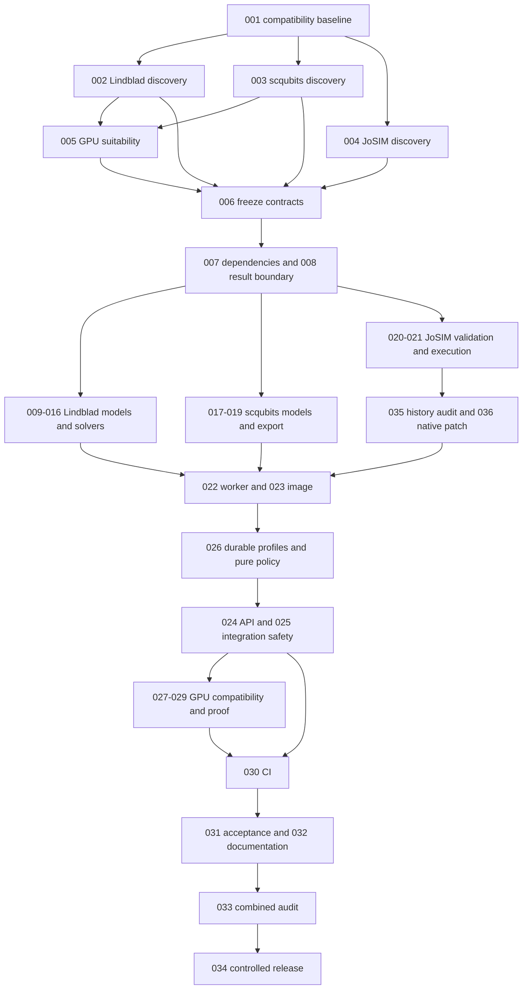

# Implementation task plan: physics engines

Status: **approved for implementation on 2026-10-25**. The owner approved the task plan and parallel System2 execution within write leases. Execution starts with TASK-001, followed by TASK-002 through TASK-004 in parallel and TASK-005 after its CPU references pass. All three backends and useful GPU acceleration remain in scope. Deployment remains subject to the existing acceptance gates. The JoSIM bounded-history design and TASK-035/036 execution plan are approved. The owner confirmed that existing approval on 2026-10-30; the earlier pending-approval labels were stale.

Prepared with System2 1.1.1 `task-planner`, scoped to the existing `spec/physics-engines` directory. Original planning baseline: main `83ffac2ebc55423cc804b62342337399b17373c3`, which includes merged PRs #34, #35 and #36. The approved requirements/design remain unchanged. This plan replaces the earlier PHY-T01 through PHY-T12 outline with atomic TASK IDs.

## Task Graph Overview (short)

The owner approved the outcome-based [Integrated delivery tranches](#integrated-delivery-tranches-approved-2026-11-08) on 2026-11-08. Original task IDs remain traceability units; combined leases and private context integration are authorized. Tranche A implementation and evidence are recorded below; production activation remains closed.



The per-task dependency lists below are authoritative. Discovery for the three backends can run in parallel. After contract freeze, backend lanes have disjoint files; scqubits export waits for the actual Lindblad static solver. Shared worker/API, dependency lock, image packaging and CD edits are serialized. All three CPU backends are required. GPU discovery is required; GPU execution is enabled only for useful, correct, supported operation/backend cells. JoSIM remains CPU unless a supported native GPU path is established.

**Gate checkpoints:** G1 accepts discovery/contract decisions before runtime code; G2 accepts all-three CPU execution and safe public integration; G3 accepts the measured GPU enable/CPU-only matrix; G4 accepts CI, documentation and exact-release verification before rollout. G1 needs new owner input only for material changes to approved scope, semantics or security boundaries. G2/G3/G4 require evidence, not an invented credential/custody approval flow.

## Tasks (the full list)

All paths introduced below are proposed implementation paths. Existing paths and commands were checked on the planning baseline. A proposed test command becomes runnable when its owning task creates that test. No task is complete based on a nonexistent test or a skipped required hardware check.

### TASK-001: Freeze the current compatibility baseline

- **Goal:** Freeze the current compatibility baseline.
- **Dependencies:** Task-plan and implementation approval only.
- **Requirements:** PHY-001, PHY-002, PHY-003, PHY-004, PHY-015.
- **Recommended Mode:** test-engineer.
- **Risk:** Med: durable request hashes and error envelopes must survive new input types.
- **Files/areas:** `tests/test_physics_compatibility_baseline.py`, `spec/physics-engines/discovery/baseline.md`. Proposed new filenames may be adjusted only with a recorded lease amendment.
- **Steps:** Capture synthetic golden requests, canonical bytes/hashes, errors and result members from main 83ffac2. Include omitted/explicit defaults, all current engine/format combinations, owner-scoped retries, historical reservations, maintenance holds and the capabilities mapping. Record the new Clifft 0.12.0 and Qiskit 2.6.0 baseline. Use no production user records.
- **Verification:** Run uv run --frozen --extra worker --extra controller --extra backup pytest -q tests/test_service.py tests/test_transactions.py tests/test_release_control.py tests/test_physics_compatibility_baseline.py. Golden bytes and public errors must match current main exactly; invalid work creates no job.
- **Rollback / Backout:** Remove discovery fixtures/report; runtime is unchanged.
- **Change budget:** max_files=2, max_new_symbols=0, interface_policy=none.
- **write_lease:**

```text
^tests/test_physics_compatibility_baseline\.py$
^spec/physics\-engines/discovery/baseline\.md$
```

### TASK-002: Characterize Lindblad semantics and CPU bounds

- **Goal:** Characterize Lindblad semantics and CPU bounds.
- **Dependencies:** TASK-001.
- **Requirements:** PHY-005, PHY-006, PHY-007, PHY-008, PHY-009, PHY-010, PHY-011, PHY-012, PHY-013.
- **Recommended Mode:** test-engineer.
- **Risk:** High: pulse interpolation and dense Liouville growth can yield wrong physics or exceed memory.
- **Files/areas:** `spec/physics-engines/probe_lindblad.py`, `spec/physics-engines/discovery/lindblad.md`. Proposed new filenames may be adjusted only with a recorded lease amendment.
- **Steps:** Extend the existing fixed probe for pulse windows between output times, complex conjugation, density positivity checks, pure/mixed state combinations, zero-collapse ME propagators, degenerate steady states and repeated MC seeds. Measure representative sparse and dense cases under 2 CPU/4 GiB plus the current 3 GiB child address-space and 12 MiB output-file bounds. Derive coefficient-grid, allocation and worst-case callback limits. Record DRAG/rise choices or explicit deferral; do not advertise untested shapes.
- **Verification:** Run the existing probe with pinned QuTiP 5.3.1/NumPy 2.5.4, then the extended cases in the actual constrained worker environment. Record command, image digest, tolerances, peak RSS, temporary/output bytes, solver results and refusal boundaries. A local unconstrained pass is insufficient.
- **Rollback / Backout:** Retain the approved design and mark affected operations unavailable until evidence resolves the gap.
- **Change budget:** max_files=2, max_new_symbols=0, interface_policy=none.
- **write_lease:**

```text
^spec/physics\-engines/probe_lindblad\.py$
^spec/physics\-engines/discovery/lindblad\.md$
```

### TASK-003: Characterize scqubits classes and export

- **Goal:** Characterize scqubits classes and export.
- **Dependencies:** TASK-001.
- **Requirements:** PHY-005, PHY-006, PHY-011, PHY-012, PHY-016, PHY-017, PHY-019.
- **Recommended Mode:** test-engineer.
- **Risk:** High: native basis size and eigenbasis conventions differ by qubit class.
- **Files/areas:** `spec/physics-engines/probe_scqubits.py`, `spec/physics-engines/discovery/scqubits.md`. Proposed new filenames may be adjusted only with a recorded lease amendment.
- **Steps:** Probe scqubits 4.3.1 with Transmon, TunableTransmon, Fluxonium and FluxQubit. Record exact constructor/operator allowlists, raw basis dimensions, valid parameter bounds, native eigensolver choices, output basis/phase conventions and licenses. Compare Transmon E01 to the analytic approximation and native calls. Demonstrate numeric Hamiltonian/operator export into QuTiP, keeping one eigensystem and an explicit energy reference. Measure full basis allocation, not just requested output levels.
- **Verification:** Run the new fixed probe in a pinned disposable environment and under the CPU worker budget. Direct-library spectra and the exported numeric Lindblad spectrum must agree to 1e-9 GHz; invariant/subspace comparisons handle degeneracies. Record actual failures per class/operator pair.
- **Rollback / Backout:** Preserve the report and withhold unsupported combinations. All four required classes remain implementation targets; dropping one requires a design decision.
- **Change budget:** max_files=2, max_new_symbols=0, interface_policy=none.
- **write_lease:**

```text
^spec/physics\-engines/probe_scqubits\.py$
^spec/physics\-engines/discovery/scqubits\.md$
```

### TASK-004: Characterize JoSIM, its safe subset and SFQ fixture

- **Goal:** Characterize JoSIM, its safe subset and SFQ fixture.
- **Dependencies:** TASK-001.
- **Requirements:** PHY-004, PHY-005, PHY-011, PHY-012, PHY-013, PHY-016, PHY-018.
- **Recommended Mode:** test-engineer.
- **Risk:** High: native netlists can read/write files and numerical output needs an SI reference.
- **Files/areas:** `spec/physics-engines/probe_josim.py`, `spec/physics-engines/discovery/josim.md`, `tests/fixtures/physics/josim/sfq.cir`. Proposed new filenames may be adjusted only with a recorded lease amendment.
- **Steps:** Build a candidate from an exact verified upstream revision, resolving proposed 2.6.x versus current v2.7 with evidence and notices. Establish a positive subset sufficient for a self-contained JTL/SFQ circuit, explicit traces and bounded transient analysis. Inventory case folding, comments, continuations, .control aliases, external waveform/file access, parameter expressions and subcircuits. Determine whether a reproducible noise seed is supported. Record binary hash and build dependencies.
- **Verification:** Run the fixed netlist through the native binary in private scratch: selected trace names/units and increasing SI times must be correct, and junction voltage integral must equal Phi0 within 2%. Adversarial file/control variants must be rejected by the proposed boundary before native launch. Record version, timing, peak memory and actual output sizes.
- **Rollback / Backout:** Keep the native executable out of public admission if a safe subset or valid SFQ fixture is not established; report the concrete blocker.
- **Change budget:** max_files=3, max_new_symbols=0, interface_policy=none.
- **write_lease:**

```text
^spec/physics\-engines/probe_josim\.py$
^spec/physics\-engines/discovery/josim\.md$
^tests/fixtures/physics/josim/sfq\.cir$
```

### TASK-005: Establish native GPU suitability and isolation constraints

- **Goal:** Establish native GPU suitability and isolation constraints.
- **Dependencies:** TASK-002, TASK-003.
- **Requirements:** PHY-005, PHY-011, PHY-019, PHY-020.
- **Recommended Mode:** test-engineer.
- **Risk:** High: a GPU matrix backend does not prove solver coverage, numerical equivalence or safe resource limits.
- **Files/areas:** `spec/physics-engines/probe_gpu.py`, `spec/physics-engines/discovery/gpu.md`, `tests/fixtures/physics/gpu/Dockerfile`, `tests/fixtures/physics/gpu/skypilot.yaml`. Proposed new filenames may be adjusted only with a recorded lease amendment.
- **Steps:** Probe maintained QuTiP and scqubits GPU options on an addressable NVIDIA allocation through SkyPilot. Start with CuPy candidates; add JAX only if evidence warrants it. Record exact CUDA/runtime/plugin versions, supported operations, float64/complex128 behavior, VRAM use, transfer/context/compilation cost and cold/warm end-to-end latency. Test CUDA initialization under the current RLIMIT_AS and file limits, trusted device visibility and sanitized child environment. Do not remove limits to make a benchmark pass. JoSIM stays CPU unless native supported acceleration is demonstrated.
- **Verification:** For predeclared small and larger representative problems, compare analytic/CPU answers and identical output semantics, including repeated seeds where meaningful. Measure CPU baseline, host memory and GPU VRAM and repeat cold/warm runs at least three times. Record scheduling/setup separately. Use no public-PR cluster credentials, new public ingress or production user work. If no supported useful path exists, record that outcome without claiming GPU execution.
- **Rollback / Backout:** Delete only the benchmark allocation/image tags owned by the probe through SkyPilot; retain evidence. CPU paths and existing cluster configuration are unchanged.
- **Change budget:** max_files=4, max_new_symbols=0, interface_policy=none.
- **write_lease:**

```text
^spec/physics\-engines/probe_gpu\.py$
^spec/physics\-engines/discovery/gpu\.md$
^tests/fixtures/physics/gpu/Dockerfile$
^tests/fixtures/physics/gpu/skypilot\.yaml$
```

### TASK-006: Freeze implementation contracts and evidence decisions

- **Goal:** Freeze implementation contracts and evidence decisions.
- **Dependencies:** TASK-002, TASK-003, TASK-004, TASK-005.
- **Requirements:** PHY-001, PHY-002, PHY-003, PHY-004, PHY-005, PHY-006, PHY-007, PHY-008, PHY-009, PHY-010, PHY-011, PHY-012, PHY-013, PHY-014, PHY-015, PHY-016, PHY-017, PHY-018, PHY-019, PHY-020.
- **Recommended Mode:** executor.
- **Risk:** High: unresolved units, pulse rules and placement policy become public version-1 contracts.
- **Files/areas:** `spec/physics-engines/decisions.md`, `spec/physics-engines/interfaces.json`, `spec/physics-engines/module-boundaries.json`, `spec/physics-engines/design.md`, `spec/physics-engines/requirements.md`. Proposed new filenames may be adjusted only with a recorded lease amendment.
- **Steps:** Record the tested library/build pins, all required operation subsets, numerical tolerances, density-validation dependency, pulse-grid/DRAG/rise rules, result-byte formula and per-operation allocation limits. Define CPU/GPU placement thresholds, profile identity, unavailable-GPU behavior and any required address-space-limit adjustment with a bounded replacement. Define stable internal validated-request/result interfaces. Keep API validation free of native solver imports. Identify the minimal durable pool/dispatch profile representation. Request owner review only for material departures from approved contracts, security boundaries or scope.
- **Verification:** Check each decision against probe receipts and PHY-001 through PHY-020. Validate both JSON documents with python -m json.tool, check local links and git diff --check. Dependent tasks stay blocked until their evidence decisions are complete; material design amendments need owner approval.
- **Rollback / Backout:** Retain the last approved contract and block affected tasks. No runtime waiver or new public option is implied.
- **Change budget:** max_files=5, max_new_symbols=0, interface_policy=none.
- **write_lease:**

```text
^spec/physics\-engines/decisions\.md$
^spec/physics\-engines/interfaces\.json$
^spec/physics\-engines/module\-boundaries\.json$
^spec/physics\-engines/design\.md$
^spec/physics\-engines/requirements\.md$
```

### TASK-007: Pin the combined CPU dependency environment

- **Goal:** Pin the combined CPU dependency environment.
- **Dependencies:** TASK-006.
- **Requirements:** PHY-005, PHY-011, PHY-014, PHY-015, PHY-016.
- **Recommended Mode:** executor.
- **Risk:** High: a new solver can conflict with the existing native wheel bundle.
- **Files/areas:** `pyproject.toml`, `uv.lock`, `tests/test_physics_dependency_versions.py`, `spec/physics-engines/discovery/dependencies.md`. Proposed new filenames may be adjusted only with a recorded lease amendment.
- **Steps:** Add the selected pinned QuTiP/scqubits worker dependencies and only the bounded API validation dependency selected in TASK-006. Resolve the combined frozen environment without incidental upgrades to current engine pins. Record JoSIM native build provenance separately. Check direct/transitive licenses and import/memory footprint. Add checks tying advertised physics versions to installed worker packages so dependency bumps cannot silently stale metadata.
- **Verification:** Run uv lock --check, uv sync --frozen --extra worker --extra controller --extra backup, uv pip check, then the proposed dependency-version test and current native capability tests using the pinned CI environment. Record exact resolved versions and image-size delta.
- **Rollback / Backout:** Revert pyproject and lock changes together while physics admission remains disabled; retain the previous worker image.
- **Change budget:** max_files=4, max_new_symbols=4, interface_policy=extend-only.
- **write_lease:**

```text
^pyproject\.toml$
^uv\.lock$
^tests/test_physics_dependency_versions\.py$
^spec/physics\-engines/discovery/dependencies\.md$
```

### TASK-008: Implement bounded physics result serialization

- **Goal:** Implement bounded physics result serialization.
- **Dependencies:** TASK-006, TASK-007.
- **Requirements:** PHY-006, PHY-011, PHY-012, PHY-013.
- **Recommended Mode:** executor.
- **Risk:** High: base64, ZIP and callback-file overhead can exceed transport after solving.
- **Files/areas:** `qsim/physics_results.py`, `tests/test_physics_results.py`. Proposed new filenames may be adjusted only with a recorded lease amendment.
- **Steps:** Implement the small shared physics result boundary selected in TASK-006. Encode numeric arrays plus scalar Unicode metadata_json; reject object arrays and nonfinite solver outputs where not explicitly allowed. Estimate all retained array bytes before allocation and verify actual NPZ, summary, base64, complete output JSON and callback sizes after serialization. Enforce the minimum of callback/HTTP/file bounds without relying on compression. Keep complex values and bounded summaries.
- **Verification:** Run uv run --frozen --extra worker --extra controller --extra backup pytest -q tests/test_physics_results.py. Test exact/beyond boundaries with incompressible arrays, many arrays, Unicode metadata, complex values, archive overhead and allow_pickle=False round trips. No over-budget success payload may be emitted.
- **Rollback / Backout:** Leave existing circuit serialization untouched; remove the new helper before physics admission is enabled.
- **Change budget:** max_files=2, max_new_symbols=8, interface_policy=extend-only.
- **write_lease:**

```text
^qsim/physics_results\.py$
^tests/test_physics_results\.py$
```

### TASK-009: Implement strict Lindblad request models

- **Goal:** Implement strict Lindblad request models.
- **Dependencies:** TASK-006, TASK-007.
- **Requirements:** PHY-003, PHY-004, PHY-005, PHY-006, PHY-007, PHY-008, PHY-009, PHY-010, PHY-011, PHY-014.
- **Recommended Mode:** executor.
- **Risk:** High: untrusted dimensions and physical states must be bounded before native allocation.
- **Files/areas:** `qsim/lindblad_models.py`, `tests/test_lindblad_models.py`. Proposed new filenames may be adjusted only with a recorded lease amendment.
- **Steps:** Implement version-1 operation-specific Pydantic models, operators, finite complex numbers, states, modes, drives and solver options with extra=forbid. Use the approved bounded positivity and resource estimators. Reject unsupported combinations, non-Hermitian inputs, invalid references and predictable overflows before queueing. Validate grids and fixed option allowlists without compiling caller expressions. Expose structural schemas and semantic JSON-Pointer errors through the agreed internal interface.
- **Verification:** Run uv run --frozen --extra worker --extra controller --extra backup pytest -q tests/test_lindblad_models.py. Include all four operations, SE/ME/MC combinations, omitted defaults, invalid density/indices, nonfinite values, unknown fields and preallocation refusal boundaries. Verify JSON Schema acceptance plus semantic validation, including escaped pointer components.
- **Rollback / Backout:** Keep models disconnected from public routes; no legacy model changes.
- **Change budget:** max_files=2, max_new_symbols=48, interface_policy=extend-only.
- **write_lease:**

```text
^qsim/lindblad_models\.py$
^tests/test_lindblad_models\.py$
```

### TASK-010: Build native Lindblad operators and static Hamiltonians

- **Goal:** Build native Lindblad operators and static Hamiltonians.
- **Dependencies:** TASK-007, TASK-009.
- **Requirements:** PHY-005, PHY-006, PHY-007, PHY-010.
- **Recommended Mode:** executor.
- **Risk:** High: tensor order, conjugation and frequency conversion can silently change the model.
- **Files/areas:** `qsim/lindblad_model.py`, `tests/test_lindblad_operators.py`. Proposed new filenames may be adjusted only with a recorded lease amendment.
- **Steps:** Construct native ordered tensor factors, ladder/quadrature/identity/projector/custom-matrix operators, oscillator/Duffing/matrix mode Hamiltonians and static products. Apply 2pi exactly once to Hamiltonian coefficients and conjugate both scalar and operator when hc is set. Keep solver imports inside isolated execution. Recheck bounded dimensions and Hermiticity at the native boundary.
- **Verification:** Run uv run --frozen --extra worker --extra controller --extra backup pytest -q tests/test_lindblad_operators.py. Verify explicit small matrix references, complex hc, omitted identities, tensor permutation sensitivity, Kerr/Duffing equivalence and a native static spectrum. No solver imports may occur merely by importing API metadata/models.
- **Rollback / Backout:** Revert the new builder while admission remains disabled.
- **Change budget:** max_files=2, max_new_symbols=14, interface_policy=extend-only.
- **write_lease:**

```text
^qsim/lindblad_model\.py$
^tests/test_lindblad_operators\.py$
```

### TASK-011: Build initial states and collapse operators

- **Goal:** Build initial states and collapse operators.
- **Dependencies:** TASK-010.
- **Requirements:** PHY-005, PHY-006, PHY-008, PHY-009, PHY-010, PHY-011.
- **Recommended Mode:** executor.
- **Risk:** High: wrong mixed-state handling or decay scaling gives plausible but incorrect physics.
- **Files/areas:** `qsim/lindblad_model.py`, `tests/test_lindblad_states.py`. Proposed new filenames may be adjusted only with a recorded lease amendment.
- **Steps:** Add Fock, coherent, thermal, product/full amplitude and density-state construction. Apply only the approved amplitude normalization and positivity tolerances. Build T1, Tphi, thermal loss and general collapse products without multiplying rates by 2pi. Reject dissipation with SE and unsupported MC mixed states. Preserve tensor order and the declared state representation.
- **Verification:** Run uv run --frozen --extra worker --extra controller --extra backup pytest -q tests/test_lindblad_states.py. Check norms, trace/positivity, invalid zero states, vacuum defaults, coherent truncation, T1 and Tphi analytic rates and pure/mixed solver rejection.
- **Rollback / Backout:** Back out builder changes before exposure; no stored state or database migration exists.
- **Change budget:** max_files=2, max_new_symbols=10, interface_policy=extend-only.
- **write_lease:**

```text
^qsim/lindblad_model\.py$
^tests/test_lindblad_states\.py$
```

### TASK-012: Implement bounded numeric drive grids

- **Goal:** Implement bounded numeric drive grids.
- **Dependencies:** TASK-011.
- **Requirements:** PHY-005, PHY-006, PHY-007, PHY-009, PHY-011.
- **Recommended Mode:** executor.
- **Risk:** High: an output-only grid can omit a pulse or alias modulation.
- **Files/areas:** `qsim/lindblad_model.py`, `tests/test_lindblad_drives.py`, and the one superseded drive-refusal assertion in `tests/test_lindblad_states.py`. Proposed new filenames may be adjusted only with a recorded lease amendment.
- **Steps:** Implement only the pulse shapes resolved in TASK-006. Construct a bounded coefficient grid containing required support boundaries, supplied sample knots and sufficient analytic/modulation resolution independently of output times. Use QuTiP numeric coefficients with explicit linear interpolation and conjugation. Set the verified integration-step constraint. Refuse excessive grid growth; do not call string coefficient compilation.
- **Verification:** Run uv run --frozen --extra worker --extra controller --extra backup pytest -q tests/test_lindblad_drives.py. Include a pulse entirely between output times, complex exponential modulation, DRAG/rise cases if admitted, sample extrapolation, phase/units and grid-refinement convergence against declared tolerances.
- **Rollback / Backout:** Withhold unresolved drive shapes and keep the last approved schema; do not approximate silently.
- **Change budget:** max_files=3, max_new_symbols=10, interface_policy=extend-only.
- **write_lease:**

```text
^qsim/lindblad_model\.py$
^tests/test_lindblad_drives\.py$
^tests/test_lindblad_states\.py$
```

### TASK-013: Implement deterministic Lindblad evolution

- **Goal:** Implement deterministic Lindblad evolution.
- **Dependencies:** TASK-008, TASK-012.
- **Requirements:** PHY-006, PHY-008, PHY-009, PHY-011, PHY-012, PHY-013.
- **Recommended Mode:** executor.
- **Risk:** High: density/ket output and retained-state memory must match the requested solver.
- **Files/areas:** `qsim/lindblad_adapter.py`, `tests/test_lindblad_evolve.py`, `qsim/lindblad_model.py`. Proposed new filenames may be adjusted only with a recorded lease amendment.
- **Steps:** Implement evolve for SE and ME with the native builder, bounded fixed solver options and named expectations. Implement `store_states=none/final/all` retained-state choices with the G1-12 representation and output estimator, including the explicit `state_times` axis and no hidden full history for final-only output. Return arrays and bounded provenance through physics_results. Keep runtime nonconvergence distinct from invalid requests.
- **Verification:** Run uv run --frozen --extra worker --extra controller --extra backup pytest -q tests/test_lindblad_evolve.py. Rabi absolute error <=1e-4, T1 relative error <=1e-4 and ringdown relative error <=1e-3; test complex expectations, nonzero first time, trace preservation, output ordering and preallocation failure.
- **Rollback / Backout:** Remove the unadvertised execution branch; existing engine paths remain unchanged.
- **Change budget:** max_files=3, max_new_symbols=8, interface_policy=extend-only.
- **write_lease:**

```text
^qsim/lindblad_adapter\.py$
^qsim/lindblad_model\.py$
^tests/test_lindblad_evolve\.py$
```

The owner approved the [native handoff amendment](discovery/native-handoff-amendment.md) on 2026-11-03. Populate and consume the defaulted seventh native-model field, validate observable mismatches before result allocation, and repeat shared builder regressions. Final allocation admission remains gated.

### TASK-014: Implement seeded Monte Carlo evolution

- **Implementation status:** Private execution implemented in this change on 2026-11-04; final allocation certification and production integration remain pending. Public admission stays closed.
- **Goal:** Implement seeded Monte Carlo evolution.
- **Dependencies:** TASK-013.
- **Requirements:** PHY-008, PHY-009, PHY-011, PHY-012, PHY-019.
- **Recommended Mode:** executor.
- **Risk:** High: ensemble statistics, seed mapping and trajectory state retention can be mislabeled.
- **Files/areas:** `qsim/lindblad_adapter.py`, `tests/test_lindblad_monte_carlo.py`. Proposed new filenames may be adjusted only with a recorded lease amendment.
- **Steps:** Implement serial bounded MC trajectories with complete seed-bit handling and repeated-seed reproducibility for the pinned backend. Return ensemble expectations and the approved ensemble density-state representation, not an undocumented trajectory axis. Bound trajectory work and retained memory without adding a wall-time cap.
- **Verification:** Run uv run --frozen --extra worker --extra controller --extra backup pytest -q tests/test_lindblad_monte_carlo.py. Compare the fixed 1000-trajectory T1 case with ME within three analytic standard errors at the predeclared time points; verify repeated seeds, high seed bits, output shapes and refusal limits.
- **Rollback / Backout:** Disable MC only before advertising it; preserve deterministic operation tests.
- **Change budget:** max_files=2, max_new_symbols=6, interface_policy=extend-only.
- **write_lease:**

```text
^qsim/lindblad_adapter\.py$
^tests/test_lindblad_monte_carlo\.py$
```

### TASK-015: Implement Hilbert and Liouville propagators

- **Goal:** Implement Hilbert and Liouville propagators.
- **Dependencies:** TASK-014.
- **Requirements:** PHY-006, PHY-009, PHY-010, PHY-011, PHY-012, PHY-013.
- **Recommended Mode:** executor.
- **Risk:** High: superoperator size scales as D^4 and empty-collapse ME must remain a superoperator.
- **Files/areas:** `qsim/lindblad_adapter.py`, `tests/test_lindblad_propagator.py`. Proposed new filenames may be adjusted only with a recorded lease amendment.
- **Steps:** Implement SE unitary and explicit-Liouvillian ME propagators from the first supplied time. Record tensor/vectorization conventions. Budget all times and D^2/D^4 output before construction, including drives and scratch costs. An empty collapse list must not change the advertised ME representation.
- **Verification:** Run uv run --frozen --extra worker --extra controller --extra backup pytest -q tests/test_lindblad_propagator.py. Compare Rabi unitary at 50 ns to the analytic exponential within 1e-6; compare zero-collapse superoperator to sprepost(U,U.dag()). Verify trace/Hermiticity behavior and exact output-limit refusals.
- **Rollback / Backout:** Withhold propagator admission if its budget or representation tests fail.
- **Change budget:** max_files=2, max_new_symbols=6, interface_policy=extend-only.
- **write_lease:**

```text
^qsim/lindblad_adapter\.py$
^tests/test_lindblad_propagator\.py$
```

### TASK-016: Implement static spectrum and steady state

- **Goal:** Implement static spectrum and steady state.
- **Dependencies:** TASK-015.
- **Requirements:** PHY-006, PHY-007, PHY-010, PHY-011, PHY-012, PHY-013.
- **Recommended Mode:** executor.
- **Risk:** High: frequency units and nonunique stationary states need explicit semantics.
- **Files/areas:** `qsim/lindblad_adapter.py`, `tests/test_lindblad_static.py`. Proposed new filenames may be adjusted only with a recorded lease amendment.
- **Steps:** Implement sorted static eigenvalues and optional eigenvectors in linear GHz, plus static Lindbladian steady state with named expectations of shape (O,) and optional state controlled by `return_state` (default true), as defined in G1-12. Always account for and validate the internal stationary density, even if its output is omitted. Reject drives for these operations. Detect/report nonconvergence and the approved nonunique-state cases without fabricating a preferred state. Bound eigenvector and stationary-solver allocations.
- **Verification:** Run uv run --frozen --extra worker --extra controller --extra backup pytest -q tests/test_lindblad_static.py. Thermal occupation error <=1e-6, dispersive shift within 5% of the stated perturbative reference, exact small spectra and Hermitian/unitary invariants. Verify failure cases and shape/byte limits.
- **Rollback / Backout:** Retain the evidence and disable the failing static operation before exposure.
- **Change budget:** max_files=2, max_new_symbols=8, interface_policy=extend-only.
- **write_lease:**

```text
^qsim/lindblad_adapter\.py$
^tests/test_lindblad_static\.py$
```

### TASK-017: Implement strict scqubits request models

- **Goal:** Implement strict scqubits request models.
- **Dependencies:** TASK-006, TASK-007.
- **Requirements:** PHY-004, PHY-005, PHY-006, PHY-011, PHY-014, PHY-016, PHY-017.
- **Recommended Mode:** executor.
- **Risk:** High: a small truncated output can hide a huge native basis allocation.
- **Files/areas:** `qsim/scqubits_models.py`, `tests/test_scqubits_models.py`. Proposed new filenames may be adjusted only with a recorded lease amendment.
- **Steps:** Implement schema-version-1 models for all four required native classes and three operations. Allow only the exact numeric parameters and per-class operators established in TASK-003. Bound full charge/oscillator basis dimensions before construction, requested levels and aggregate output. Reject native callbacks, arbitrary method/options dictionaries, YAML and symbolic circuit input.
- **Verification:** Run uv run --frozen --extra worker --extra controller --extra backup pytest -q tests/test_scqubits_models.py. Verify each class/operation and constructor boundary, class/operator rejection, nonfinite numbers, unknown fields and raw-basis overflow despite small evals_count.
- **Rollback / Backout:** Keep public scqubits admission disabled.
- **Change budget:** max_files=2, max_new_symbols=16, interface_policy=extend-only.
- **write_lease:**

```text
^qsim/scqubits_models\.py$
^tests/test_scqubits_models\.py$
```

### TASK-018: Implement scqubits spectra and matrix elements

- **Goal:** Implement scqubits spectra and matrix elements.
- **Dependencies:** TASK-008, TASK-017.
- **Requirements:** PHY-005, PHY-006, PHY-011, PHY-012, PHY-016, PHY-017.
- **Recommended Mode:** executor.
- **Risk:** High: operator matrix elements require a consistent native eigenbasis.
- **Files/areas:** `qsim/scqubits_adapter.py`, `tests/test_scqubits_execution.py`. Proposed new filenames may be adjusted only with a recorded lease amendment.
- **Steps:** Construct allowlisted native classes with explicit safe CPU diagonalization settings. Implement spectrum and matrix_elements using the same eigensystem per request, with stable ordering, units, representation metadata and bounded arrays. No request dictionary is forwarded as arbitrary native kwargs.
- **Verification:** Run uv run --frozen --extra worker --extra controller --extra backup pytest -q tests/test_scqubits_execution.py. Compare all class fixtures to direct pinned-library calls; Transmon E01 must meet the approved analytic tolerance. Compare eigenvectors by projectors/subspaces where phases or degeneracy permit arbitrary bases.
- **Rollback / Backout:** Leave scqubits unadvertised and preserve the existing worker baseline.
- **Change budget:** max_files=2, max_new_symbols=8, interface_policy=extend-only.
- **write_lease:**

```text
^qsim/scqubits_adapter\.py$
^tests/test_scqubits_execution\.py$
```

### TASK-019: Implement numeric scqubits-to-Lindblad export

- **Goal:** Implement numeric scqubits-to-Lindblad export.
- **Dependencies:** TASK-016, TASK-018.
- **Requirements:** PHY-006, PHY-007, PHY-012, PHY-016, PHY-017.
- **Recommended Mode:** executor.
- **Risk:** High: an inconsistent energy reference or operator basis breaks the cross-engine model.
- **Files/areas:** `qsim/scqubits_adapter.py`, `tests/test_scqubits_export.py`. Proposed new filenames may be adjusted only with a recorded lease amendment.
- **Steps:** Export the selected diagonal Hamiltonian and operator matrices from one eigensystem as a versioned numeric matrix-mode JSON in metadata_json. Declare energy reference, basis and units. Bound JSON duplication as well as numeric arrays. Validate that the result can be submitted directly to the Lindblad schema; the client performs the second submission.
- **Verification:** Run uv run --frozen --extra worker --extra controller --extra backup pytest -q tests/test_scqubits_export.py. Every supported class must round-trip its exported spectrum to Lindblad within 1e-9 GHz. Test operator consistency, phase-invariant comparisons, malformed exports and output-byte limits.
- **Rollback / Backout:** Disable export independently before it is advertised; retain native spectra/matrix-elements if already verified.
- **Change budget:** max_files=2, max_new_symbols=5, interface_policy=extend-only.
- **write_lease:**

```text
^qsim/scqubits_adapter\.py$
^tests/test_scqubits_export\.py$
```

### TASK-020: Implement JoSIM request validation and netlist safety

- **Goal:** Implement JoSIM request validation and netlist safety.
- **Dependencies:** TASK-004, TASK-006; remaining native workspace certification also requires TASK-036. The existing schema/grammar stage is already implemented.
- **Requirements:** PHY-004, PHY-005, PHY-011, PHY-014, PHY-016, PHY-018.
- **Recommended Mode:** executor.
- **Risk:** High: an include alias or output directive can cross the filesystem boundary.
- **Files/areas:** `qsim/josim_models.py`, `qsim/josim_validation.py`, `tests/test_josim_validation.py`, `tests/test_josim_security.py`, `qsim/josim_adapter.py`, `tests/test_josim_execution.py`. Proposed new filenames may be adjusted only with a recorded lease amendment.
- **Steps:** Implement the approved narrow netlist subset and schema without a general SPICE interpreter. Bound text, tokens, devices, model definitions, transient samples and selected traces before native launch. Normalize allowed comments/continuations/case safely. Reject all unapproved control/file constructs, expressions, external data and recursive/unsupported subcircuits. Validate optional temperature/noise only if native seed support was proven.
- **Verification:** Run uv run --frozen --extra worker --extra controller --extra backup pytest -q tests/test_josim_validation.py tests/test_josim_security.py. Positive fixture acceptance and adversarial include/file/control aliases, continuation tricks, quotes, output paths and trace/time overflows must be exercised. Rejected input never invokes a native process.
- **Rollback / Backout:** Keep the endpoint disconnected until positive validation and safety cases pass.
- **Change budget:** max_files=6, max_new_symbols=14, interface_policy=extend-only.
- **write_lease:**

```text
^qsim/josim_models\.py$
^qsim/josim_validation\.py$
^tests/test_josim_validation\.py$
^tests/test_josim_security\.py$
^qsim/josim_adapter\.py$
^tests/test_josim_execution\.py$
```

The owner approved the [native handoff amendment](discovery/native-handoff-amendment.md) on 2026-11-03. This executor also owns atomic TASK-021 projection/binary reconciliation inside the expanded lease; no concurrent TASK-021 writer is allowed. Prove actual projection owners/copies within the additional 1-MiB envelope. Public admission remains closed pending packaging, worker integration and existing acceptance gates.

### TASK-021: Implement native JoSIM transient execution

- **Goal:** Implement native JoSIM transient execution.
- **Dependencies:** TASK-007, TASK-008, TASK-020.
- **Requirements:** PHY-005, PHY-006, PHY-011, PHY-012, PHY-013, PHY-016, PHY-018.
- **Recommended Mode:** executor.
- **Risk:** High: native output and noisy convergence failures must not escape or become false success.
- **Files/areas:** `qsim/josim_adapter.py`, `tests/test_josim_execution.py`. Proposed new filenames may be adjusted only with a recorded lease amendment.
- **Steps:** Execute the exact pinned binary with a fixed argument vector and server-created private scratch files. Use no shell. Convert only selected traces to bounded NPZ time/traces/trace_names and units/provenance metadata. Validate actual output size, finiteness and increasing SI times before success. Return sanitized convergence failures; clean private scratch on normal/error exits. Include version and seed only where actually used.
- **Verification:** Run uv run --frozen --extra worker --extra controller --extra backup pytest -q tests/test_josim_execution.py against the real pinned executable from TASK-004. Verify SFQ integral within 2%, trace order/units, refusal after oversized/corrupt output and scratch cleanup; no mocked executable can substitute for numerical acceptance.
- **Rollback / Backout:** Remove the JoSIM execution branch before exposure; preserve the prior CPU worker image.
- **Change budget:** max_files=2, max_new_symbols=8, interface_policy=extend-only.
- **write_lease:**

```text
^qsim/josim_adapter\.py$
^tests/test_josim_execution\.py$
```

### TASK-022: Integrate physics into the isolated worker wrapper

- **Goal:** Integrate physics into the isolated worker wrapper.
- **Dependencies:** TASK-008, TASK-016, TASK-019, TASK-021, TASK-036 and the completed TASK-020 native workspace certificate.
- **Requirements:** PHY-002, PHY-005, PHY-011, PHY-012, PHY-013.
- **Recommended Mode:** executor.
- **Risk:** High: native execution must not receive callback credentials or break existing engine dispatch.
- **Files/areas:** `qsim/worker.py`, `tests/test_physics_worker.py`, `tests/test_worker_lifecycle.py`. Proposed new filenames may be adjusted only with a recorded lease amendment.
- **Steps:** Dispatch validated physics envelopes to the new native adapters inside the existing child process, retaining current circuit behavior. Pass only the approved sanitized environment. Enforce predictive and actual result/file budgets, bounded error guidance and complete success/failure callbacks. Preserve long-running job behavior and explicit cancellation; do not add execution timeouts.
- **Verification:** Run uv run --frozen --extra worker --extra controller --extra backup pytest -q tests/test_physics_worker.py tests/test_worker_lifecycle.py plus each backend adapter test group. Exercise a real child for each engine and all result types; inspect child environment and ensure no secret/token/model dump reaches errors.
- **Rollback / Backout:** Revert new dispatch branches together while physics admission remains off; never roll back a running numerical job by deleting its files.
- **Change budget:** max_files=3, max_new_symbols=8, interface_policy=extend-only.
- **write_lease:**

```text
^qsim/worker\.py$
^tests/test_physics_worker\.py$
^tests/test_worker_lifecycle\.py$
```

### TASK-023: Package and verify the deployable CPU worker

- **Goal:** Package and verify the deployable CPU worker.
- **Dependencies:** TASK-007, TASK-022.
- **Requirements:** PHY-002, PHY-005, PHY-011, PHY-015, PHY-016, PHY-017, PHY-018.
- **Recommended Mode:** executor.
- **Risk:** High: host tests do not prove native binaries, imports or limits in the deployable image.
- **Files/areas:** `deploy/Dockerfile`, `deploy/physics/josim-build.sh`, `tests/check_worker_image.sh`, `tests/test_physics_image.py`. Proposed new filenames may be adjusted only with a recorded lease amendment.
- **Steps:** Build/install the pinned JoSIM executable reproducibly with verified source and runtime libraries/notices. Copy only required physics runtime modules into the existing worker target and keep API/store/controller authority out. Extend the current image smoke script for all three physical backends and every new schema family. Test startup and numerical execution with actual child limits and constrained CPU memory.
- **Verification:** Run bash tools/ci/check-worker.sh, then explicit 2-CPU/4-GiB container checks using the selected worker tag and the existing 3-GiB/12-MiB child limits. Verify actual native version/provenance and numerical arrays, absent credentials, no unintended files and clean exit. Do not label an unconstrained host pass as image acceptance.
- **Rollback / Backout:** Retain the last accepted worker digest and leave physics routes disabled until a compatible image is available.
- **Change budget:** max_files=9, max_new_symbols=3, interface_policy=extend-only.
- **write_lease:**

```text
^deploy/Dockerfile$
^deploy/physics/josim\-build\.sh$
^tests/check_worker_image\.sh$
^tests/test_physics_image\.py$
^qsim/josim_models\.py$
^qsim/josim_adapter\.py$
^tests/test_josim_validation\.py$
^tests/test_physics_worker\.py$
^tests/test_josim_execution\.py$
```

### TASK-024: Integrate additive API routes, schemas and capabilities

- **Goal:** Integrate additive API routes, schemas and capabilities.
- **Dependencies:** TASK-001, TASK-009, TASK-017, TASK-020, TASK-023, TASK-026.
- **Requirements:** PHY-001, PHY-002, PHY-003, PHY-004, PHY-014, PHY-016, PHY-017, PHY-018.
- **Recommended Mode:** executor.
- **Risk:** High: general-route validation and canonical defaults can invalidate durable retries.
- **Files/areas:** `qsim/api.py`, `qsim/physics_submission.py`, `tests/test_physics_api.py`, `tests/test_physics_compatibility_baseline.py`, `tests/test_physics_schemas.py`. Proposed new filenames may be adjusted only with a recorded lease amendment.
- **Steps:** Add explicit routes for lindblad/scqubits/josim and generic format dispatch into the same enqueue path, keeping legacy Submission unchanged. Normalize explicit/generic requests identically. Replay matching owner/idempotency reservations before current admission policy, then atomically recheck on enqueue. Persist the resolved dispatch context separately from canonical identity; TASK-026 installs its nullable storage and pure settings resolver first. Serve generated versioned schemas and add metadata to the existing engine-name mapping without native imports. Preserve old error locations/messages and optional generic-route Idempotency-Key semantics. Keep new admission/capabilities behind a narrow server-controlled activation gate until release acceptance covers them; callers cannot toggle it.
- **Verification:** Run uv run --frozen --extra worker --extra controller --extra backup pytest -q tests/test_physics_api.py tests/test_physics_schemas.py tests/test_physics_compatibility_baseline.py tests/test_service.py tests/test_transactions.py. Verify equivalent-route replay, 409 body conflict, owner isolation, 422 pointers/no job, 413 byte rejection, disabled capability behavior and native-import-free API startup.
- **Rollback / Backout:** Turn off only the new engine activation gate; retain existing jobs/results, canonical hashes and schema history.
- **Change budget:** max_files=5, max_new_symbols=10, interface_policy=extend-only.
- **write_lease:**

```text
^qsim/api\.py$
^qsim/physics_submission\.py$
^tests/test_physics_api\.py$
^tests/test_physics_compatibility_baseline\.py$
^tests/test_physics_schemas\.py$
```

### TASK-025: Certify shared job lifecycle and backup compatibility

- **Goal:** Certify shared job lifecycle and backup compatibility.
- **Dependencies:** TASK-024.
- **Requirements:** PHY-001, PHY-002, PHY-003, PHY-004, PHY-005, PHY-012, PHY-013, PHY-015.
- **Recommended Mode:** test-engineer.
- **Risk:** High: lifecycle shortcuts or unsafe NPZ metadata can break recovery and retries.
- **Files/areas:** `tests/test_physics_lifecycle.py`, `tests/test_physics_backup.py`, `tests/test_physics_security.py`. Proposed new filenames may be adjusted only with a recorded lease amendment.
- **Steps:** Run all physical backends through real isolated children and the existing durable job/callback test harness. Cover idempotency across route aliases, owner conflicts, SSE Last-Event-ID, maintenance admission, cancellation, lost callbacks, terminal immutability, cleanup and deletion. Verify native backup validation accepts complex numeric/Unicode NPZ and rejects object arrays; include pending invitation material unchanged. Security failures go back to the owning implementation task, not broad edits from this lease.
- **Verification:** Run uv run --frozen --extra worker --extra controller --extra backup pytest -q tests/test_physics_lifecycle.py tests/test_physics_backup.py tests/test_physics_security.py tests/test_transactions.py tests/test_backup_restore.py. No weakened existing assertion or allow_pickle=True path is acceptable.
- **Rollback / Backout:** Keep activation disabled and reopen the responsible task for a bounded correction.
- **Change budget:** max_files=3, max_new_symbols=0, interface_policy=none.
- **write_lease:**

```text
^tests/test_physics_lifecycle\.py$
^tests/test_physics_backup\.py$
^tests/test_physics_security\.py$
```

### TASK-026: Extend existing SkyPilot placement and pool compatibility

- **Goal:** Extend existing SkyPilot placement and pool compatibility.
- **Dependencies:** TASK-005, TASK-006, TASK-023.
- **Requirements:** PHY-002, PHY-011, PHY-019, PHY-020.
- **Recommended Mode:** executor.
- **Risk:** High: wrong pool reuse or ambiguous retries can place work on incompatible hardware or duplicate it.
- **Files/areas:** `qsim/controller.py`, `qsim/settings.py`, `qsim/store.py`, `tests/test_physics_placement.py`, `tests/test_dispatch.py`, `tests/test_skypilot_contract.py`. Proposed new filenames may be adjusted only with a recorded lease amendment.
- **Steps:** Implement the small server-owned engine/operation profile policy selected in TASK-006. Preserve legacy CPU selection and existing SkyPilot scheduling. Match worker image and complete resource/profile identity before warm reuse; persist only the minimal resolved identity needed to survive restart/policy changes. Any additive pool/dispatch fields must treat legacy entries safely and require no jobs-table rewrite. Implement the approved GPU-unavailable queue/equivalent-CPU fallback rule without changing an in-flight ambiguous submission. No global queue cap, new scheduler or cluster-wide resource changes.
- **Verification:** Run uv run --frozen --extra worker --extra controller --extra backup pytest -q tests/test_physics_placement.py tests/test_dispatch.py tests/test_skypilot_contract.py. Prove GPU/CPU and same-image/different-resource reuse rejection, preserved image pins, startup migration, crash/retry/lost-ack/cancel safety, saturation queueing and no duplicate native jobs.
- **Rollback / Backout:** Disable GPU selection and drain affected work before reverting profile code. Preserve additive fields and active dispatch identities; do not force CPU fallback for a GPU-only-sized model.
- **Change budget:** max_files=6, max_new_symbols=10, interface_policy=extend-only.
- **write_lease:**

```text
^qsim/controller\.py$
^qsim/settings\.py$
^qsim/store\.py$
^tests/test_physics_placement\.py$
^tests/test_dispatch\.py$
^tests/test_skypilot_contract\.py$
```

### TASK-027: Package optional GPU artifacts through the existing CD path

- **Goal:** Package optional GPU artifacts through the existing CD path.
- **Dependencies:** TASK-005, TASK-007, TASK-023, TASK-026.
- **Requirements:** PHY-005, PHY-011, PHY-015, PHY-019, PHY-020.
- **Recommended Mode:** executor.
- **Risk:** High: GPU dependencies and artifacts must stay paired with reviewed source and retained rollback images.
- **Files/areas:** `pyproject.toml`, `uv.lock`, `deploy/Dockerfile`, `tools/ci/check-physics-gpu.sh`, `tools/ci/check-release.sh`, `tools/cd/release.py`, `tests/test_cd_gpu_artifacts.py`. Proposed new filenames may be adjusted only with a recorded lease amendment.
- **Steps:** If TASK-005 supports useful acceleration, pin only the selected GPU dependencies and add a GPU worker target derived from the existing worker structure. Extend CI bundle creation/validation, publish/cleanup, retained image inventory and rollback capture for the optional GPU worker digest. Preserve existing three-target CPU artifacts and legacy receipt reads. Build/import-check without devices in normal CI, while keeping actual GPU execution a separate evidence check. If no useful path exists, record the tested CPU-only outcome and avoid adding a GPU artifact.
- **Verification:** Run uv lock --check, uv pip check, bash tools/ci/check-release.sh, the proposed GPU image check when applicable, and the CD artifact tests. Reject missing/mismatched GPU archives/revisions and preserve CPU-only compatibility, scoped tag cleanup and exact-source metadata.
- **Rollback / Backout:** Disable GPU policy before retiring GPU artifacts; retain all currently referenced CPU/GPU image digests and recovery records.
- **Change budget:** max_files=7, max_new_symbols=8, interface_policy=extend-only.
- **write_lease:**

```text
^pyproject\.toml$
^uv\.lock$
^deploy/Dockerfile$
^tools/ci/check\-physics\-gpu\.sh$
^tools/ci/check\-release\.sh$
^tools/cd/release\.py$
^tests/test_cd_gpu_artifacts\.py$
```

### TASK-028: Integrate only proven GPU native execution

- **Goal:** Integrate only proven GPU native execution.
- **Dependencies:** TASK-016, TASK-019, TASK-022, TASK-026, TASK-027.
- **Requirements:** PHY-005, PHY-006, PHY-009, PHY-011, PHY-012, PHY-019, PHY-020.
- **Recommended Mode:** executor.
- **Risk:** High: CUDA address space and device visibility need a verified isolation policy.
- **Files/areas:** `qsim/lindblad_adapter.py`, `qsim/scqubits_adapter.py`, `qsim/worker.py`, `tests/test_physics_gpu_backend.py`, `tests/test_worker_lifecycle.py`. Proposed new filenames may be adjusted only with a recorded lease amendment.
- **Steps:** For operation/backend cells proven by TASK-005, select native GPU methods from the server policy and preserve numeric state/result conventions. Pass only allocation-derived device visibility and fixed trusted runtime library settings to the child. Apply the approved host-memory/address-space/VRAM policy and output limits. A need to relax a security boundary beyond TASK-006 returns for owner review. Unsupported methods stay CPU-only; JoSIM is not routed to a speculative GPU path.
- **Verification:** Run uv run --frozen --extra worker --extra controller --extra backup pytest -q tests/test_physics_gpu_backend.py tests/test_worker_lifecycle.py and CPU adapter regressions. Test no-device/missing-library failure, policy-only selection, preserved child credential isolation and bounded fallback. Device-free tests must not be counted as successful GPU computation.
- **Rollback / Backout:** Disable GPU selection and revert its native branches after draining; keep CPU engine behavior and stored results intact.
- **Change budget:** max_files=5, max_new_symbols=8, interface_policy=extend-only.
- **write_lease:**

```text
^qsim/lindblad_adapter\.py$
^qsim/scqubits_adapter\.py$
^qsim/worker\.py$
^tests/test_physics_gpu_backend\.py$
^tests/test_worker_lifecycle\.py$
```

### TASK-029: Verify actual GPU execution and the benefit threshold

- **Goal:** Verify actual GPU execution and the benefit threshold.
- **Dependencies:** TASK-028.
- **Requirements:** PHY-006, PHY-011, PHY-015, PHY-019, PHY-020.
- **Recommended Mode:** test-engineer.
- **Risk:** High: hardware presence or a mocked backend is insufficient acceleration evidence.
- **Files/areas:** `tests/test_physics_gpu_live.py`, `spec/physics-engines/discovery/gpu-acceptance.md`. Proposed new filenames may be adjusted only with a recorded lease amendment.
- **Steps:** Run opt-in trusted hardware tests in a controlled SkyPilot allocation using the actual pinned GPU worker and the same isolated child entrypoint. Compare CPU/GPU physics and declared precision, seeded behavior where supported, large/small performance, GPU/host memory and cancellation. Use fixed synthetic inputs and private operator configuration. Keep untrusted PR runners away from deployment credentials and cluster access. Record an evidence-based enable/CPU-only decision per operation; no post hoc relaxed correctness threshold.
- **Verification:** Run the proposed opt-in live GPU module only with explicit hardware-test configuration. Unavailable hardware leaves the GPU discovery/proof incomplete; it is not evidence of poor benefit. A GPU-enabled release requires executed tests, actual CUDA/device records, correct arrays and the TASK-006 benefit criterion; skipped/unavailable tests never count. No benefit with a correct backend may justify retaining CPU for that operation.
- **Rollback / Backout:** Clean only test-owned SkyPilot allocations and artifacts. Disable unproven GPU cells; retain evidence and the usable CPU service.
- **Change budget:** max_files=2, max_new_symbols=0, interface_policy=none.
- **write_lease:**

```text
^tests/test_physics_gpu_live\.py$
^spec/physics\-engines/discovery/gpu\-acceptance\.md$
```

### TASK-030: Extend Standpunkt-first CI and image coverage

- **Goal:** Extend Standpunkt-first CI and image coverage.
- **Dependencies:** TASK-023, TASK-025, TASK-027, TASK-028.
- **Requirements:** PHY-001, PHY-005, PHY-011, PHY-014, PHY-015, PHY-019, PHY-020.
- **Recommended Mode:** executor.
- **Risk:** High: new native paths can escape CI or leak deployment access into public PR jobs.
- **Files/areas:** `tools/ci/check.sh`, `tools/ci/check-worker.sh`, `.github/workflows/ci.yml`, `tests/check_worker_image.sh`, `tests/test_physics_ci_contract.py`. Proposed new filenames may be adjusted only with a recorded lease amendment.
- **Steps:** Run strict schemas, all three CPU engines, real isolated-child/image tests, safety and lifecycle fixtures in the existing Standpunkt-first flow with hosted fallback. Keep routing and execution-path reporting truthful. Build optional GPU artifacts without claiming device execution. Use TASK-029 trusted hardware evidence for GPU enablement; do not mount cluster/registration credentials into public PR CI. Preserve all existing engine checks and frozen dependency validation.
- **Verification:** Run bash tools/ci/check.sh, bash tools/ci/check-worker.sh, bash tools/ci/check-release.sh and the proposed CI contract test. Verify the actual dispatched Standpunkt child or actual hosted test job, not merely the parent workflow. Every new PR must have appropriate tests; hardware skip status is explicit.
- **Rollback / Backout:** Revert CI extensions only with new feature admission off; preserve current mandatory checks and branch protection.
- **Change budget:** max_files=5, max_new_symbols=4, interface_policy=extend-only.
- **write_lease:**

```text
^tools/ci/check\.sh$
^tools/ci/check\-worker\.sh$
^\.github/workflows/ci\.yml$
^tests/check_worker_image\.sh$
^tests/test_physics_ci_contract\.py$
```

### TASK-031: Extend the exact-release acceptance contract

- **Goal:** Extend the exact-release acceptance contract.
- **Dependencies:** TASK-024, TASK-025, TASK-029, TASK-030.
- **Requirements:** PHY-001, PHY-012, PHY-013, PHY-015, PHY-016, PHY-017, PHY-018, PHY-019, PHY-020.
- **Recommended Mode:** executor.
- **Risk:** High: green image builds must not stand in for real physics or native job completion.
- **Files/areas:** `tools/cd/acceptance.py`, `tools/cd/release.py`, `qsim/release_probe.py`, `tests/test_cd_acceptance.py`, `tests/test_cd_acceptance_flow.py`, `tests/test_cd_release.py`. Proposed new filenames may be adjusted only with a recorded lease amendment.
- **Steps:** Add bounded analytic Lindblad, scqubits spectrum/export and JoSIM SFQ cases to existing circuit acceptance. Include GPU cases only for enabled operation/profile cells and verify actual GPU device/backend, worker image and native job success. Extend the current eight-job probe bound to the explicit case inventory without weakening owner/job matching. Version new acceptance/optional-image evidence and preserve historical verified receipt interpretation. Reopen admission only after every required case and cleanup succeeds.
- **Verification:** Run uv run --frozen --extra worker --extra controller --extra backup pytest -q tests/test_cd_acceptance.py tests/test_cd_acceptance_flow.py tests/test_cd_release.py and proposed physics acceptance cases through real workers. Missing/incorrect physics, GPU metadata, native completion or result arrays must retain the hold and fail promotion. CPU-only configurations and historical receipts remain valid on their documented versions.
- **Rollback / Backout:** Keep activation off and preserve the failed ledger/hold. Never replace verification with a success stub or reinterpret a creation receipt as restore evidence.
- **Change budget:** max_files=6, max_new_symbols=8, interface_policy=extend-only.
- **write_lease:**

```text
^tools/cd/acceptance\.py$
^tools/cd/release\.py$
^qsim/release_probe\.py$
^tests/test_cd_acceptance\.py$
^tests/test_cd_acceptance_flow\.py$
^tests/test_cd_release\.py$
```

### TASK-032: Publish tested developer and agent documentation

- **Goal:** Publish tested developer and agent documentation.
- **Dependencies:** TASK-024, TASK-029, TASK-031.
- **Requirements:** PHY-003, PHY-006, PHY-011, PHY-012, PHY-014, PHY-015, PHY-016, PHY-017, PHY-018, PHY-019, PHY-020.
- **Recommended Mode:** executor.
- **Risk:** Med: examples and CPU-only labels can drift from the newly enabled operation matrix.
- **Files/areas:** `README.md`, `qsim/static/index.html`, `qsim/static/agents.md`, `tests/test_physics_examples.py`, `docs/physics-engines.md`. Proposed new filenames may be adjusted only with a recorded lease amendment.
- **Steps:** Document all three endpoints/general formats, served schemas, units, output interpretation, dimension/byte limits, failure behavior and numeric scqubits export into Lindblad. Use examples extracted from tested fixtures. Update blanket CPU-only descriptions to the actual per-operation policy and show GPU support only where enabled. Retain the existing API-key/developer focus and de-emphasized downloadable agent instructions. Document explicit unavailable/fallback behavior and required operator configuration without public hostnames, tokens or internal addresses.
- **Verification:** Run uv run --frozen --extra worker --extra controller --extra backup pytest -q tests/test_physics_examples.py plus existing example tests; check links and git diff --check. Each advertised example must pass the exact validator and native path, and metadata/schema/library versions must match the worker lock.
- **Rollback / Backout:** Remove only unadvertised new sections while keeping old guides usable; disable new admission if examples expose a contract defect.
- **Change budget:** max_files=5, max_new_symbols=0, interface_policy=extend-only.
- **write_lease:**

```text
^README\.md$
^qsim/static/index\.html$
^qsim/static/agents\.md$
^tests/test_physics_examples\.py$
^docs/physics\-engines\.md$
```

### TASK-033: Audit the complete implementation and release evidence

- **Goal:** Audit the complete implementation and release evidence.
- **Dependencies:** TASK-030, TASK-031, TASK-032.
- **Requirements:** PHY-001, PHY-002, PHY-003, PHY-004, PHY-005, PHY-006, PHY-007, PHY-008, PHY-009, PHY-010, PHY-011, PHY-012, PHY-013, PHY-014, PHY-015, PHY-016, PHY-017, PHY-018, PHY-019, PHY-020.
- **Recommended Mode:** security-sentinel.
- **Risk:** High: integration can reopen injection, isolation, identity or resource gaps missed by individual backends.
- **Files/areas:** `spec/physics-engines/security.md`. Proposed new filenames may be adjusted only with a recorded lease amendment.
- **Steps:** Write the System2 security review with scope, data classification, threat model, abuse cases, findings, required fixes and residual risk. Audit the combined diff and executed evidence against every requirement and contract. Check native imports, all code/file execution surfaces, API preallocation limits, GPU memory/device boundaries, pool/restart identity, result size math, backup compatibility and old client hashes. Inspect all PR CI paths and automatic reviews. Confirm all three backends are implemented; any disabled GPU cell needs an evidence-based decision. Findings return to bounded owning tasks with the review-round rule intact.
- **Verification:** Require a clean full CPU/image suite, real native fixtures for all three, actual hardware evidence for each enabled GPU path, zero unresolved correctness/security findings and a complete requirement-to-test ledger. Review performed by the author must be labeled as such; do not invent independent review.
- **Rollback / Backout:** Keep activation off or disable only affected new cells and preserve failure evidence; do not waive unresolved acceptance gates.
- **Change budget:** max_files=1, max_new_symbols=0, interface_policy=none.
- **write_lease:**

```text
^spec/physics\-engines/security\.md$
```

### TASK-034: Complete the controlled all-three-backend rollout

- **Goal:** Complete the controlled all-three-backend rollout.
- **Dependencies:** TASK-033.
- **Requirements:** PHY-001, PHY-002, PHY-003, PHY-004, PHY-005, PHY-006, PHY-007, PHY-008, PHY-009, PHY-010, PHY-011, PHY-012, PHY-013, PHY-014, PHY-015, PHY-016, PHY-017, PHY-018, PHY-019, PHY-020.
- **Recommended Mode:** docs-release.
- **Risk:** High: a source merge is not deployed acceptance and active jobs or recovery data must be preserved.
- **Files/areas:** `spec/physics-engines/validation.md`, `docs/physics-engines.md`. Proposed new filenames may be adjusted only with a recorded lease amendment.
- **Steps:** The authorized coordinator/operator performs infrastructure actions; docs-release records the evidence and does not deploy. After owner merges, reconcile all work to current main, verify its exact successful push-CI artifacts and private runtime parity, and use the existing restricted deployment runner. Respect the current bootstrap state and all real backup gates. Drain without cancelling accepted simulations, capture a fresh encrypted versioned backup, promote exact CPU/GPU digests and activate only the verified engine/profile matrix. Run all old/new acceptance cases with the dedicated smoke identity, prove native completion/results/cleanup, then reopen admission. Record private deployment/image evidence separately from the public summary; leave existing credentials and recovery keys unchanged.
- **Verification:** Verify main ancestry and exact artifact/source identity, actual backup/readback/fsynced locator, restricted smoke admission, physics arrays/units, native SkyPilot success, actual enabled GPU placement, service HTTP behavior, general admission and final durable verified ledger. Full completion requires Lindblad, scqubits and JoSIM; a successful Lindblad-only increment is not final acceptance.
- **Rollback / Backout:** On failure preserve the owning hold and ledger. Recover or roll forward under the existing runbook; rollback needs compatible retained images and a fresh drain. Do not restore over new jobs or force bootstrap true.
- **Change budget:** max_files=2, max_new_symbols=0, interface_policy=none.
- **write_lease:**

```text
^spec/physics\-engines/validation\.md$
^docs/physics\-engines\.md$
```

### TASK-035: Prove the native JoSIM history dependencies

- **Goal:** Derive the smallest retained state that preserves the admitted native solver and output semantics before changing native code.
- **Dependencies:** Existing TASK-004/020/021 stages and the approved bounded-history design/task plan. The owner confirmed execution approval on 2026-10-30.
- **Requirements:** PHY-005, PHY-011, PHY-012, PHY-013, PHY-016, PHY-018.
- **Recommended Mode:** test-engineer.
- **Risk:** High: discarding history used by integration or output interpolation can silently change the simulated physics.
- **Files/areas:** `spec/physics-engines/discovery/josim-workspace.md`, proposed `spec/physics-engines/probe_josim_history.py`. Exact native patch hunks are determined by this audit, not guessed in advance.
- **Steps:** Audit every writer/reader and allocation of retained time, selected trace and device history in upstream commit `02a34ee5e7a3a6952b21ccc726fbf7a6d5e2b224`. Cover R/L/junction devices, DC/PWL sources, phase/voltage/current conversions, retries, startup, output selection and interpolation. Record a reader-to-lifetime table with immutable source references and checked row/index arithmetic. Add fixed synthetic comparisons using explicit trusted original/patched binary paths; the probe must not provision resources, download code, select a caller binary in production or add a product timeout. Freeze original output references and require exact deterministic CSV and parsed-array equality under the same toolchain by default. A differing trace needs an explicit per-unit/trace tolerance with a source-backed numerical justification and owner acceptance before TASK-036; the separate 2% SFQ integral tolerance is not a waveform tolerance. A path needing unbounded history blocks the patch and returns to the owner.
- **Verification:** The existing `python3 spec/physics-engines/probe_josim.py --binary /absolute/original-josim-cli` remains the SFQ reference. The new probe command, to be created and verified by this task, is `python3 spec/physics-engines/probe_josim_history.py --original /absolute/original-josim-cli --candidate /absolute/original-josim-cli`; self-comparison validates fixture coverage only, not the amendment. Exercise the DC reproducers, each accepted device/trace family, PWL boundaries, timestep retries, convergence failure and output interval boundaries. Record commands, binary/source identities, tolerances and measured counts under the unchanged constrained CPU profile.
- **Rollback / Backout:** Retain the evidence and current certificate refusal. Do not narrow accepted syntax, approximate interpolation or increase memory limits to make the audit pass.
- **Change budget:** max_files=2, max_new_symbols=8 (probe declarations only), interface_policy=none.
- **write_lease:**

```text
^spec/physics\-engines/discovery/josim-workspace\.md$
^spec/physics\-engines/probe_josim_history\.py$
```

### TASK-036: Patch and verify bounded native JoSIM history

- **Goal:** Implement the audited retention policy with unchanged numerical/output semantics and a source-derived memory bound independent of internal step count.
- **Dependencies:** TASK-035 passes under the already-approved execution plan. A failed audit requires a new design decision.
- **Requirements:** PHY-005, PHY-011, PHY-012, PHY-013, PHY-016, PHY-018.
- **Recommended Mode:** executor.
- **Risk:** High: native lifetime changes can corrupt retry state, alter output or retain hidden allocations.
- **Files/areas:** proposed `vendor/josim/bounded-history.patch`, `tests/test_josim_history.py`, and `spec/physics-engines/probe_josim_history.py`. Patch hunks may touch only the pinned upstream history producers/consumers identified by TASK-035. Record their exact source-path lease before editing; exceeding this area or budget returns for an amendment. Final image/build integration remains TASK-023.
- **Steps:** Retain the proven rolling device/integration history and bounded requested output. Preserve equations, adaptive timesteps, retry/convergence decisions, units, trace order and native time selection/interpolation. Bound capacities, scratch buffers and transient reallocation overlap before allocation with checked arithmetic. Keep complete results or return a sanitized resource error. Add no iteration/work/wall-time cap or partial-result success. Build original and candidate reproducibly from the same pinned source/toolchain; record patch and binary hashes. Do not package or activate the candidate in production in this task.
- **Verification:** Run the TASK-035 probe with distinct original/candidate binaries. Compare all admitted-family fixtures, SFQ integrals within the existing 2% tolerance, exact native output times/row counts/order and exact deterministic CSV/array equality under the same toolchain. Any differing trace blocks completion unless TASK-035 has recorded an explicit owner-accepted per-trace numerical tolerance and its source-backed justification. Investigate every difference; matching SFQ integrals alone cannot establish waveform equivalence. Run `pytest -q tests/test_josim_history.py tests/test_josim_execution.py tests/test_josim_validation.py tests/test_josim_security.py` in the pinned environment. Native acceptance requires real binaries, not mocks or skipped fixtures. Increase internal step counts while holding requested rows fixed, instrument actual retained capacities and compare them to the source ledger. Verify retry cleanup and all largest admitted dimensions under 2 CPU/4 GiB, 3-GiB child address space and 12-MiB files, with the total planned charge at most 2 GiB. Instrumented evidence must correspond to the final uninstrumented source and binary; RSS observations alone are insufficient.
- **Rollback / Backout:** Withhold the patch from the worker image and leave native admission closed. Preserve the original executable and failing comparison evidence. Existing simulations, credentials and release/backup gates stay unchanged.
- **Change budget:** max_files=3 repository artifacts; max_new_symbols=16 across Python and the applied native patch, interface_policy=none. No new production Python module or HTTP path.
- **write_lease:**

```text
^vendor/josim/bounded-history\.patch$
^tests/test_josim_history\.py$
^spec/physics\-engines/probe_josim_history\.py$
```

After TASK-036, resume TASK-020's fixed source/binary-bound admission certificate, then TASK-021/022 integration. TASK-023 owns production build provenance, patch distribution and notices/relink obligations. The native patch and final combined worker image must both pass before G2 can accept JoSIM.

## Definition of Done Checklist

- [ ] Every PHY-001 through PHY-020 requirement maps to executed evidence; approved scope has not shrunk to one backend.
- [x] Lindblad supports the approved evolve/propagator/spectrum/steadystate matrix, with measured physical/numerical limits and tested coefficient semantics.
- [x] scqubits supports all four required classes and spectrum/matrix_elements/export_for_lindblad, including the real numeric export round trip.
- [x] JoSIM supports the verified transient subset and an actual SFQ fixture; caller-controlled file/code execution is refused before native launch.
- [x] Strict schemas, pointer errors, finite values, operation-specific dimensions and complete callback/file byte budgets are enforced before unsafe allocation.
- [x] Existing canonical request identities, errors, idempotency, owner isolation, polling/SSE, cancellation, cleanup and deletion remain compatible.
- [x] CPU workers pass with current isolation and measured memory limits. GPU discovery records native coverage, correctness, precision, cold/warm benefit and an explicit placement/fallback decision.
- [x] Every advertised GPU cell has actual pinned-image/device execution evidence; unavailable/skipped hardware tests are not counted as passes.
- [x] Native result arrays and Unicode metadata remain safe for allow_pickle=False and current backup validation. No credentials are added to children, logs, examples or public evidence.
- [ ] All old/new CI and image checks pass, with the actual Standpunkt or hosted path recorded. Automatic reviews stay within two rounds unless the owner authorizes an exception; the owner merges PRs.
- [x] Developer/agent examples, schemas, capabilities, library versions and supported devices agree. Deferred sweeps, persistent state and Palace are not advertised.
- [ ] The exact current-main release passes fresh real backup gates and all required native/application acceptance before general admission reopens. Existing credentials and recovery keys remain unchanged.

## Execution Notes (tooling, environment, checkpoints)

### Discovery amendment, 2026-10-26

All GPU discovery and runtime execution must be scheduled through the existing SkyPilot API server, including Runpod allocations. The earlier direct Runpod Serverless transport bypassed that requirement and is withdrawn from the execution plan. Its historical CPU/GPU receipts remain diagnostic evidence, not scheduler or production acceptance. Do not submit more requests to that endpoint or use a direct provider API as a fallback. Retain the previously created idle endpoint as the owner requested; it is not part of the accepted WQS execution path. The temporary serverless-handler lease is historical only and adds no production transport. Its replacement fourth leased file is the fixed `tests/fixtures/physics/gpu/skypilot.yaml`, making the required scheduler path repeatable; the numerical probe and numerical command-line Docker fixture remain in the original lease.

The owner-approved test budget is $25 total. Use a test-owned SkyPilot Runpod allocation with automatic teardown and explicit cleanup through SkyPilot on provisioning/setup failure. Preserve existing local GPU consumers and credentials. Keep numerical child limits unchanged for the first hardware probes; the fixed higher-address-space initialization sweep is diagnostic only, not authorization to relax numerical isolation. Laminar PR #170 was merged and the NVIDIA resource-selection correction applied; local cards still have existing consumers.

### Execution checklist reconciled, 2026-11-02

Owner approval recorded on 2026-10-25. Base main is `83ffac2ebc55423cc804b62342337399b17373c3`; dependency commit `9c27fb1` contains TASK-001 before the three parallel backend executors started in the same worktree. Each executor wrote only its disjoint lease; the coordinator owns this status and README.

| Task | Current evidence and state |
| --- | --- |
| TASK-001 | Complete: [baseline](discovery/baseline.md), 96 focused tests. Full pinned-image check: 803 Python tests, 6 subtests and 3 console tests pass. Additive capability engine entries remain allowed. |
| TASK-002 | [Constrained CPU reference complete](discovery/lindblad.md). Pulse/work ceilings, per-operation bounds and shape decisions were accepted with G1 on 2026-10-26; native implementation evidence remains required. |
| TASK-003 | [CPU discovery complete](discovery/scqubits.md): all four classes, 16 operator pairs, 12 execution fixtures and four dimension refusals. |
| TASK-004 | [Native discovery complete](discovery/josim.md): real SFQ physics, safe-subset prototype and deterministic native seed checks. Distribution/license closure belongs to dependency/image tasks. |
| TASK-005 | [Declared-case discovery complete](discovery/gpu.md): SkyPilot RTX4090 run passed 48 CPU and 48 GPU-candidate comparisons under approved separate bounds. Native scqubits kernels were slower at measured sizes; tested QuTiP paths fell back to CPU. Production GPU acceptance remains gated. |
| TASK-006 | Complete: the owner approved the G1 contracts, work accounting and sequencing amendment on 2026-10-26. See [decisions](decisions.md) and the approval record below. |
| TASK-007 | Complete, merged to main through PR #41: pinned combined CPU dependencies, dependency compatibility and constrained native import evidence. See [dependency evidence](discovery/dependencies.md). |
| TASK-008 | Complete, merged to main through PR #42: bounded numeric result serialization and 75 focused tests. |
| TASK-017 | Complete request-model stage for all four classes and three operations. Schema/validation reached main through PR #42; PR #50 adds the source/algorithm allocation certificate for spectra and matrix elements. Export admission remains gated by TASK-019. Worker/API activation and final image acceptance remain open. |
| TASK-020 | Private validation, bounded native projection and workspace certification are merged, as recorded in the native runtime promotion receipt. Production packaging is merged; final admission and joined integration are implemented in Tranche A, pending review/CI/merge. Public activation remains gated. See [evidence and design](discovery/josim-workspace.md). |
| TASK-009 | Strict Lindblad request models and bounded validation merged through PR #47; private drive-grid error bounds are merged through TASK-012, while final native allocation/admission certificates remain unavailable and admission stays closed. See the execution receipt below. |
| TASK-010 | Complete native static Hamiltonian/operator stage, merged in PR #49. All 32 operator tests passed, including tiny-coefficient preservation and settings restoration. States, collapse channels and private drive grids are complete through TASK-011/012; solvers remain later tasks. |
| TASK-011 | Complete, merged through PR #55 at `2310ca9`. Native initial states and collapse channels pass 363 focused/regression tests. Public admission remains certificate-gated. |
| TASK-012 | Complete private drive-grid stage, merged through PR #60 at `d35f690`. All 325 focused drives/states/operators/models tests passed, including rounded flattop boundaries, envelope/native interpolation rounding, modulation and refinement. Public admission and final allocation certification remain gated. |
| TASK-013 through TASK-016 | Private evolution, Monte Carlo, propagators and static solvers are merged through PR #74. Native allocation certification and joined API/worker evidence are implemented in Tranche A; production activation remains gated. |
| TASK-018 | Complete native spectra/matrix-elements stage: PR #45 adds numerical execution; merged PR #50 binds admission and runtime identity to the allocation certificate. All four classes and 16 operators are tested, including maximum bases. The focused models/execution/result suite passed 322 tests. Worker/API integration and final image acceptance remain gated. |
| TASK-019 | Private same-eigensystem numeric export merged through PR #75. Export allocation certification and the joined numeric handoff are implemented in Tranche A; production activation remains gated. |
| TASK-021 | Private native transient execution, bounded projection and matching binary/certificate verification are merged. Worker row-shape reconciliation is implemented through TASK-022 below; production packaging and public admission remain gated. |
| TASK-035 | Complete, merged through PR #56 at `3d8cbd6`. Seven frozen original fixtures self-compare exactly. The audit establishes finite retention feasibility; patched equivalence is now proven by TASK-036. Final admission certification remains separate. |
| TASK-036 | Complete native history patch/proof stage, merged through PR #61 at `5bfcff9`. Seven original/candidate fixtures and seven capacity cases pass with distinct real binaries; 182 focused tests passed without skips. Source-derived charge is 570,708,992 bytes under the 2-GiB ceiling. TASK-020 still owns the final admission certificate; TASK-023 owns packaging/distribution. No backend activation is implied. |
| TASK-022 | Complete private isolated-worker integration, merged through PR #76 at `439c94d`. Main CI and existing-service CD/backup/acceptance passed; public physics admission remains closed. |
| TASK-023 | Complete CPU worker packaging and approved Bookworm JoSIM repin, merged through PR #77 at `f18253a`; the constrained-image and frozen-reference receipt below remains authoritative. |
| TASK-026 | Complete durable CPU profile and pool integration, merged through PR #78 at `c4cdb55`. Historical pending-review labels below are superseded by this merge. |
| TASK-024 | Complete gated API integration, merged through PR #79 at `410f062`; production physics admission remains off. |
| TASK-025 | Joined all-three CPU lifecycle, result/context safety and encrypted native backup/restore are implemented in Tranche A with mandatory image evidence; awaiting PR review, canonical CI and merge. |
| TASK-027 through TASK-034 | Tranche B owns the CPU-only GPU disposition, mandatory CI/release qualification, tested docs and combined audit; exact live rollout and backup gates remain required. |

The historical initial discovery PR combined the approved plan with TASK-001 through TASK-004 and TASK-005's blocked-evidence report. Combined task budgets allow at most 12 files, plus two coordinator status files, with zero new production symbols and no runtime interface changes. Actual touched paths total 12. No lease overlaps occurred. Independent coordinator repeats of Lindblad, all four scqubits boundary exports and the native JoSIM probe passed. Public reports contain synthetic data and immutable local image identities, not private endpoints or credentials.

### Foundation integration receipt, 2026-10-27

PR #41 reached main at merge commit `67f281d`. PRs #43 and #44 first merged into `codex/physics-results`; PR #42 then brought their staged schemas, TASK-008 and the reconciled checklist to main at `d39650e`. Before starting the next lanes on 2026-10-28, the coordinator verified #42's final head `319547b` was an ancestor of main and its source tree matched main exactly. This checklist update is coordinator-owned and adds no runtime interface or implementation lease.

The frozen combined serializer/scqubits/JoSIM source passed 1,149 Python tests, 6 subtests and 3 console tests in a nonroot 2-CPU/4-GiB CI container; the explicit project interpreter checked 146 compatible packages. PR #42 passed fresh CI and current-head automatic review before its merge. These results establish the shared result boundary and staged validation only, not native runtime acceptance. G1 is approved; G2 CPU integration, G3 GPU decisions and G4 release acceptance remain open. The owner authorized the next disjoint implementation lanes after the main verification.

### Parallel implementation receipt, 2026-10-28

TASK-009 owns only `qsim/lindblad_models.py` and `tests/test_lindblad_models.py` (two files, 38 production declarations against a 48-declaration budget). TASK-018 owns only `qsim/scqubits_adapter.py` and `tests/test_scqubits_execution.py` (two files, five declarations against an eight-declaration budget). TASK-021 owns only `qsim/josim_adapter.py` and `tests/test_josim_execution.py` (two files, three declarations against an eight-declaration budget). All lanes start from main `d39650e` and have disjoint writes. The coordinator owns checklist/design status updates and publication; executors do not change shared integration files, dependencies or production settings.

TASK-009 passed 187 focused schema, canonicalization, physical validation and result-planning tests with no skips or warnings under the constrained CPU profile. It preserves canonical requests before physical admission, bounded API-only NumPy checks, escaped semantic pointers and explicit missing-certificate refusal. The native builder must recover a ket for accepted physically pure density inputs to SE/MC; no canonical input state is repaired or rewritten. TASK-018 passed 45 native execution tests, 129 schema tests and 75 shared result tests under the existing constrained CPU profile. TASK-021 passed 22 execution tests with the real pinned discovery binary, 138 validation/security tests and 75 shared result tests. Both junction SFQ integrals meet the 2% tolerance; all 999 returned rows and five traces are preserved. An independent coordinator repeat of both lanes passed 409 tests with no skips in the frozen combined environment. Ordinary CI without the JoSIM test binary explicitly skips its single native fixture; that skip is not native acceptance. The separate constrained real-binary test provides numerical evidence.

Public adapter entry points reproduce admission and remain closed while native allocation certificates are missing. Native helpers are tested directly without mocking admission. TASK-022 must derive an exact JoSIM result plan from verified actual rows within the admitted ceiling before serialization. TASK-023 must establish the production binary identity and complete native distribution obligations. No new route, native capability advertisement, GPU allocation or production release is included.

The coordinator then ran the canonical combined CI command against all six frozen source/test files: 1,403 Python tests, 6 subtests and 3 console tests passed, with no skips, in 120.05 seconds for pytest. The real pinned JoSIM binary was present for this run. Explicit interpreter dependency verification checked all 146 installed packages successfully. Each PR still requires its own current-head automatic review and required CI checks; this combined result does not replace those merge gates.

### Next batch and JoSIM planning amendment, 2026-10-28

Main `fbab28c020377396daa0b3bb2f150ee7791cd056` contains PRs #45, #46, #47 and the separate LaminarAuth-owned PR #48. PR #46 head `f82ac6b4a4192895eaa4d78efbfddedafe3c343e` is an ancestor of main and has the same source tree. The coordinator verified these facts before opening the next disjoint leases: TASK-010 operators, TASK-017 allocation proof and TASK-020 workspace discovery. TASK-018 consumes the certificate within its existing separate adapter/test lease. Production routes and capabilities remain unchanged.

The JoSIM audit found that the output-row bound does not bound native adaptive history. Two independent constrained runs reproduced roughly 11 MiB versus 98 MiB peak child RSS with the same 1,000 output rows. The source audit and explicit small-output regression preserve admission refusal. The owner approved the bounded-history design direction and requested an implementation plan. TASK-035 and TASK-036 above are that plan. Its execution approval is confirmed in the 2026-10-30 reconciliation below. They serialize on the probe path; unrelated Lindblad/scqubits leases can continue. That discovery/planning increment implemented no native patch and changed no resources, credentials or release gates; the confirmed TASK-035/036 execution approval is recorded below.

### Current batch verification receipt

The scqubits certificate digest is `531974791bde44c9f6bb29e85fe042e785e1315326e8c0288c788ad38ab4991d`. The complete version/source/native manifest and exact file sizes are fixed in `qsim/scqubits_models.py`; the worker checks them before numerical construction. Certificate coverage is the pinned Linux CPython 3.12 x86_64 CPU environment. Export remains gated.

The independent coordinator cross-lane repeat passed 704 tests with the real pinned JoSIM executable and no skips. A subsequent canonical suite exposed an inherited pre-exec `getrusage` peak in the new child-RSS assertion; an independent 600-MiB-parent reproducer reported 626,436 KiB from `getrusage` but 11,184 KiB from post-exec `/proc/self/status` VmHWM. The corrected test uses Linux post-exec VmHWM with the same 512-MiB threshold and resource profile. All 20 maximum-size cases also passed while a synthetic 600-MiB parent remained resident. The final canonical constrained run passed 1,517 Python tests, 6 subtests and 3 console tests with zero skips; the explicit interpreter check confirmed all 146 packages compatible. Each PR still requires its own current-head CI and automatic review before merge. One upstream scqubits invalid-escape deprecation warning appeared. TASK-010 now includes 32 operator tests, including relative comparisons for `1e-20` coefficients and restoration of QuTiP settings after success/failure. TASK-017/018 separately passed 322 integrated tests and 20 fresh maximum-basis native children. The largest planned charge is 760,735,000 bytes. These are constrained source/numerical checks, not final TASK-023 packaging or service activation evidence.

#### Frozen scqubits native selection

scqubits `eigensys` with server-selected esys_scipy_dense calls self.hamiltonian() once (qubit_base.py457-472), casts an ndarray without native copies (diag.py64-125), and scipy.linalg.eigh(...,subset_by_index=(0,K-1)). _decomp.py564 selects EVR; real matrices use DSYEVR and FluxQubit complex matrices use ZHEEVR. The adapter separately constructs H for validation, so charge TWO constructor invocations; neither is assumed reused. The selected default driver source is hash-bound, not merely named in metadata. Worker validates every fixed path with expected bytes/EOF/hash before any native constructor. No path or identity override comes from request data.

All D=1..512 real and complex queries were executed in this exact environment. For D >= 2: DSYEVR lwork33D,liwork10D; ZHEEVR lwork33D,lrwork24D,liwork10D. D1 liwork/lrwork are1 and lwork33. Frozen charges bound the special case:304D and760D bytes respectively. LAPACK Fortran matrix copy, outputs and support vectors are separately charged. Requery occurs only in tests, never API validation.

#### Constructor ledger

D is FULL raw dimension; K<=min(32,D). These are class-specific source-call-site counts, summed conservatively even when temporaries do not coexist. They are not a universal solver workspace factor.

Transmon/Tunable per H call:8D²+32D. One real diagonal matrix; list conversion and arange/advanced indices fit four8D vector charges. Worst allowlisted operator56D²+8D: real offdiagonal matrix8D², complex scaling16D², conjugate16D², possible overlapping inplace temporary16D² and real repeat vector8D.

Fluxonium per H call:12*8D²+8*16D²+196D. Real matrices: LC diagonal1; creation/annihilation/sum/scale/division phi5; alpha-phi,identity,beta-identity,sum argument4; EJ scaling and final subtraction2. Complex matrices: cosm real-input exponent1, output1 and six explicit native exponential work matrices6. SciPy 1.18.1 C src/_matfuncs_expm.c2740 allocates complex128(6D²+4D), plus int32(D) pivots; no allocation grows with scaling/squaring count. The 196D linear budget covers at most128D real constructor/diagonal/index vectors plus64D complex exponential vectors and4D pivots. For the two oscillator ladders, NumPy diagflat source bounds each sqrt input/output plus arange/index arithmetic by 48D; their 96D plus LC/argument indices fit 128D. Worst cos/sin operator removes LC and final two real H buffers, giving9*8D²+8*16D²+188D. n/phi operators fit this upper envelope. At SciPy commit `e4e854eaa8f18d807cd3496028e257e36caa93cc`, the [C kernel](https://github.com/scipy/scipy/blob/e4e854eaa8f18d807cd3496028e257e36caa93cc/scipy/linalg/src/_matfuncs_expm.c) has SHA `accbf76ec32c090a0ce30ed0853b35f9bd83bdd672ac6b3bffcc11ef54c912f9`; the separate [C extension wrapper](https://github.com/scipy/scipy/blob/e4e854eaa8f18d807cd3496028e257e36caa93cc/scipy/linalg/_matfuncsmodule.c) has SHA `e2e6897101a0743a8921c5aac18f767b626516e58f7f5d56bc0f54180dffd54d`. The SciPy 1.18.1 source distribution SHA is `52c4b7422442aba924d03ad4019852b08a92e64ea187b933135687bfe2747307`. Its Python facade `_matfuncs.py` matches the installed wheel (`72da5780b458ecf9f78fd75662fa28c95cb14b66c4faf1327891be009830a1b6`). The installed compiled extension is independently bound by the certificate manifest.

FluxQubit per H call:17*16D²+736D+96. Three kinetic terms each allocate a full complex kron and scalar output (6); four potential terms allocate2,2,3,3 full complex matrices (10); kinetic+potential sum1. Small n/identity/subtraction/matmul/exp factors are bounded by152D+152D+128D+304D=736D, using sqrt(D)<=D for the primitive diagonal vectors. The 2x2 capacitance, inverse and scaling consume 96 bytes. Worst sin operator4*16D²+40D includes full kron, scaling, conjugate and possible inplace-overlap buffer; small exp factor+identity<=40D.

The plan sums twice the class H constructor cost, optionally the largest selected-class operator cost, then named validation/copy charges; no buffer is assumed reusable. Validation charges scaled H, abs,conjugate,difference,absolute difference/RHS and ten conservative boolean masks. EVR copy/work/output charges are separate. Ordered eigenpair arrays, complex conversion and sort indices are separate. Residual+Gram/norm allocations charge72DK+48K²+16K+8D, and matrix-element transform charges32DK+16K² plus106D² operator validation buffers. Native matrix constructors are finite-shape, independent of energy magnitude. Native-order overflow/underflow checks now also reject unrepresentable Fluxonium8*EL*EC and FluxQubit2*EC intermediates before admission, preserving valid finite scales without a physical GHz cutoff.

#### Serialization and process coexistence

One 512 MiB import/native-headroom charge is retained. Current actual qsim.worker top-level imports are stdlib; fresh nonroot parent import RSS20,284 KiB. Largest observed fresh combined numerical child RSS302,504 KiB; the sum322,788 KiB is below512 MiB. These observations support headroom and do not replace the named byte accounting. Future worker integration must retain a single bounded parent/child execution and rerun actual combined-image/live acceptance; this certificate is not permission for concurrent unbounded children.

Numeric results are charged separately. Metadata reserves3*4*65536+65536 bytes for Unicode/UTF8/scalar and summary. NPZ serialization reserves4N for BytesIO capacity, raw value, member chunk and validation/coexisting copy. Base64 reserves2B for encoded bytes and ASCII string. Callback JSON reserves5C for worst Unicode and UTF8 coexistence. Parent/child handoff reserves2C explicitly for each side's bounded callback representation. Here N=result.npz_upper_bytes, B=4ceil(N/3), C=result.callback_upper_bytes. No process boundary is assumed to make result arrays or wire buffers disappear. Sum of line items is checked against2 GiB.3-GiB address space / 4-GiB isolation remains unchanged.


### Main reconciliation and next lanes, 2026-10-30

The source checkpoint is main `943bb0ab773630259a5dcfbb371d984d218f4a77`, the merge of PR #52. Final heads from PRs #49, #50, #51 and #52 are all ancestors of that main revision. PR #52 head `aa7d5ebd16b343f63a8b9253c5af0273830a7c95` has the same source tree as the main merge. Before this documentation reconciliation, the open WQS PR list was empty. PR #53 was withdrawn as superseded by Laminar's shared enforcing-policy repair; its dedicated WQS profile selection is absent from main.

PR #49 closes TASK-010's operator stage. PR #50 closes the TASK-017/018 spectra/matrix-elements allocation and runtime-identity work. PR #51 contains the JoSIM workspace evidence and TASK-035/036 plan. PR #52 updates the two pinned setup-python references to upstream v7.1.0; it adds no simulator capability. The final combined PR CI passed 1,516 Python tests, 6 subtests and 3 console tests on Standpunkt, with the existing optional native JoSIM fixture skipped. Hosted image/tool checks passed. Historical real-binary JoSIM evidence remains separate from that CI skip.

The owner confirmed that TASK-035/036 were already approved; this correction removes stale approval blockers without changing their scope, budgets or verification. G1 remains approved. G2 implementation and all-three CPU acceptance remain open; G3/G4 runtime and release acceptance are later gates. Merged adapters and green ordinary CI do not complete worker/API integration or combined-image acceptance.

Historical next lanes at that checkpoint:

- TASK-011 was ready: build Lindblad initial states and collapse operators in `qsim/lindblad_model.py` and `tests/test_lindblad_states.py`. Continue through TASK-012 to TASK-016 in dependency order; these tasks share builder/adapter paths and must serialize their overlapping leases.
- TASK-035 was ready in parallel: audit native JoSIM history lifetimes and establish equivalence fixtures in `spec/physics-engines/discovery/josim-workspace.md` and `spec/physics-engines/probe_josim_history.py`. TASK-036 may start after that audit succeeds, using the approved patch/test/probe lease. A failed proof or changed numerical contract returns for a design decision.
- TASK-019 waits for TASK-016 and completed TASK-018, so scqubits export cannot yet start independently. TASK-022/023 worker integration and packaging wait for their backend prerequisites, including the JoSIM certificate.

There are no runtime write leases opened by this documentation change. The next implementation batch should start from current main after this reconciliation merges. Existing credentials, workloads and backup/release gates remain unchanged; all GPU work remains scheduled through SkyPilot.

### Parallel TASK-011/TASK-035 start, 2026-10-30

The owner merged PR #54 and authorized both lanes. Main is
`87b942fa6c54acd3fd95859b1ed30bea5ac5a405`; PR #54 final head
`7da4bf20e5166caa093d33163b4603657cc66f68` is its ancestor and has the same source
tree. The checkout was clean and there were no open WQS PRs before starting.
Both executors consume this common frozen baseline; neither writes git state.

TASK-011 owns only `qsim/lindblad_model.py` and
`tests/test_lindblad_states.py` (two files, at most ten new production declarations).
TASK-035 owns only `spec/physics-engines/discovery/josim-workspace.md` and
`spec/physics-engines/probe_josim_history.py` (two files, at most eight probe
declarations). The coordinator owns this ledger and publication. These leases
are disjoint. TASK-036 remains dependent on a successful history audit; neither
this start record nor an original-binary self-comparison establishes patched
native equivalence or a workspace certificate.

Existing credentials, workloads and release/backup gates remain unchanged. The
lanes use disposable CPU verification only. Any GPU work remains scheduled
through SkyPilot. Runtime/API activation and production packaging remain later
tasks.

### Parallel TASK-011/TASK-035 results, 2026-10-30

Coordinator canonical CI passed 1,586 Python tests, 6 subtests and all three
console tests with the real JoSIM binary enabled and no skips. This source-level
regression result does not replace remote PR checks or later runtime acceptance.

Both executor leases are frozen. TASK-011 adds four private builder helpers
within its two-file budget. Fock/coherent/thermal/product states, scaled amplitude
normalization, exact caller density preservation and native collapse channels
pass 363 focused/regression tests, including analytic T1/Tphi trajectories and
extreme thermal occupations. An independent read-only contract review found no
actionable findings; the coordinator repeated all 363 tests successfully.
Native QuTiP options are scoped and restored. Public admission still requires
its existing certificate; drives, solvers and runtime activation remain later work.

TASK-035 adds seven probe declarations within its two-file budget. The immutable
reader/lifetime ledger supports bounded storage for the admitted phase-analysis
R/L/JJ plus DC/PWL path. It records checked arithmetic obligations and the exact
four upstream source paths permitted for the future TASK-036 patch. Seven
real-binary fixtures self-compare exactly against frozen CSV/array/diagnostic
references; three malformed CSV cases and a comparator tamper are rejected.
The coordinator independently repeated that harness successfully. This proves
the audit and baseline harness, not a patched binary or a workspace certificate.

The audit also freezes an existing capability discrepancy: native `DEVV I01`
emits a warning and drops the requested column with exit zero; the production
adapter rejects the incomplete header. Resolving that mismatch belongs to
TASK-020/021/G2 and is outside the native history patch lease. It is not claimed
as supported API behavior. JoSIM admission remains closed. TASK-036 is ready
to follow this audit under the existing approval, but was not started in this
batch. Credentials, workloads and release/backup gates are unchanged.

### Commands and evidence

Existing main commands are `bash tools/ci/check.sh`, `bash tools/ci/check-worker.sh` and `bash tools/ci/check-release.sh`. The first installs the frozen worker/controller/backup extras, checks dependencies, runs pytest and the three console tests. The latter commands build and verify deployable images. Run applicable focused tests while implementing, then the full required checks once per relevant final change. Repeat broad checks only after changes/failures justify it.

Use the pinned CI runner environment. The recent dependency work exposed a host-specific OpenMP static-TLS loader mismatch outside that environment; do not weaken numerical tests, change product resource limits or ship host preload hacks to mask it. Hardware tests have a separate trusted configuration and must report actual execution or an explicit unavailable outcome.

Baseline circuit dependencies include Clifft 0.12.0, Google qsim 0.22.1, Qiskit 2.6.0 and Aer 0.17.2. TASK-007 records the selected combined CPU physics pins and footprint evidence. Final worker packaging and native allocation certificates remain later tasks. CUDA/library presence alone is not GPU acceptance. Resource snapshots are not reservations.

The existing source has a 3 GiB numerical-child RLIMIT_AS and a 12 MiB RLIMIT_FSIZE. The result field allows 12 MiB of base64, the HTTP body 16 MiB and summary JSON 2 MiB. Count complete output JSON/file overhead as well as arrays and archive overhead. GPU virtual address requirements and VRAM need explicit treatment; no blanket removal of isolation limits is authorized.

### Ownership and write leases

Planning writes only this task plan. Implementation begins after the owner approves the plan and authorizes execution. Each task starts from current main or a documented dependency commit, with no unrelated dirty work carried into its branch. Executors return task owner, base SHA, branch/worktree, active lease, touched paths, test commands, result and PR as a completion receipt. The coordinator maintains shared task status; the final evidence task consolidates receipts into `validation.md`. Executors do not edit shared status/evidence files outside their leases. Only that task's owner writes a leased path. A dependent executor consumes a reviewed dependency revision, not another writer's moving checkout.

`max_files` counts all touched files; `max_new_symbols` counts new production functions, classes and exports, not fixtures/test functions or imported symbols. `interface_policy=none` prohibits changes to published runtime interfaces; discovery/test functions are permitted within the lease. `extend-only` permits the approved additive contract while preserving existing semantics. Budget or path expansion requires an amended plan before those writes. No task has a breaking-interface allowance.

A write lease is exclusive. Overlap is checked by matching actual file paths against the anchored regex patterns. A task may edit fewer files, but it may not edit a shared file merely to make its own tests pass. Return the failing contract to the owning task or serialize a coordinated correction. The owner subsequently approved execution on 2026-10-25. TASK-001 passed before the three backend discovery executors started. The coordinator owns shared status; each executor owns only its task lease.

**Parallel execution candidates after approval:**

- TASK-002, TASK-003 and TASK-004 have disjoint probe/report leases. TASK-005 follows the CPU probe baselines.
- After TASK-006/007, TASK-008, TASK-009, TASK-017 and TASK-020 can proceed independently. Native execution waits for the shared result boundary and each lane's models.
- TASK-010 through TASK-016 share Lindblad builder/adapter paths and follow their stated sequence. TASK-018/019 share scqubits paths. JoSIM safety and native execution have separate files but remain dependency-ordered.
- Shared worker integration waits for all adapters. Dependency-lock/image work, controller/store profile changes, GPU adapter integration and CD acceptance are serialized wherever leases overlap.
- TASK-032 documentation can run alongside a read-only integration review after interfaces and acceptance are fixed; TASK-033 waits for final documentation/evidence. Audit findings return to the appropriate owner.

This graph permits parallel work safely; actual concurrency also depends on available executor slots and lease ownership at that time. It does not authorize unlimited agents or concurrent edits to the same file.

### PRs, rollout and rollback

Use `codex/` branches and PR-sized tasks; combine tightly coupled dependency tasks into a PR only if the combined diff remains within an explicitly recorded budget. Keep incomplete paths unadvertised and new API activation off until the release verifier covers them. No direct main pushes, force-pushes to main, premature merges or manual duplicate Codex review triggers. Main protection requires PRs, an up-to-date passing `CI result and path` check, and resolved review threads, including for admins. Notify the owner on CI failure. After two automatic review rounds, prepare/test any further correction and request the existing review-limit exception before another push.

The initial controlled release/CD bootstrap remains operational work with its own evidence. Task approval must not be treated as proof that its gates passed. Before any feature rollout, inspect current live state and existing ledger/hold; preserve unrelated work and ongoing simulations. No credential rotation, new public ingress, cluster-wide resource change, production restore or fabricated recovery receipt is part of this plan. Direct restore remains a separate explicit v2 operation, not a new prerequisite for creation.

Runtime rollback uses the existing controlled drain/hold runbook and compatible retained digests. Never delete a failed ledger, rewrite historical request hashes, cancel accepted jobs to force a drain, or restore a database over new results. GPU fallback and image retirement preserve resolved dispatch identities and active allocations.

## Traceability (REQ IDs -> TASK IDs)

- **PHY-001:** TASK-001, TASK-006, TASK-024, TASK-025, TASK-030, TASK-031, TASK-033, TASK-034.
- **PHY-002:** TASK-001, TASK-006, TASK-022, TASK-023, TASK-024, TASK-025, TASK-026, TASK-033, TASK-034.
- **PHY-003:** TASK-001, TASK-006, TASK-009, TASK-024, TASK-025, TASK-032, TASK-033, TASK-034.
- **PHY-004:** TASK-001, TASK-004, TASK-006, TASK-009, TASK-017, TASK-020, TASK-024, TASK-025, TASK-033, TASK-034.
- **PHY-005:** TASK-002, TASK-003, TASK-004, TASK-005, TASK-006, TASK-007, TASK-009, TASK-010, TASK-011, TASK-012, TASK-017, TASK-018, TASK-020, TASK-021, TASK-022, TASK-023, TASK-025, TASK-027, TASK-028, TASK-030, TASK-033, TASK-034, TASK-035, TASK-036.
- **PHY-006:** TASK-002, TASK-003, TASK-006, TASK-008, TASK-009, TASK-010, TASK-011, TASK-012, TASK-013, TASK-015, TASK-016, TASK-017, TASK-018, TASK-019, TASK-021, TASK-028, TASK-029, TASK-032, TASK-033, TASK-034.
- **PHY-007:** TASK-002, TASK-006, TASK-009, TASK-010, TASK-012, TASK-016, TASK-019, TASK-033, TASK-034.
- **PHY-008:** TASK-002, TASK-006, TASK-009, TASK-011, TASK-013, TASK-014, TASK-033, TASK-034.
- **PHY-009:** TASK-002, TASK-006, TASK-009, TASK-011, TASK-012, TASK-013, TASK-014, TASK-015, TASK-028, TASK-033, TASK-034.
- **PHY-010:** TASK-002, TASK-006, TASK-009, TASK-010, TASK-011, TASK-015, TASK-016, TASK-033, TASK-034.
- **PHY-011:** TASK-002, TASK-003, TASK-004, TASK-005, TASK-006, TASK-007, TASK-008, TASK-009, TASK-011, TASK-012, TASK-013, TASK-014, TASK-015, TASK-016, TASK-017, TASK-018, TASK-020, TASK-021, TASK-022, TASK-023, TASK-026, TASK-027, TASK-028, TASK-029, TASK-030, TASK-032, TASK-033, TASK-034, TASK-035, TASK-036.
- **PHY-012:** TASK-002, TASK-003, TASK-004, TASK-006, TASK-008, TASK-013, TASK-014, TASK-015, TASK-016, TASK-018, TASK-019, TASK-021, TASK-022, TASK-025, TASK-028, TASK-031, TASK-032, TASK-033, TASK-034, TASK-035, TASK-036.
- **PHY-013:** TASK-002, TASK-004, TASK-006, TASK-008, TASK-013, TASK-015, TASK-016, TASK-021, TASK-022, TASK-025, TASK-031, TASK-033, TASK-034, TASK-035, TASK-036.
- **PHY-014:** TASK-006, TASK-007, TASK-009, TASK-017, TASK-020, TASK-024, TASK-030, TASK-032, TASK-033, TASK-034.
- **PHY-015:** TASK-001, TASK-006, TASK-007, TASK-023, TASK-025, TASK-027, TASK-029, TASK-030, TASK-031, TASK-032, TASK-033, TASK-034.
- **PHY-016:** TASK-003, TASK-004, TASK-006, TASK-007, TASK-017, TASK-018, TASK-019, TASK-020, TASK-021, TASK-023, TASK-024, TASK-031, TASK-032, TASK-033, TASK-034, TASK-035, TASK-036.
- **PHY-017:** TASK-003, TASK-006, TASK-017, TASK-018, TASK-019, TASK-023, TASK-024, TASK-031, TASK-032, TASK-033, TASK-034.
- **PHY-018:** TASK-004, TASK-006, TASK-020, TASK-021, TASK-023, TASK-024, TASK-031, TASK-032, TASK-033, TASK-034, TASK-035, TASK-036.
- **PHY-019:** TASK-003, TASK-005, TASK-006, TASK-014, TASK-026, TASK-027, TASK-028, TASK-029, TASK-030, TASK-031, TASK-032, TASK-033, TASK-034.
- **PHY-020:** TASK-005, TASK-006, TASK-026, TASK-027, TASK-028, TASK-029, TASK-030, TASK-031, TASK-032, TASK-033, TASK-034.

Approval requested: the owner accepts this task graph, budgets, write leases and evidence gates before implementation. Discovery may resolve implementation choices inside the approved design; material changes to scope, scientific semantics or isolation return for review. The approved endpoint/lifecycle architecture remains the basis for all three backends.

### Owner-approved bounded GPU numerical discovery, 2026-10-26

After reviewing the SkyPilot RTX4090 initialization sweep, the owner approved the fixed 8 GiB AS profile for numerical GPU discovery. Only the synthetic GPU cases may use the explicit `--gpu-discovery-8g` flag. CPU cases remain at 3 GiB AS; initialization-only profile flags cannot raise a numerical case. The 12 MiB file limit, nonroot sanitized fresh children, one SkyPilot-scheduled GPU, $25 total test budget and SkyPilot cleanup remain required. An 8 GiB failure does not authorize a further increase. Production policy is unchanged.

### Complete G1 packet prepared for review, 2026-10-26

The packet now records source-pinned vern7 per-call bounds and cumulative job accounting without a new job-wide cutoff; strict internal exports/import boundaries; explicit result/model/profile contracts; all-three CPU scope and the measured GPU matrix. The CPU-only wrapper prototype and its bounded exhaustion/MC-repeat checks passed in a 2-CPU/4-GiB container. No production runtime, dependency lock, deployment or existing credential was changed by this packet pass. A separate correction of PR #39 timing evidence reran the already-approved fixed GPU cases through SkyPilot and verified teardown; existing GPU workloads were preserved. The owner approved the complete G1 packet on 2026-10-26 and authorized TASK-007 onward in dependency order. Native certificate/pulse/license and combined-image tests remain mandatory G2/G3 acceptance, not unresolved design choices.

The proposed G1 sequencing amendment makes TASK-024 depend on TASK-026, so the existing settings/store lease installs pure profile resolution and nullable profile metadata before API admission begins writing it. There is no cycle: TASK-026 depends on 005/006/023, not 024. File/write budgets are unchanged. The owner approved this ordering amendment with the G1 packet on 2026-10-26.

### Implementation handoff, 2026-10-26

TASK-007 passed its frozen combined environment, all 807 Python tests/6 subtests/3 console tests, and actual API/worker image checks; its detailed evidence is in [dependencies](discovery/dependencies.md). TASK-008 may now proceed. Coordinator contract correction: allow Python's standard-library `base64` in `physics_results.py`, required by the already-approved artifact encoding contract. This adds no native dependency, public export or resource authority. The coordinator owns only this task-status entry and the matching import-boundary artifact; TASK-008 retains its separate two-file/eight-symbol implementation lease.

TASK-008 passed its isolated full canonical CI (882 Python tests, 6 subtests and 3 console tests) and 75 focused constrained result tests. The implementation has six approved exports and eight class/function declarations, including exact NPZ/base64/summary/callback byte validation. This result boundary does not activate a backend or waive native allocation certificates.

### Merged-task reconciliation and execution start, 2026-11-01

PR #55 merged TASK-011 at `2310ca97f96d5dd63949e09e654bd7b596afd7c8`. PR #56 merged TASK-035 at `3d8cbd62049d8e5657a69a65aa638971fdc6fecf`. Both are on current main; exact-main CI run 41333543501 passed with Standpunkt tests and hosted image/tool checks. The automatic review for PR #56 completed cleanly at its final head before the owner merged it.

The owner authorized the next batch. TASK-012 and TASK-036 start from `3d8cbd6` in separate worktrees. TASK-012 owns `qsim/lindblad_model.py`, `tests/test_lindblad_drives.py` and the superseded refusal test in `tests/test_lindblad_states.py`. TASK-036 owns only `vendor/josim/bounded-history.patch`, `tests/test_josim_history.py` and `spec/physics-engines/probe_josim_history.py`. Its native patch hunks are restricted to pinned upstream `include/JoSIM/Simulation.hpp`, `src/Simulation.cpp`, `src/Output.cpp` and `include/JoSIM/Transient.hpp`. The coordinator owns this checklist and README; neither executor edits shared status. Existing task budgets and interface restrictions apply.

The existing circuit release at `00185b5` passed all eight live acceptance cases and native SkyPilot checks; CD run 41200949699 is green. This closes that operational bootstrap baseline. It does not complete physics G2, G3 or G4, or authorize physics admission. Worker/API integration, native memory certificates and final physics image/release acceptance remain required. Credentials, unrelated workloads and backup/release gates are unchanged. All GPU work remains scheduled through SkyPilot; this batch adds no GPU allocation.

TASK-012 lease clarification: the existing state suite explicitly refuses all private drive construction as a placeholder for future work. Bounded drive construction supersedes that assertion. The executor may change only that adjacent assertion to verify segmented private construction while public admission remains gated. The task file budget becomes three; the production symbol budget, published interfaces and semantic scope are unchanged. This amendment is recorded before the adjacent test is edited.

### Merged-stage and operational receipt, 2026-11-02

This receipt supersedes the older in-progress lane status above. Main
`8d8b2d0486e0feba6b0cc7514836f67256d83cb5` contains PR #60's TASK-012 private
drive-grid construction and PR #61's TASK-036 bounded native history proof.
The scope of those completed stages remains narrower than public activation.

TASK-012 passed 325 focused tests, including rounded ramp tails, coefficient
evaluation/native interpolation roundoff, absolute carrier phase and refinement.
TASK-036 passed 182 focused tests without skips, with seven distinct real
original/candidate comparisons and seven capacity cases. Its source-derived
570,708,992-byte charge is below 2 GiB; final source/binary-bound admission and
combined production packaging remain TASK-020/023 responsibilities.

The next approved implementation lanes have disjoint write leases:

- TASK-013: deterministic SE/ME evolution in `qsim/lindblad_adapter.py` and
  `tests/test_lindblad_evolve.py`, with bounded state retention, expectations and
  the existing numerical acceptance criteria.
- TASK-020 remainder: bind JoSIM native admission to the proven patched source
  and binary, finish its allocation certificate and reconcile the frozen
  current-source trace capability debt. This precedes TASK-021 integration
  reconciliation and TASK-022/023 worker/image activation.

Monte Carlo, propagators and static solvers follow TASK-013 in order. TASK-019
scqubits export still waits for TASK-016; it is not independently ready. No new
implementation lane was started by this checklist reconciliation. G2/G3/G4
remain open for physics. GPU execution remains scheduled through SkyPilot.

Exact-main [CI 41589604153](https://github.com/Wehden/wqs-quantum-sim/actions/runs/41589604153)
passed with local tests and hosted image/tool checks. Normal
[CD 41590212314](https://github.com/Wehden/wqs-quantum-sim/actions/runs/41590212314)
created a fresh encrypted readback-verified backup and deployed all four roles.
Its first acceptance attempt exceeded the verifier deadline after genuine
CPU/memory placement saturation; the failed ledger and job evidence were retained.
The original eight jobs subsequently succeeded and cleaned up.

Operator recovery selected 13 obsolete clusters from two previously verified
acceptance receipts, checked every associated WQS job was succeeded/cleaned,
verified terminal native queues and no active launch/exec request, and retired
only those clusters through SkyPilot. All 13 teardown requests succeeded. Existing
credentials and unrelated workloads were untouched. The original pre-rollout
backup's exact version/hash/size and live role images were rechecked under the
recovery procedure before the unchanged verifier was resumed. Its eight new
cases, native completion, controller progress, role checks and cleanup passed;
the ledger is verified, pending is zero and admission is open. The same-SHA CD
retry completed green by replaying that verified receipt; it is not a second
backup/acceptance cycle.
See [the recovery runbook](../../docs/cd-recovery.md) for the operator boundary.

Operational follow-up: determine why obsolete idle clusters retained resources
after reusable-pool entries expired, and make retirement/accounting reliable
through SkyPilot. This observed capacity debt is separate from the physics
feature tasks. Do not add simulation execution limits, evict unrelated work or
relax backup/acceptance gates as a substitute.

### Native-handoff approval and merged-stage reconciliation, 2026-11-03

Main `1181e1da5fe182214fa35ea0a3e81e1ab485bb61` contains PR #66's durable
SkyPilot idle-worker retirement and PR #67's private JoSIM workspace certificate.
TASK-020 remains partial: private allocation planning is implemented, while
projection/runtime identity reconciliation and production packaging remain open.
The retirement code reached all four application roles at `304bea5`; that
release's acceptance failed during CPU/memory placement saturation, so this
receipt does not claim operational acceptance or a verified CD release.

The owner explicitly approved both native-handoff interface amendments and
parallel TASK-013/TASK-020 execution. Their runtime leases are disjoint; the
coordinator owns shared contracts and status. See the approved
[native-handoff amendment](discovery/native-handoff-amendment.md) for observable
semantics, JoSIM projection accounting and numerical acceptance. G2/G3/G4,
backup/release gates and public physics admission remain unchanged. Existing
credentials and unrelated workloads remain untouched. No GPU allocation is
needed for these CPU implementation lanes.

### Native runtime promotion and checklist reconciliation, 2026-11-03

PR #68 reached main at `63b82a33eca17620d4f698ad7722bf6d521f485a`.
PR #69 (TASK-013) and PR #70 (TASK-020/021 private reconciliation) were then
merged into the temporary contract branch rather than main. This promotion
retains their original commits and merge ancestry and brings both runtime
changes onto main together. Their runtime files match the reviewed heads
`a48e02413593836078b580a0fe72599279f9fe8d` and
`7ddd71e3eed7970cae246feb675de04ce8c5f3ef` exactly.

- TASK-013 deterministic SE/ME execution and the approved observable handoff are
  implemented privately. Forty evolution tests and 440 focused tests pass.
  Public admission and final allocation certification remain gated.
- TASK-020 validation, bounded native projection and private workspace
  certification are implemented. TASK-021 now checks the matching candidate
  binary and complete reproduced plan before private execution. The four
  JoSIM suites passed 226 tests without skips with real binaries, including
  the constrained pinned-image repeat. The projection owner/copy bound is
  825,262 bytes within its 1-MiB allowance; the largest plan is 622,775,052 bytes.
  Production packaging, worker integration and public activation remain open.
- Combined local integration of both runtime lanes passed 666 tests without
  skips. Original PR CI passed Standpunkt tests and hosted image/tool checks;
  the promotion requires its own current-head CI and automatic review.

The next dependency-ready numerical task is TASK-014 (seeded Monte Carlo),
followed by TASK-015 and TASK-016. TASK-019 still depends on TASK-016.
TASK-022/023 and G2/G3/G4 remain open. This reconciliation starts no new
implementation lane. CD acceptance remains unverified after the retained failed
release ledger; backup gates, existing credentials and unrelated workloads
remain unchanged. Future dependent PRs must be retargeted to main and refreshed
after their parent merges before being described as ready to merge.


### TASK-014 private execution receipt, 2026-11-04

This receipt supersedes the older deployment and next-task status above.

The owner resumed TASK-014 from main `d9f5c88f652f17d571b1fdf06e84588ec6712545`
and requested implementation, tests and checklist in one PR. PR #71's complete
ancestry, including the reviewed TASK-013 and JoSIM runtime commits, is on main.
The existing circuit-service release at that revision passed normal
[CD run 41734189279, attempt 2](https://github.com/Wehden/wqs-quantum-sim/actions/runs/41734189279)
after operator recovery: a fresh encrypted readback-verified backup, all four
roles, eight live/native acceptance cases, open admission and zero pending jobs.
That receipt covers Clifft, Google qsim and Aer. It does not activate physics.

TASK-014 now implements private serial QuTiP Monte Carlo stepping, preserving
all seed bits through NumPy SeedSequence children and an explicit PCG64 generator.
The exact effective seed is recorded as a decimal string, avoiding JSON integer
precision loss. Requested/completed trajectories, native entries, output points,
completed segments and jumps are counted across the whole job. The existing
source-derived RHS bound includes failed calls. No job-wide work or time cutoff,
parallel trajectory allocation, improved sampling or partial success is added.

At pulse-segment boundaries the adapter transfers the native unnormalized state,
pending norm threshold and generator without drawing another random threshold.
Only requested ensemble expectation/density outputs are accumulated. Native jump
history is replaced by a constant-size count-only list. The retired solver's
options callback is disconnected before discarding it so native workspaces do
not accumulate until cyclic collection. Native solver mathematics are unchanged.
QuTiP/NumPy versions and native MC, seed-mapping and RK source identities are
checked before output allocation. Public exports and frozen interfaces are
unchanged; runtime changes stay in the two leased files with four new production
class/function declarations, below the budget of six. This shared checklist is
the coordinator's requested update in the same PR.

Verification: the exact MC task command passes 46 tests; the combined MC,
deterministic evolution, operator, drive, state, model and result suites pass
486 tests. The fixed 1,000-trajectory T1 case agrees with ME within three analytic
standard errors at the declared time points. Tests cover high seed bits, exact
repeats and native seed mapping, segmented RNG preservation, a separate native
hard-pulse reference, complex observable order, ensemble retention, constant jump
storage, prompt workspace release, source/certificate refusals, failed native
advances, cancellation propagation and native-setting restoration. Numerical
checks use the real pinned native libraries; no mocked solver substitutes for
numerical acceptance.

Final algorithm-specific allocation certification, largest-admitted-shape and
combined-image proofs, worker/API integration and G2/G3/G4 remain open. TASK-015
is next after this implementation reaches main; no further task starts here.
Existing credentials, backup/release gates and unrelated workloads are unchanged.
No model, GPU or cluster allocation was launched for local verification.


### TASK-015 private execution receipt, 2026-11-05

This receipt supersedes earlier next-task and deployment status. TASK-014 PR #72
is merged at main `c79532cb2d85163718ed9678c713c30216cd2526`. Exact-main
[CI 42048299196](https://github.com/Wehden/wqs-quantum-sim/actions/runs/42048299196)
and normal [CD 42049290634](https://github.com/Wehden/wqs-quantum-sim/actions/runs/42049290634)
passed. The deployment ledger records that exact SHA as verified with a completed
backup and verified acceptance. The physics API remains unadmitted.

TASK-015 implements private Hilbert unitary and explicit-Liouvillian ME
propagators using the pinned native Vern7 solver. Both start at identity at the
first supplied time and carry the cumulative operator across pulse boundaries.
ME remains a column-stacked Liouville superoperator with an empty collapse list.
Metadata records representation, reference time, tensor order and dimensions.
Scalar Hilbert spaces use the native solver identity space with dimension
simplification disabled inside the restored CoreOptions context.

The existing result plan checks every D^2/D^4 output before allocation. Public
admission still requires the unavailable algorithm-specific allocation
certificate; synthetic test plans do not establish workspace admission. Native
runtime/source pins and work accounting are shared with evolution. No native
result history is retained; solver workspaces are released between segments.
Invalid maps and incomplete output fail without repair or partial success.

Verification: 28 propagator tests and 514 combined Lindblad/result tests pass
with the real pinned CPU libraries. Tests cover analytic Rabi and damping,
empty-collapse ME against sprepost, column stacking, tensor order, absolute
carrier time, hidden pulse boundaries, scalar spaces, finite/physical map
validation, exact output boundaries, certificate/runtime refusals, failed-call
accounting, prompt workspace release and native-setting restoration. All 148
installed packages pass compatibility checks. Three new production functions
are within the six-symbol budget; implementation and tests use the two leased
files. This coordinator checklist update accompanies them in the same PR.

TASK-015 awaits PR review, CI and merge. TASK-016 is next after merge. Final
native allocation certification, largest-admitted-shape and constrained-image
proofs, worker/API integration and G2/G3/G4 remain open. No GPU, model or cluster
allocation was launched for local tests. Backup/release gates, existing
credentials and unrelated workloads are unchanged.


### TASK-016 private execution receipt, 2026-11-05

This receipt supersedes earlier next-task status. PR #73 merged at main
`fced6ef0e0b23c8883ddf626d4cd0cdfc95c4f10`; its complete propagator commit
`eb3220b0f79ff3e91ebdef0d1ebce8ea90858e59` is an ancestor of main. Exact-main
[CI 42167573121](https://github.com/Wehden/wqs-quantum-sim/actions/runs/42167573121)
is still running at this checkpoint, with its local attempt successful and the
hosted image lane in progress. CD/acceptance for this revision is not yet
verified. The previous verified circuit release remains `c79532c`; physics
admission remains disabled by the missing native allocation certificates.

TASK-016 implements sorted static spectra in absolute linear GHz with optional
column eigenvectors using SciPy's dense `eigh` / `evd` path. It validates finite
ordered values and returned eigenpair residuals/orthogonality. Unique stationary
states use an explicit static Liouvillian, dense SVD uniqueness check and QuTiP's
dense direct solver. The singular-value threshold and next-value gap follow the
approved scale-relative rule exactly. Nonunique or ambiguous states are refused
before solving. Scalar Hilbert space has exactly one trace-one density and is
handled explicitly after the same uniqueness check.

Every stationary density is computed and validated internally for shape,
trace, Hermiticity, positivity and stationary residual, even when `return_state`
is false. Ordered complex named expectations have shape (O,); omitted output
controls add no extra arrays. Native call counts include failed eigensolver,
SVD and stationary solver entries and are decimal strings. Native errors are
sanitized; core options are restored on success and failure. Static drives and
inapplicable controls remain rejected by the existing request contract.

Verification: all 44 static tests and 558 combined Lindblad/result tests pass
using the real pinned native CPU libraries. This includes the thermal occupation
error below 1e-6 and dispersive shift within 5% of the declared perturbative
reference, complex eigenpairs/expectations, tensor order, optional outputs,
nonunique and weakly connected stationary states, exact threshold boundaries,
scale-relative residuals, invalid native outputs and failure accounting. Tests
exercise the structural D256 spectrum and D32 stationary density, including a
nonreturned internal density; these local tests are not constrained-image
workspace certificates. All 148 installed packages pass compatibility checks.

Three new production functions are within the eight-symbol budget. Runtime and
tests stay in the two leased files; this coordinator checklist update is in the
same PR. Public exports and admission signatures are unchanged. Existing result
reservations are reproduced before numerical solver allocation. Final dense
LAPACK workspace-query certificates, simultaneous buffer/serialization proofs
and largest-admitted-shape testing under the constrained combined image remain
mandatory before admission; no universal workspace multiplier is introduced.

TASK-016 awaits review, CI and merge. TASK-019 (same-basis scqubits export) becomes
dependency-ready after that merge. TASK-022/023 and G2/G3/G4 remain open. No GPU,
model or cluster allocation was launched for local tests. Existing credentials,
backup/release gates and unrelated workloads are unchanged.


### TASK-019 private execution receipt, 2026-11-05

This receipt supersedes earlier next-task status. PR #74 merged at main
`f8068c331bea86319978e12a0ec217ff6183c934`; its full static-solver commit
`4f1abbea2d90e0ce5df694d7aca28eb1f826b479` is an ancestor of main. Exact-main
[CI 42170818833](https://github.com/Wehden/wqs-quantum-sim/actions/runs/42170818833)
passed its local test attempt and hosted image lane. Normal
[CD 42171316698](https://github.com/Wehden/wqs-quantum-sim/actions/runs/42171316698)
is in progress at this checkpoint, so this receipt does not claim acceptance
for that revision. The preceding revision `fced6ef` passed
[CD 42168243656](https://github.com/Wehden/wqs-quantum-sim/actions/runs/42168243656).

TASK-019 implements private numeric export for all four scqubits classes.
One native eigensystem supplies every selected operator and the diagonal
Hamiltonian. Export eigenvalues and Hamiltonian are ground-referenced linear
GHz; metadata records the removed absolute ground energy and its units. Raw
basis, selected energy-basis dimension/order, arbitrary native phase/degenerate
subspace conventions, selected operator order and operator units remain explicit.
The exported eigenbasis is defined by these numeric Hamiltonian/operator arrays.
No eigenvector phase is independently changed for an operator.

The result contains `eigenvalues`, `hamiltonian` and the ordered selected operator
arrays. Its `metadata_json` includes a version-1 `lindblad_request`: a complete
spectrum request with one numeric matrix mode and named operator matrices.
Real/imaginary components use finite JSON numbers, with no executable/native
objects. Clients can submit that body or adapt its model for evolution; the
adapter never submits another job. Production imports remain inside the frozen
scqubits boundary and do not import a Lindblad runtime or request model. Tests
validate the emitted body using the real Lindblad schema and native adapter.

The existing conservative JSON-duplication/result reservation runs before native
construction. Actual finite UTF-8 metadata, including work observations, is
checked against 64 KiB; the shared serializer enforces the complete NPZ/callback
budget. Unrepresentable ground-energy differences and invalid native operators
fail without producing an export. Public export admission still refuses the
missing algorithm-specific allocation certificate. This private numerical stage
does not certify constructor, eigenvector, JSON duplication and serialization
workspace coexistence or activate API traffic.

Verification: 27 export tests and 832 combined scqubits/Lindblad/result tests
pass with the pinned native CPU libraries. All four classes round-trip their
exported spectra within 1e-9 GHz. Tests compare every operator to the same
captured eigensystem, phase changes and degenerate-subspace rotations, safe NPZ
metadata, malformed handoffs, empty/single-level output, exact numeric
reservations, preconstruction JSON refusals, the largest all-operator JSON
family, and real cross-engine complex expectations with GHz converted to
angular units exactly once. All 148 installed packages pass compatibility
checks. Three new functions are within the five-symbol budget; implementation
and tests use the two leased files. This coordinator checklist update is in the
same PR. Existing spectrum/matrix-elements execution tests remain unchanged.

TASK-019 awaits review, CI and merge. Before TASK-022 worker integration, close
or verify its remaining native admission-certificate dependencies; TASK-023
combined-image acceptance and G2/G3/G4 remain required. No GPU, model or cluster
allocation was launched for local tests. Existing credentials, backup/release
gates and unrelated workloads are unchanged.


### TASK-022 private worker receipt, 2026-11-05

This receipt supersedes earlier next-task and deployment status. PR #75 merged
at main `94d090710886e553eb31dd848964847c3075e8c1`; its export commit
`5e88a3ff0d0b895bf90fd05e244970ec2dddfb70` is an ancestor of main. Exact-main
[CI 42175900332](https://github.com/Wehden/wqs-quantum-sim/actions/runs/42175900332)
and normal [CD 42176589691](https://github.com/Wehden/wqs-quantum-sim/actions/runs/42176589691)
passed. The deployment ledger records that exact revision as verified, with a
completed backup and verified acceptance. This covers the existing circuit
service, not physics activation.

TASK-022 adds lazy physics dispatch to the existing fresh numerical child.
Strict engine models reproduce admission before importing the selected native
adapter. Adapters revalidate the plan and runtime through their existing public
entrypoints, with a fixed CPU execution context. Client policy/resource overrides
remain invalid. Missing Lindblad, export and production JoSIM admission
certificates still refuse execution; this task adds no production bypass.

The child requires nonroot execution, retains 3-GiB AS and 12-MiB file limits,
and disables core dumps for physics. It receives only the fixed PATH and
single-thread OpenBLAS/OpenMP environment. Callback credentials remain in the
parent. Physics stdin/stdout/stderr use DEVNULL so native logs neither leak nor
accumulate in parent memory. Existing transport retries, cancellation and
unlimited simulation duration remain unchanged; no CPU-second or job-work cap
is added. The four existing circuit numerical functions are unchanged.

Shared serialization verifies predictive and actual numeric/NPZ/callback bounds.
JoSIM's actual adaptive row count may reduce its reserved ceiling, with matching
time/trace rows and no larger dimensions or transport envelope. The parent
checks file type/size, complete JSON status/member shape, finite bounded summary,
base64/decoded size and actual callback JSON bytes before sending a completion.
Missing, malformed or oversized output and child launch/exit failures become a
bounded FAILED callback. Fixed error guidance excludes native details; only
allowlisted decimal work counters can accompany a failure. Parent/adapter
scratch cleanup is preserved on success, failure and cancellation.

Verification: the exact TASK-022 pytest group passes 56 tests with the pinned
JoSIM executable present. A combined backend/worker run passes 1,113 tests with
original/candidate/instrumented JoSIM binaries and source fixtures present, with
no skips. That run predates the additional import-refusal test included in the
final 56-test group. All 148 installed packages pass compatibility checks.
Real fresh children exercise certified scqubits spectrum/matrix-elements and
private Lindblad evolve SE/ME/MC, propagator SE/ME, spectrum/steady-state,
scqubits export and pinned JoSIM SFQ results. Synthetic test-only admission
plans exercise still-gated numerical families; they do not certify admission.
The JoSIM test uses its real private allocation certificate and verifies the
candidate binary hash, shorter native row count and SFQ integral within 2%.
That test explicitly skips when its pinned binary is unavailable; such a skip
is not native/image acceptance.

Legacy verification found an Aer static-TLS import failure on this host and
reproduced it with the unchanged main worker. The existing pinned CPU test image
passes all 111 selected worker/circuit checks, including Aer and QASM. Its
nonroot, 2-CPU/4-GiB, network-disabled, read-only-root run uses only read-only
code/package/binary mounts and ephemeral `/tmp` and user-home mounts. The latter
is required for existing QASM tests whose child environment omits HOME and
whose stderr contract rejects Matplotlib's cache warning. No production TLS,
library or environment workaround is introduced. This is selected-fixture
wrapper evidence, not acceptance of a deployable production physics image.

Repeat the host worker group using the standard frozen worker/controller/backup
extras and `WQS_TEST_JOSIM_BINARY` pointing to the previously verified candidate.
For the selected container repeat use CPU test image
`sha256:30465f32041d36dc6f3d0ac1e20fe5b856f72a25943f74829683cfc7fea61b79`,
user 1001:1001, `--cpus 2 --memory 4g --memory-swap 4g --network none --read-only
--cap-drop ALL --security-opt no-new-privileges`, `/tmp` tmpfs 128 MiB mode1777,
and `/home/runner` tmpfs 16 MiB uid/gid1001 mode0700. Mount `qsim`, `tests` and
`pyproject.toml` read-only under `/workspace`, frozen CPython3.12 site-packages
read-only at `/usr/local/lib/python3.12/dist-packages`, and the candidate read-only
at `/candidate`. Set HOME=/tmp, OMP/OPENBLAS/MKL threads=1,
PYTHONDONTWRITEBYTECODE=1 and WQS_TEST_JOSIM_BINARY=/candidate. From `/workspace`
run `/usr/bin/python3.12 -m pytest -q -p no:cacheprovider --basetemp=/tmp/pytest`
against `test_physics_worker.py`, `test_worker_lifecycle.py`,
`test_physics_compatibility_baseline.py`, `test_qasm_sampling.py`,
`test_aer_worker.py` and `test_aer_sampling.py` under `tests/`.

Four new functions and two fixed dispatch/error tables fit the eight-symbol
budget. Runtime/tests use the three leased files; this coordinator checklist is
in the same PR. TASK-022 awaits review, CI and merge. TASK-023 production
packaging/image checks follow after merge. Final native allocation certificates,
durable profile/API integration and G2/G3/G4 remain mandatory before physics
activation. No GPU/model/cluster allocation was launched for these local tests.
Existing credentials, backup/release gates and unrelated workloads are unchanged.


### TASK-023 packaging checkpoint and proposed lease amendment, 2026-11-06

PR #76 is merged at main `439c94d80efa10ffc37cf893e89431d870b2a508`, including
its original worker commit `9c5a465d0c7fd34ec951e5820d94ee37ac93322e`.
[Main CI 42237753443](https://github.com/Wehden/wqs-quantum-sim/actions/runs/42237753443)
passed. [CD 42238675056](https://github.com/Wehden/wqs-quantum-sim/actions/runs/42238675056)
passed. The deployment ledger records that exact SHA as verified, with a
completed backup and verified acceptance for the existing circuit service.

The existing exact JoSIM candidate cannot execute in the current
`python:3.12-bookworm` worker: a read-only, network-disabled test reports missing
GLIBC_2.38 and GLIBCXX_3.4.32. That worker has glibc 2.36. Its immutable base
manifest is `sha256:dbbe4ceb97851e2e5fa83798b239811f871cb743b259ba3563737349f6bcfaa0`.
The candidate remains the frozen original acceptance artifact; do not weaken its
identity check or label a copied incompatible binary as a deployable build.

Within the existing four-file lease, packaging now includes only the required
physics runtime modules and a locked nonroot qsim account. The numeric uid alone
was insufficient: a fresh credential-free scqubits child raised `Could not
determine home directory` without a passwd/home entry. The image checks use a
bounded ephemeral user home. No API/store/controller authority is copied. These
changes do not activate physics and are not a complete image acceptance receipt.
Both independent package/notices and real certified scqubits child tests passed
in the newly built Bookworm worker under nonroot 2-CPU/4-GiB constraints. The
owned prototype image tag was removed after testing; no image was published.

**Owner approved on 2026-11-07:** retain the Bookworm worker base and
produce a reproducible compatible JoSIM build from the same pinned upstream
commit and bounded-history patch. Preserve the KLU numerical path; exclude unused
SuperLU/CBLAS dependencies from the production link/build where their absence is
proven. Bundle complete corresponding native sources, applicable notices and a
rebuild/relink recipe. Licensing/source correspondence remains a distribution
gate, not a claim that JoSIM's MIT notice covers all dependencies.

After native frozen-equivalence, representation/capacity and constrained-image
memory proofs pass, repin the production binary/toolchain identity. Do not change
frozen fixture outputs or silently accept a failed proof. Keep all public
admission refusals, CPU/AS/file limits, credentials and backup/release gates.

The existing TASK-023 lease cannot update the runtime identity or its two
hardcoded positive identity tests. Extend max_files from four to eight, keeping
the three-symbol production budget, with these additional files:

```text
^qsim/josim_models\.py$
^qsim/josim_adapter\.py$
^tests/test_josim_validation\.py$
^tests/test_physics_worker\.py$
```

The original negative tests for previously measured binary identities remain
valid and must not be replaced by a permissive check. The shared coordinator
checklist accompanies implementation/tests in the same PR. No production
identity file has been changed at this checkpoint. The alternative owner choice
is to retain the old binary and review a worker-base migration separately.

The owner approved this lease amendment and the verified production repin on 2026-11-07. Admission, credentials and backup gates remain unchanged.

Production-repin scope reconciliation, 2026-11-07: the existing
`tests/test_josim_execution.py` also compares its active production candidate to
the historical Ubuntu receipt indirectly. Include this companion test in the
same approved native-repin work (nine leased implementation/test files total).
It now checks the sealed production digest while retaining the original binary,
frozen fixtures and diagnostic companion as independent references. No frozen
numerical reference or failure check is weakened.


### TASK-023 CPU worker packaging receipt, 2026-11-07

The approved Bookworm rebuild supersedes the incompatible Ubuntu production
candidate. The upstream JoSIM commit and bounded-history patch are unchanged,
as are all four patched numerical source hashes and frozen reference outputs.
The production executable SHA-256 is
`0bca2802d5e152a1b4325cc4a9f4e8e5b01331d705d45ea757c72e0cb1afe676`;
its source-matched diagnostic companion is
`aec6e2ea281a70484512285d0d6b42722e0a0e8c7fab04b657ca6736adeef209`.
The compiler is Debian GCC 12.2.0-14+deb12u1, using the pinned Bookworm base
recorded above. The production allocation policy revision is now
`josim-cpu-bookworm-nodev-v1`; source-derived allocation charges, result bounds
and child limits are unchanged.

The build verifies downloaded source hashes, links the KLU long solver and
excludes unused SuperLU/CBLAS. It packages applicable notices, complete
corresponding native sources and an offline rebuild/relink recipe. A manifest
records source/compiler identities, executable digests and runtime library
hashes. Rebuilding the bundled sources in a different directory without network
access reproduced the exact production executable digest. The diagnostic
executable and test code are absent from the production worker.

`bash tools/ci/check-worker.sh` passed the existing startup/circuit smoke checks
and all seven new image tests. Actual cgroup limits were verified at 2 CPUs and
4 GiB, with nonroot fresh numerical children, no network, read-only root and
ephemeral writable directories. The children retain their 3-GiB address-space
and 12-MiB output-file limits. Seven frozen JoSIM cases matched exactly,
including failure diagnostics; all seven capacity cases passed with matching
production/diagnostic results and bounded native histories. The longest
restart case covered 264,765,429 attempted steps. Compiler representation and
index-overflow checks passed in the actual builder environment.

The image also passed maximum certified scqubits spectrum/matrix-element
shapes for all four supported classes. Test-local private plans exercised all
Lindblad solver/result families, scqubits export and the JoSIM SFQ result through
real isolated children. These private numerical checks do not certify every
Lindblad admission bound or enable any public operation. The normal scqubits
export refusal remains enforced. Production contains no test admission switch.

The focused worker/lifecycle, Lindblad, scqubits and JoSIM regression group
passed 1,114 tests without skips using the new production executable plus the
independent original/diagnostic references. `uv pip check` reported 148
compatible packages. Shell syntax checks and `git diff --check` passed.

TASK-023 remains pending PR review, CI and merge. No image was published or
production rollout performed by this task. Physics admission remains closed;
TASK-026 profile/storage integration precedes TASK-024 API integration. Final
native admission certificates and G2/G3/G4 evidence remain required. Existing
credentials, unrelated workloads and backup/release gates are unchanged.


### TASK-026 durable profile and pool receipt, 2026-11-08

PR #77 is merged at main `f18253ae9c0c6db73f629d2413064e72da26fb90`.
Its worker-image implementation head `65df0ecb482a775c3977bc427e60291540e56aa0`
is an ancestor of main. This task starts from that main in an isolated worktree.
The TASK-023 implementation is now merged; its earlier pending-review labels
are historical checkpoints.

The pure settings resolver now returns a fresh `physics-cpu-v1` worker profile
with an immutable image digest, scheduling infrastructure, 2 CPUs/4 GiB,
nonroot uid 1000, 3-GiB child AS, 12-MiB file limit, serial native threads,
float64/complex128 precision and explicit placement/algorithm-set revisions.
It imports neither native numerical packages nor SkyPilot. The registry covers
only the current certified scqubits spectrum/matrix-element operation policy.
Missing Lindblad, JoSIM and export admission certificates remain refusals.
GPU dispatch and CPU fallback are unavailable until a reviewed production
profile and equivalent numerical admission exist; the discovery-only 8-GiB GPU
profile is not promoted here.

Existing `job_dispatch` and `worker_pool` tables gain nullable `profile_json`
TEXT columns through their existing additive migration path. Legacy jobs/pool
ownership are preserved; there is no jobs-table rewrite. A dispatch context
contains the worker tuple plus admission-policy revision, allocation-plan digest
and per-job algorithm. Pool rows store only the worker tuple. Complete canonical
profile fingerprints control physics warm reuse, so per-job allocation or
algorithm choices do not prevent compatible reuse. Missing/corrupt pool metadata
never authorizes physics reuse, and circuit workers retain their legacy
compatibility lane. Busy or retiring workers remain unavailable for reuse.

The controller validates the stored context before claiming work. It records
the pool assignment and launch intent transactionally before calling SkyPilot,
and builds resources/image from the persisted profile rather than rollout-time
defaults. Physics runs under the packaged qsim account, preserving only named
outer-worker callback/context and native-thread environment variables through
sudo. Actual launch, execution and teardown still use the existing SkyPilot
SDK. Lost acknowledgements retain their original intent for reconciliation;
capacity failure tears down partial placement and queues the same identity with
its original profile. Cancellation retains that context until native cleanup
settles. No global queue cap, deadline or direct GPU/host placement is added.

Verification: 29 new placement tests failed before implementation. The final
placement/dispatch/real-installed-SDK group passes 71 tests. Including existing
transaction, release-control and backup/restore tests passes 172 tests; the
three console tests pass, dependency compatibility and diff checks pass.
These tests use fake SkyPilot requests plus real SDK task construction; no
cluster allocation or production rollout was performed. The broad host suite
hit 36 failures and four import errors, including OpenMP `static TLS block`
exhaustion in Aer/qsim. An unchanged-main run reproduced the identical 40
failure identifiers. The configured CI runner remains the full-suite gate;
this host run is not reported as green.

Five implementation/test files are within the six-file lease and three new
production functions are within the ten-symbol budget. This coordinator
checklist is included in the same PR. TASK-026 awaits review, CI and merge.
TASK-024 must wire normalized API admission/context persistence into the same
enqueue/idempotency transaction and complete worker-context integration/safety
verification before activation. Final numerical certificates and G2/G3/G4
remain open. Existing credentials, backup/release gates and unrelated workloads
are unchanged.


### TASK-024 gated API integration receipt, 2026-11-08

PR #78 is merged at main `c4cdb55957e3ee13e5f37d924b90c9501dcef7e3`.
Its head `f2c1b28f53e9f5e3d4a0f59bf9e2e68792b2f48e` is an ancestor of main.
This task starts from that main in an isolated worktree and reconciles
TASK-026's earlier pending-review checkpoint.

The three explicit submission routes and three version-1 schema routes are
implemented. Generic `/api/jobs` recognizes physics engine/format selectors,
while the unchanged circuit `Submission` model retains its existing validation
path. Explicit routes supply engine/format defaults and require the existing
Idempotency-Key header; the generic route retains its optional-header contract.
All routes share authentication, owner scope and the existing enqueue/store.
There is no second queue or scheduler.

`physics_submission` selects the existing strict engine models, normalizes
operation defaults and emits canonical JSON independently of server policy.
Structural/finite validation precedes replay. Matching owner-scoped retries
return their durable reservation before the current activation gate, image or
resource admission runs. New jobs receive physical/native allocation admission
outside the write transaction. The existing BEGIN IMMEDIATE transaction repeats
the reservation check, honors the unchanged release-maintenance block, then
persists the job, reservation and dispatch context together. The context seals
the allocation plan digest, algorithm and admission revision separately from
the canonical public request/hash and records the resolved worker profile.

New physics validation errors retain bounded type/location/message fields plus
an escaped RFC 6901 pointer; raw inputs and exception tracebacks are omitted.
Legacy circuit errors retain their existing fields and locations. Structural
schemas are generated from the same Pydantic models and explicitly distinguish
schema validity from semantic/admission checks. API imports load no QuTiP,
scqubits, SciPy, SkyPilot or worker/controller code. The existing `engines`
capability mapping receives only enabled certified physics cells.

The new server-only `QSIM_PHYSICS_ENABLED=1` activation switch defaults off.
No deployed configuration is changed. Even with this gate enabled in synthetic
tests, missing Lindblad, JoSIM and scqubits-export admission certificates remain
refusals; only the current scqubits spectrum/matrix-element CPU policy resolves.
GPU selection, raw resources and client activation overrides remain unavailable.
The existing controller consumes the persisted context; final worker-context
revalidation and lifecycle/native/result/backup safety must be certified before
activation. This PR does not claim G2/G3/G4 acceptance or a physics rollout.

Verification includes concurrent duplicate submissions, cross-route/default
replay, changed-body conflicts and a conflict injected during admission,
tombstones, owner isolation, maintenance holds, allocation-plan digest identity,
strict schema versions, escaped nested pointers, body byte limits, absent
native imports and versioned-schema parity. The combined API/schema,
placement/dispatch/real-SDK, transactions, release-control, bootstrap and
backup/restore group passes 216 tests. The three console tests and dependency,
Python syntax and diff checks pass. The bootstrap test exposed a changed
indentation of the reviewed release-maintenance block; the implementation now
preserves that block exactly, without changing the test or protocol tooling.

The specified API/compatibility/service/transaction command reports 134 passes
and the same two Aer native-result failures reproduced on unchanged main.
The final broad host run reports 1,875 passes, 36 skips, 36 failures and four
import errors; its 40 failing identifiers exactly match the unchanged-main
baseline. Native OpenMP static-TLS loading failures remain a host limitation,
not a green full-suite receipt. No TLS/dependency workaround or weakened test
is introduced. The configured CI runner remains the full-suite gate.

Four implementation/test files and ten new production definitions stay within
the five-file/ten-symbol lease. This coordinator checklist accompanies the same
PR. TASK-024 awaits review, CI and merge. TASK-025 is the next dependency-ready
shared lifecycle/backup certification task after merge; final missing admission
certificates and G2/G3/G4 remain open. Credentials, existing backup/release gates
and unrelated workloads are unchanged. No cluster resources are allocated.


### Integrated delivery tranches, approved 2026-11-08

**Status: owner approved on 2026-11-08.** PR #79 is
merged at `410f0627057da79b6d588515b9cbe3fe10b72e17`; its implementation head
`e6611b365e9f9bf4d6939e86bcba35ee35483b72` is an ancestor of main. This amendment
starts from that main. Original requirements, physical semantics, numerical
limits and G2/G3/G4 obligations remain in force. Historical task IDs identify
requirements/evidence, rather than prescribing one PR each.

The delivery target is **two substantial implementation PRs**, followed by one
consolidated rollout receipt if repository evidence needs a post-rollout change.
Do not create a PR per certificate, test family, lease or status correction.
A material unexpected design/security problem can change this plan only with
an explicit report of its effect on the complete outcome. A failing backend
blocks the all-three outcome; it does not silently become a smaller release.

#### Main baseline and integration gaps

The API now normalizes requests, replays durable reservations and persists a
sealed dispatch context. The controller validates that context, uses its pinned
image/resources and fingerprints the complete worker compatibility tuple.
CPU packaging includes all three native backends and the reproducible Bookworm
JoSIM binary. Existing code is staged; none of this proves public physics
acceptance or enables admission.

Read-only source inspection on this baseline found these remaining seams:

| Seam | Current state | Required completion |
| --- | --- | --- |
| Admission | Lindblad and scqubits export unconditionally refuse missing native certificates; JoSIM computes its private plan then refuses final admission. Settings resolves only scqubits spectra/matrix elements. | Source/algorithm/image-bound certificates and maximum-owner proofs for every approved CPU family, then matching policy registration. |
| Worker context | The controller sends `QSIM_EXECUTION_CONTEXT`; `remote()` does not consume it. The child recomputes admission but passes only `{'backend':'cpu'}` to adapters. | Compare the admitted context with the authenticated job, current installed runtime and recomputed plan before native execution. |
| Callback archive | `api.complete` validates base64 and the `PK` prefix. The outer physics payload reader bounds sizes but does not prove archive members match the admitted result schema. | Physics-specific bounded NPZ/member/dtype/shape/metadata validation before durable success; preserve circuit compatibility. |
| Lost final callback | The controller reconciles SkyPilot API requests and launch intents. This is not by itself proof of native job completion or final-result delivery. | Exercise unrecoverable callback loss against acknowledged native terminal state without duplicating execution or leaving an unobserved RUNNING record. |
| Recovery | Backup native loading checks NPZ safety, including object dtype refusal. No full all-three result/context lifecycle round trip is yet recorded. | Restore test data to an isolated destination and verify results, reservations, dispatch metadata and pending invitations. |
| Release | Acceptance currently selects eight circuit jobs; the read-only release probe bounds the job inventory at eight. | Versioned all-three physics inventory, math/result checks and matching native/image/source receipts. |

The host's broad pytest run has a previously reproduced OpenMP static-TLS
failure baseline. It cannot qualify integration. Fresh green execution on the
configured Standpunkt runner or its existing hosted fallback, plus mandatory
built-image tests, is required. No dependency/TLS workaround or test waiver is
part of this plan.

#### TRANCHE-A: Complete the all-three CPU service path

- **Outcome / PR boundary:** One API-to-worker-to-result integration PR. All
  required CPU families use real admission certificates and the production
  isolated entrypoint. Lifecycle, security and backup tests accompany the code.
  Production activation remains off when this PR merges.
- **Traceability:** Finish the certificate remainders of TASK-009/013-020, the
  context remainders of TASK-022/024/026, and TASK-025. Reuse TASK-023's accepted
  native build and frozen references; do not redo JoSIM's numerical patch.
- **Risk:** High. Incorrect ownership/workspace accounting or a trusted-context
  gap can defeat isolation even when numerical unit tests pass.
- **Change budget:** max_files=27 including four spec/evidence files;
  max_new_symbols=20; interface_policy=extend-only for the private contract
  below. No new production Python module, public route, scheduler or store.

**A1. Certify the existing numerical paths.** Build a per-operation allocation
ledger covering simultaneously live input/model/solver/workspace/output and
serialization owners. Bind the final algorithm, native dependency/source hashes
and policy revision to the exact combined worker. Prove largest admitted
combinations under 2 CPU/4 GiB, nonroot, 3-GiB child AS and 12-MiB files, with
charged allocation <=2 GiB. RSS alone is insufficient. Include dense ME and
propagator D^4 ownership, MC serial trajectories/ensemble state, drive grids,
static eigensystem/unique-state workspaces and scqubits export overlap.

The existing source and binary-bound JoSIM ledger must be reconciled with the
accepted Bookworm build and all frozen/capacity comparisons, not replaced by an
RSS guess. Remove a refusal only after its proof passes. Do not narrow the
approved subset, change tolerances, relax limits, approximate output or add a
job/work/time cap to make a proof pass. A required unprovable family returns
for a design decision and keeps this tranche incomplete.

**A2. Close the context contract.** Proposed private transport amendment:

1. For physics only, the existing callback-authenticated internal input endpoint
   returns `{'request': <canonical request>, 'execution_context': <stored context>}`.
   Circuit input responses remain byte/shape compatible. Public bodies/hashes
   never contain this envelope or a caller resource/context selector.
2. The outer worker compares the stored context with its trusted launch context
   before reporting RUNNING, then writes a private bounded input envelope for
   the fresh numerical child. No URL, callback token, user credential or general
   controller environment enters that file or the child's environment.
3. Reuse pure plan-digest/context validation in the existing `physics_results`
   boundary where needed by API and worker. Do not import API/store/controller
   or deployment settings into the numerical child. Amend `interfaces.json`
   and the import boundary explicitly for any new pure helper exports.
4. The child normalizes the original request, recomputes its certified plan and
   compares plan digest, algorithm, admission revision, CPU profile/precision
   and installed native provenance before importing the execution adapter.
   Missing, changed, unknown or obsolete identities fail closed. Existing
   direct physics tests must use the same context path, without admission
   monkeypatches or a production test switch.
5. Image identity needs a chain of evidence: the immutable scheduled digest,
   effective SkyPilot allocation/handle and release/build provenance must agree.
   A supplied environment string is not proof of the actual image, and an image
   cannot embed its own final digest. Use build/source/native manifests plus
   native allocation evidence; do not claim self-attestation from string equality.

**A3. Finish lifecycle and result boundaries.** Validate physics callbacks
against the stored admitted contract using bounded archive header/member checks
before loading arrays. Cover expected names, numeric/complex and bounded Unicode
metadata, shapes/units, duplicate/traversal members, object arrays, compression
expansion and complete-result byte budgets. Use `allow_pickle=False` throughout.
Do not impose a new incompatible result format on existing circuit callbacks.

Exercise controller/native/HTTP failure ordering: restart before submission,
lost launch/exec acknowledgement, capacity teardown/retry, cancellation during
launch and execution, lost final callback and duplicate/late callbacks. Reuse
the existing native-job-id/queue status mechanism for terminal reconciliation.
For unrecoverable delivery, define and test a bounded terminal failure with an
atomic terminal-state recheck; never infer failure from elapsed simulation time,
rerun an ambiguous execution or overwrite an already committed success. Unknown
native state retains ownership and is reported as unknown, not a verified pass.

**A4. Prove the joined path.** Add a repeatable harness exercising authenticated
HTTP submission, the real controller task configuration, packaged outer worker,
real native child, real HTTP callback, polling/SSE and NPZ download. In ordinary
PR CI only the SkyPilot placement transport may be faked; native computation,
auth, admission plans, store, callbacks and downloaded arrays must be real.
The harness uses owned disposable containers and isolated synthetic data.
Container transport is not represented as proof of live SkyPilot placement.

| Family | Joined success evidence | Required refusal/failure evidence |
| --- | --- | --- |
| Lindblad | SE/ME/MC evolve, SE/ME propagators, spectrum, unique steady state; analytic phase/decay, density/state conventions and repeatable seeded MC. | Zero-collapse MC, nonunique stationary state, native convergence exhaustion with retained counters, result/owner bounds, invalid density and drive semantics. |
| scqubits | All four classes for spectra/matrix elements; exported numeric Hamiltonian/operators submitted to Lindblad by the test client, with independent physical checks. | Invalid constructor/operator/conditioning, export/result limits, native nonfinite/residual failures. No server-side batch/state manager is introduced. |
| JoSIM | SFQ units/integral, selected trace order/projection and frozen native waveforms through the ordinary API/worker path. | Unsupported/file/code statements before enqueue; native convergence failure without partial success; provenance and bounded-history mismatches. |
| Shared service | Route/default replay, concurrent conflicts, owner isolation, warm compatible reuse and cold mismatch, SSE cursor resume, terminal immutability, cleanup/deletion and mixed circuit/physics traffic. | Alter one context field at a time; confirm refusal before native execution. Test unavailable/corrupt results, retries across policy/image changes and callback-loss reconciliation without duplicates. |
| Recovery | Completed real results from all three, complex and Unicode NPZ members, durable reservations/context and synthetic pending invitation material restored to a separate destination. | Object arrays, hostile archives, incomplete backup/restore and receipt mismatches remain refusals. Existing key custody and rotation are untouched. |

**Concurrent write lanes, one integration PR.** Lindblad certificates,
scqubits export certificates and JoSIM final admission can proceed in disjoint
model/test files. A context/lifecycle executor owns the shared worker/API/result
boundary; a test executor can build the lifecycle/backup harness in its disjoint
test lease. The coordinator exclusively owns settings registration, shared image
check script and spec/evidence reconciliation. Name a single writer per path
before execution; transfer shared leases sequentially. Merge all lane work into
one integration branch and rerun the joined suite before opening the PR ready.
Do not issue partially integrated backend PRs merely because a lane finishes.

**Union write lease, proposed:**

```text
^qsim/(lindblad_models|scqubits_models|josim_models|physics_results|physics_submission|worker|settings|controller|api)\.py$
^deploy/Dockerfile$
^tests/test_(lindblad_models|scqubits_export|josim_validation|worker_lifecycle)\.py$
^tests/test_physics_(cpu_admission|lifecycle|backup|security|worker|api|placement|image)\.py$
^tests/check_worker_image\.sh$
^spec/physics-engines/(interfaces\.json|module-boundaries\.json|tasks\.md|discovery/cpu-acceptance\.md)$
```

**Verification / exit:** Existing native-model suites plus the planned
`tests/test_physics_cpu_admission.py`, `test_physics_lifecycle.py`,
`test_physics_backup.py` and `test_physics_security.py` must pass. Those four
filenames are proposed tests, not currently runnable evidence. Run existing
`bash tools/ci/check.sh`, `bash tools/ci/check-worker.sh` and
`bash tools/ci/check-release.sh` in the configured environments. Mandatory image
checks must execute final certificates and the joined child path without mocks
or skips. Publish a requirement/operation/evidence ledger in
`discovery/cpu-acceptance.md`. No unresolved correctness/security defect or
missing required CPU family can be labeled complete.

**Backout:** Keep public physics activation off, preserve circuit behavior,
stored contexts/results and owned native resources. Do not stop unrelated
workers, rotate credentials or weaken release/recovery checks.

#### TRANCHE-B: Qualify one releasable, documented engine matrix

- **Outcome / PR boundary:** One release-qualification PR combining CI coverage,
  exact-release mathematical acceptance, tested developer/agent documentation
  and the combined security/evidence audit. This PR makes promotion enforceable;
  a green PR still does not prove a deployed release.
- **Traceability:** TASK-030/031/032/033, plus the explicit disposition of
  conditional TASK-027/028/029. Depends on merged TRANCHE-A and green current-main
  CI, not an unmerged feature-branch base.
- **Risk:** High. A circuit-only acceptance receipt must never certify physics;
  a mocked hardware path must never be reported as real placement or recovery.
- **Change budget:** max_files=25 including six spec/evidence files;
  max_new_symbols=16; interface_policy=extend-only, versioned acceptance receipts.

**B1. Dispose of GPU scope explicitly.** For this bounded first release, retain
CPU for every cell. The already accepted SkyPilot discovery demonstrated native
scqubits eigensolvers but no useful benefit at the measured sizes; tested QuTiP
paths performed host fallback, and JoSIM has no established GPU implementation.
Record an empty enabled-GPU matrix with those exact limits on the conclusion.
TASK-027/028 have no artifact/runtime branch to implement for this matrix;
TASK-029 records that conditional outcome, not a passing unexecuted GPU test.
Larger-problem crossover and other native backends remain future evidence work,
not claims of universal GPU inefficiency. No new GPU spend/allocation is needed
for this disposition. Adding a production GPU cell later requires the approved
measured profile and actual SkyPilot/device proof before it is advertised.

**B2. Make integration mandatory in CI.** Preserve Standpunkt-first execution,
existing hosted fallback, path reporting and protected checks. Run the all-three
joined CPU harness and largest-shape image proofs as mandatory jobs; missing
binaries/certificates may not turn into optional skips. Keep PR CI free of
cluster/deployment credentials. Device-free image builds do not count as GPU
execution. Resolve any failures on the actual selected runner before requesting
merge; the host TLS baseline is not a CI exception.

**B3. Extend existing CD acceptance.** Version the acceptance contract and
explicit case inventory rather than only increasing the old eight-job number.
Retain all eight circuit cases. Add named Lindblad analytic/seeded/ME cases,
scqubits spectrum/export-to-Lindblad and JoSIM SFQ cases sufficient to cover the
enabled matrix. For each, check owner/request identity, arrays/units/math,
immutable worker/source/profile identity, native job completion and cleanup.
Derive the bounded job selection from that inventory; do not remove ownership
checks or enable arbitrary probe job lists. Historical circuit receipts remain
valid for their original scope and cannot satisfy physics acceptance.

Deploy staged code under the existing release hold. Enable the certified matrix
only in the restricted dedicated-smoke admission phase; general users remain
held. Failure, missing evidence or partial completion retains the hold and
failed receipt. Reopen general admission only after the full matrix, real fresh
backup gates and native cleanup succeed. Use the existing deployment runner and
release-control protocol, without a parallel manual deployment path.

**B4. Documentation and combined audit.** Extract examples from executed
fixtures and cover all three APIs, schemas, units, result arrays, limits,
errors, retry/queue behavior and the scqubits numeric export round trip. Keep
API-key/developer focus and the downloadable agent instructions. Reconcile the
stale spec README and operation/status tables. Record author audit honestly;
automatic Codex review does not substitute for executed numerical/recovery
proof. Audit every PHY-001 through PHY-020 requirement against a named passing
receipt, with unknowns/failures still visible.

**Union write lease, proposed:**

```text
^tools/ci/(check\.sh|check-worker\.sh)$
^\.github/workflows/ci\.yml$
^tests/check_worker_image\.sh$
^tools/cd/(acceptance|release)\.py$
^qsim/release_probe\.py$
^tests/test_cd_(acceptance|acceptance_flow|release)\.py$
^tests/test_physics_(ci_contract|examples)\.py$
^README\.md$
^qsim/static/(index\.html|agents\.md)$
^docs/physics-engines\.md$
^spec/physics-engines/(README\.md|security\.md|validation\.md|tasks\.md|discovery/gpu-acceptance\.md|discovery/cpu-acceptance\.md)$
```

**Verification / exit:** Run the existing CI/worker/release scripts, CD acceptance
and release suites, planned CI-contract/example tests and complete TRANCHE-A
regressions. Inject each missing/incorrect acceptance member and prove promotion
fails closed. The configured CI runner, hosted image jobs and automatic review
must match the current PR head. Two automatic review rounds remain the default;
ask before an additional corrective push. The owner merges.

**Backout:** Keep new physics activation off and preserve existing receipts,
backup gates and circuit service. Never rewrite a failed receipt as verified.

#### Operational checkpoint: controlled all-three rollout

This is TASK-034 after the owner merges TRANCHE-B, not another partially
implemented feature PR. Verify every implementation head reached current main
and use its exact green push-CI artifacts. Run the existing authorized CD flow:
owned release hold/drain, fresh encrypted backup/readback and durable locator,
exact image promotion, restricted smoke matrix through real SkyPilot, native
results/cleanup, verified ledger, then general admission. Existing accepted
jobs drain without forced cancellation; credentials and unrelated workloads
remain untouched. No backup gate is bypassed to finish this tranche.

Operational evidence must separate source merge, successful CI, deployed image,
application/native acceptance and verified backup/recovery. Any unknown stage
is reported as unknown and keeps its gate open. Retain private locators and
sensitive deployment details outside public docs. Consolidate the final public
validation/checklist receipt into one follow-up evidence PR if needed after
rollout, rather than producing a PR per operational step.

#### Owner approval and execution boundary

The owner approved the two implementation-PR boundaries, combined leases and
private context amendment on 2026-11-08. Tranche A uses disjoint executor leases
and one integration PR. Tranche B follows its merge and current-main CI; it
does not need this approval repeated unless material scope or safety changes.
The existing CPU-only decision remains in force. Production rollout still
requires all backup/release and exact-native acceptance gates.


### Tranche A execution authorization and matching-test reconciliation, 2026-11-08

The owner approved the integrated delivery amendment with “Go for it.” Execution
starts from main `410f062`; the private context contract and combined leases
are approved. Production activation remains off.

The Lindblad audit found three existing companion tests whose only admission
expectation is the historical unconditional certificate refusal. Completing the
approved certificate necessarily supersedes that placeholder. Record these
narrow matching-test additions before editing, with the union file ceiling 30:

```text
^tests/test_lindblad_evolve\.py$
^tests/test_lindblad_propagator\.py$
^tests/test_lindblad_static\.py$
```

Only the placeholder admission assertions are added to that lane. Native math,
source identity, resource limits and numerical assertions remain unchanged.
This is matching coverage for the approved outcome, not an extra numerical
policy or scope change. The coordinator retains shared runtime and evidence
files; the three certificate lanes have exclusive model/companion-test leases.


Tranche A private-context reconciliation: new jobs use context version 2 with
`result_plan` containing the admitted numeric/metadata/transport reservation.
A digest alone cannot reconstruct the callback contract after policy changes.
This implements the approved stored-result validation requirement. Public bodies
and canonical hashes are unchanged. Existing version-1 records are preserved;
the controller retains their original tuple, and compatibility validation may
use only an exactly matching original plan digest, never silently replace it
with a newer plan. No jobs-table rewrite is added.


JoSIM matching-test reconciliation: the accepted public certificate supersedes
five admission-refusal placeholders in `tests/test_josim_security.py` and one in
`tests/test_josim_execution.py`. Add those two companion-test paths to the JoSIM
lane and union ceiling 32 before editing. Preserve every source/binary identity
refusal, frozen trace, tolerance and security subset assertion. No native code
or resource boundary changes are authorized by this test reconciliation.


Scqubits matching-test reconciliation: add `tests/test_scqubits_models.py` and
`tests/test_scqubits_execution.py` to that lane for the five old unconditional
export-refusal assertions only, preserving class/operator/numerical/security
assertions. Union file ceiling becomes 34. These companion expectations are
necessarily superseded by the approved certified-export outcome; no numerical
or resource policy is relaxed.


Native callback-loss reconciliation needs one additive `native_check_id` in the
existing job_dispatch row so a controller restart resumes its asynchronous
SkyPilot queue-status request instead of dropping ownership or blocking the
single dispatcher. Add `qsim/store.py` to the coordinator lease (ceiling35).
No jobs-table rewrite, deadline, retry quota or new scheduler is introduced.


The existing schema/capability test in `tests/test_physics_schemas.py` describes
the old scqubits-only registry. Add this companion path for matching the now
certified engine/operation matrix and retaining all strict-schema assertions;
union ceiling36. Production activation is unchanged.


Final Lindblad companion-test reconciliation adds only the stale certificate-
unavailable assertions in `tests/test_lindblad_monte_carlo.py`,
`tests/test_lindblad_drives.py` and `tests/test_lindblad_states.py`. These now
must verify a supplied synthetic/mismatched plan is rejected before native
construction. The union ceiling is39; source algorithms, tolerances, shapes,
limits and all existing numerical assertions remain unchanged.


Version-2 stored context also carries `native_identity`, derived solely from
sealed certificate binary/source/projection fields (empty for other engines).
The shared factory prevents transport/test constructors from drifting. Worker
revalidation binds it to the recomputed plan; callback validation binds emitted
native headers to this admitted identity, without applying newer policy to an
older result. Version-1 callback bridging is allowed only after exact original
plan verification, and terminal callback replay preserves the prior outcome.


Matching coverage reconciliation adds `tests/test_lindblad_operators.py` for its
single old unavailable-certificate assertion and `tests/test_physics_results.py`
for the explicitly approved additional pure exports, retaining safe-import and
numerical checks. Union ceiling41. Native acknowledgement now also persists
`native_job_id` in job_dispatch alongside its async observation ID, so SkyPilot
API-request retention does not erase already acknowledged native ownership.
No accepted job is re-executed merely because an old API request expires.


The Lindblad decoder now applies an equivalent certificate lower-bound precheck:
raw typed complex-cell positions cost at least4*1328bytes each in the existing
canonical/model/handoff term. Inputs whose lower bound alone exceeds2GiB are
refused before Pydantic expands their complex leaf models. No separate cell,
language, job or time cap is introduced; every previously admissible request
passes this lower-bound precheck unchanged. A ~4MiB raw maximum-matrix payload
now proves refusal before leaf construction/native arrays, alongside lower-
bound<=canonical-owner and JSON-revalidation tests.


### Tranche A joined CPU integration receipt, 2026-11-08

The approved combined outcome is implemented in one branch from verified main
`410f062`. All three production CPU admission paths have source/algorithm-bound
plans; the worker enforces stored context and installed native/source identity.
Physics callbacks enforce the admitted archive/header/resource contract. Native
acknowledgements and queue observations survive restart; lost callbacks,
infrastructure failures and absent allocations have distinct tested cleanup.
Public physics activation remains off. No deployment configuration, credential,
backup gate, unrelated workload or GPU allocation was changed.

`bash tools/ci/check-worker.sh` passed its complete mandatory path on the final
local image `sha256:ab72787f156c56c1436000142e72be002b59cf473d24af6c892f668eed9f4ffb`:
legacy startup/circuit checks, six packaged physics checks (including all frozen
JoSIM/capacity cases), offline native source rebuild/ABI verification, three
CPU admission/workspace/raw-input tests containing 15 native boundary cases,
and **23 joined HTTP/native/recovery tests with zero skips**. The final CPU
repeat's maximum charge is 1,684,075,944 bytes and measured peak RSS 1,285,020 KiB.
Actual nonroot 2-CPU/4-GiB container and 3-GiB AS/12-MiB file limits were verified.
The local image ID and synthetic scheduler ref are distinct JUnit properties;
this is not live SkyPilot/registry attestation.

The broad host run reports 1,947 passes, 62 skips, 36 failures and 4 import errors.
Its 40 failing identifiers exactly match the reproduced unchanged-main native
OpenMP/TLS baseline. It is not claimed green; canonical configured-runner CI
and hosted image checks must still pass. Three console tests, all 148 installed
dependency compatibility checks and diff/syntax checks pass. No numerical test
or safety assertion was weakened to accommodate the host environment.

Parallel executors owned disjoint certificate and harness files. A read-only
peer audit of the shared runtime found four concrete cases which were fixed
before publication: setup/driver failure warm reuse, cleanup on confirmed
absence, self-consistent incompatible result metadata and unknown/corrupt
stored context acceptance. Targeted regressions cover each. This scoped peer
pass is not the complete TASK-033 release audit.

The companion-test reconciliations above cover obsolete unconditional-refusal
and export-list assertions only. The combined diff uses 41 files including the
coordinator/evidence/interface documents and 12 new production definitions,
within the reconciled ceilings 41/20. No new production module or public HTTP
path is added. [CPU acceptance evidence](discovery/cpu-acceptance.md) contains
the source ledgers, exact identities, commands and scope boundaries.

Tranche A awaits current-head CI, automatic review and owner merge. Next is the
already-approved Tranche B qualification PR. G2/G3/G4 and the final all-three live
rollout are not marked complete by local tests or this source receipt.

Final compatibility reconciliation: private protocol negotiation preserves flat
input for older pinned version-1 workers and returns sealed context to new
workers. A regression covers both shapes and unsupported protocol rejection.
The focused API/worker/lifecycle run passes 96 tests with one host-only native
skip. This uses existing files within the same tranche budget.

### Tranche B execution authorization, 2026-11-08

PR #80 is merged at main `87304d249005ad65db6a256bf970e04ede1c1288`.
Its complete push CI run `42535051613` passed, including actual Standpunkt
child `42535074189` and hosted image/runner checks. The owner authorized
Tranche B. The coordinator owns `tools/cd/acceptance.py`, `tools/cd/release.py`,
`qsim/release_probe.py`, their three existing CD test modules and the six
approved spec/evidence files. The CI executor owns the five B2 paths; the
documentation executor owns the five B4 paths. Leases are disjoint, within the
approved 25-file/16-new-production-definition combined budget. No new public
API or scheduler is introduced. Private probe selection and acceptance receipts
are versioned; historical circuit receipts keep only their original scope.
Production changes await the merged qualification and controlled rollout.

B2 matching-test reconciliation: the existing joined fixture in
`tests/test_physics_lifecycle.py` receives one teardown JUnit property counting
successful actual native processes. This narrowly extends the combined test
lease so the mandatory receipt gate cannot pass with provenance alone and no
execution. No runtime behavior changes; the 25-file budget remains unchanged.


### Tranche B implementation and reconciliation receipt, 2026-11-08

Tranche A's PR #80 is merged and its exact-main CI is green. TASK-030/031/032/033
and conditional TASK-027/028/029 are implemented together in this qualification
branch. Current-head PR CI, automatic review and owner merge remain pending;
TASK-034 and final live G4 acceptance remain open.

The 21-case version-2 contract retains all eight circuit cases. It adds every
Lindblad operation/solver family, independent seeded relaxation plus repeat,
scqubits spectrum/matrix/export and a dependent Lindblad handoff, and exact
frozen JoSIM SFQ output. Named requests, owners, profiles, source/image identity,
stored/downloaded digests, refreshed actual SkyPilot CPU allocations, native
success and cleanup are required. Historical circuit receipts cannot promote
physics. Failure after an uncertain open or final receipt write attempts to
restore the owned hold and records failed deployment/version receipts; unknown
hold recovery stays unknown. No accepted job is cancelled by that recovery.

The mandatory image harness rejects skipped/empty native proofs and requires
actual successful process counts and inspected image identity. All 13 packaged
release physics cases pass; all 38 documentation tests (including 11 native
examples) pass without skips. The current source ledger and remaining real
release obligations are in [validation](validation.md), the [security audit](security.md)
and [device disposition](discovery/gpu-acceptance.md). GPU enablement is empty;
there is no new GPU artifact, allocation or performance claim.

Next: owner merges the qualification PR after exact-head CI/review. Existing CD
then stages the candidate with physics enabled under its durable owned hold,
using the unchanged fresh encrypted-backup gates. Only the dedicated smoke
identity is admitted for the full real-SkyPilot matrix. General admission opens
only after complete acceptance, native cleanup and drain. Credentials, recovery
keys and unrelated workloads remain unchanged. No parallel manual deploy path
or acceptance bypass is introduced.

The same B2 matching-test lease also lets the joined helper submit the unchanged
full circuit envelopes through the generic `/api/jobs` route. Explicit Stim/QASM
routes have narrower bodies. The mandatory image lane now executes all eight
legacy release cases in the actual packaged worker; the normal host lane retains
its existing isolated-host checks. No circuit API contract is changed or waived.

### PR #81 first review correction, 2026-11-09

The first automatic review found a valid P1: physics activation updated the
controller's worker digest but omitted the API admission process. Both now
receive the same candidate `QSIM_WORKER_IMAGE`; acceptance checks the API value
before submissions and recovery capture retains its previous explicit value.
Regression tests reject missing/default/stale API values. Fresh isolated API
processes starting with a missing or old digest accept all three physics
backends and persist only the candidate digest after applying the CD patch.
All 146 focused CD/acceptance tests pass. Existing credentials, backup gates,
worker numerics and unrelated workloads are unchanged. The corrective push
uses automatic review round 2; no manual review request is sent.

### TASK-034 corrective launcher lease, 2026-11-10

After cluster restoration, exact-main CD attempt 2 passed fresh encrypted backup
and deployed the candidate, then failed live physics acceptance. All eight
circuit cases succeeded; the twelve submitted physics jobs failed before their
worker callback. SkyPilot native logs show `bash: -n: command not found`.
The pinned SDK defines a root-shell `sudo()` function which executes its first
argument; bare `sudo -n` therefore treats `-n` as a command.

Corrective scope is the existing approved nonroot launcher, not a new isolation
profile: use `/usr/bin/sudo` explicitly, and execute the actual task command under
the pinned SkyPilot root-shell prefix in mandatory joined image tests. The
coordinator owns `qsim/controller.py`, `tests/test_physics_placement.py`,
`tests/test_physics_lifecycle.py`, this checklist and validation/security receipts.
Budget: at most 6 files, no new production definitions or public interfaces.
Credentials, numerical admission, CPU/GPU resources and backup/release gates
are unchanged. Existing accepted jobs settle normally. The failed live receipt
and owning hold are retained until reviewed correction and operator recovery.

Launcher correction verification: 96 focused tests and all 101 joined packaged
lifecycle/release/example tests passed, with zero joined skips. The first native
case also passed the explicit UID-1000 assertion under the real SkyPilot root
prefix. The production change is one command-path correction; no numerical
algorithm, profile, authentication or gate semantics changed. The failed live
attempt remains failed and held with zero pending jobs. A corrective PR and
reviewed controlled recovery are required before another full live acceptance.

### TASK-034 distributed native-evidence correction, 2026-11-12

PR #82 is merged at `a058714`; its exact-main CI passed with 101 mandatory image
tests and no skips. Controlled recovery passed fresh encrypted backup/readback
and deployed the immutable candidate images while keeping admission held. The
full acceptance retry produced 21 successful, cleaned jobs. Its final native
probe exceeded 120 seconds because each distinct allocation received a separate
forced status refresh. The existing single-cluster test fixture missed that
distributed cost. TASK-034 and final G4 acceptance remain open.

This corrective lease covers `qsim/release_probe.py`,
`tests/test_cd_acceptance.py`, `docs/cd-recovery.md`, this checklist and
`validation.md`: at most five files, no new production definitions or interfaces.
Submit queue reads together and refresh the complete allocation inventory once.
Keep the existing deadline and all per-job/native-allocation requirements.
Tests cover 21 distinct allocations, reordered inventory, missing/duplicate/down
allocations, wrong image/resource shape and mismatched or pending native jobs.

A read-only candidate diagnostic verified 21 native jobs on 16 allocations in
18.2 seconds. It neither installs the candidate nor certifies production. The
failed receipts and held admission remain intact. Merge, fresh exact-main CI,
controlled recovery and the standard full acceptance hook are still required.
The recovery record also documents separating failed diagnostics from the
verified backup-receipt inventory without relaxing its validation. Credentials,
backup gates, numerical admission and unrelated workloads remain unchanged.
