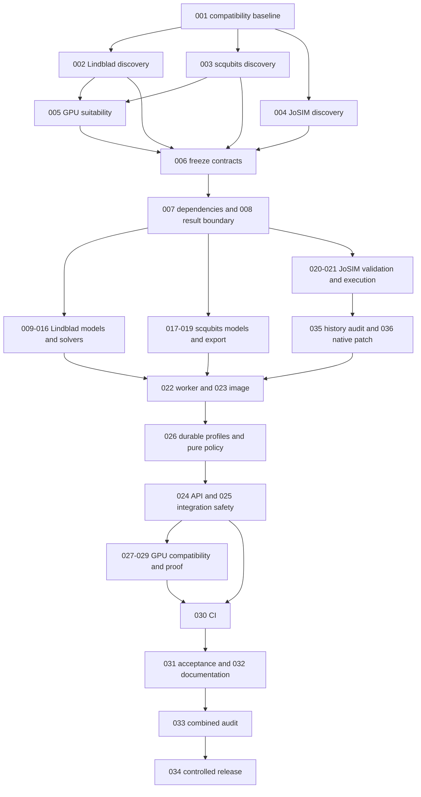

# Implementation task plan: physics engines

Status: **approved for implementation on 2026-10-25**. The owner approved the task plan and parallel System2 execution within write leases. Execution starts with TASK-001, followed by TASK-002 through TASK-004 in parallel and TASK-005 after its CPU references pass. All three backends and useful GPU acceleration remain in scope. Deployment remains subject to the existing acceptance gates. The owner approved the JoSIM bounded-history design direction on 2026-10-28; new TASK-035/036 below are prepared for task-plan review and are not yet approved for implementation.

Prepared with System2 1.1.1 `task-planner`, scoped to the existing `spec/physics-engines` directory. Planning baseline: current main `83ffac2ebc55423cc804b62342337399b17373c3`, which includes merged PRs #34, #35 and #36. The approved requirements/design remain unchanged. This plan replaces the earlier PHY-T01 through PHY-T12 outline with atomic TASK IDs.

## Task Graph Overview (short)



The per-task dependency lists below are authoritative. Discovery for the three backends can run in parallel. After contract freeze, backend lanes have disjoint files; scqubits export waits for the actual Lindblad static solver. Shared worker/API, dependency lock, image packaging and CD edits are serialized. All three CPU backends are required. GPU discovery is required; GPU execution is enabled only for useful, correct, supported operation/backend cells. JoSIM remains CPU unless a supported native GPU path is established.

**Gate checkpoints:** G1 accepts discovery/contract decisions before runtime code; G2 accepts all-three CPU execution and safe public integration; G3 accepts the measured GPU enable/CPU-only matrix; G4 accepts CI, documentation and exact-release verification before rollout. G1 needs new owner input only for material changes to approved scope, semantics or security boundaries. G2/G3/G4 require evidence, not an invented credential/custody approval flow.

## Tasks (the full list)

All paths introduced below are proposed implementation paths. Existing paths and commands were checked on the planning baseline. A proposed test command becomes runnable when its owning task creates that test. No task is complete based on a nonexistent test or a skipped required hardware check.

### TASK-001: Freeze the current compatibility baseline

- **Goal:** Freeze the current compatibility baseline.
- **Dependencies:** Task-plan and implementation approval only.
- **Requirements:** PHY-001, PHY-002, PHY-003, PHY-004, PHY-015.
- **Recommended Mode:** test-engineer.
- **Risk:** Med: durable request hashes and error envelopes must survive new input types.
- **Files/areas:** `tests/test_physics_compatibility_baseline.py`, `spec/physics-engines/discovery/baseline.md`. Proposed new filenames may be adjusted only with a recorded lease amendment.
- **Steps:** Capture synthetic golden requests, canonical bytes/hashes, errors and result members from main 83ffac2. Include omitted/explicit defaults, all current engine/format combinations, owner-scoped retries, historical reservations, maintenance holds and the capabilities mapping. Record the new Clifft 0.12.0 and Qiskit 2.6.0 baseline. Use no production user records.
- **Verification:** Run uv run --frozen --extra worker --extra controller --extra backup pytest -q tests/test_service.py tests/test_transactions.py tests/test_release_control.py tests/test_physics_compatibility_baseline.py. Golden bytes and public errors must match current main exactly; invalid work creates no job.
- **Rollback / Backout:** Remove discovery fixtures/report; runtime is unchanged.
- **Change budget:** max_files=2, max_new_symbols=0, interface_policy=none.
- **write_lease:**

```text
^tests/test_physics_compatibility_baseline\.py$
^spec/physics\-engines/discovery/baseline\.md$
```

### TASK-002: Characterize Lindblad semantics and CPU bounds

- **Goal:** Characterize Lindblad semantics and CPU bounds.
- **Dependencies:** TASK-001.
- **Requirements:** PHY-005, PHY-006, PHY-007, PHY-008, PHY-009, PHY-010, PHY-011, PHY-012, PHY-013.
- **Recommended Mode:** test-engineer.
- **Risk:** High: pulse interpolation and dense Liouville growth can yield wrong physics or exceed memory.
- **Files/areas:** `spec/physics-engines/probe_lindblad.py`, `spec/physics-engines/discovery/lindblad.md`. Proposed new filenames may be adjusted only with a recorded lease amendment.
- **Steps:** Extend the existing fixed probe for pulse windows between output times, complex conjugation, density positivity checks, pure/mixed state combinations, zero-collapse ME propagators, degenerate steady states and repeated MC seeds. Measure representative sparse and dense cases under 2 CPU/4 GiB plus the current 3 GiB child address-space and 12 MiB output-file bounds. Derive coefficient-grid, allocation and worst-case callback limits. Record DRAG/rise choices or explicit deferral; do not advertise untested shapes.
- **Verification:** Run the existing probe with pinned QuTiP 5.3.1/NumPy 2.5.4, then the extended cases in the actual constrained worker environment. Record command, image digest, tolerances, peak RSS, temporary/output bytes, solver results and refusal boundaries. A local unconstrained pass is insufficient.
- **Rollback / Backout:** Retain the approved design and mark affected operations unavailable until evidence resolves the gap.
- **Change budget:** max_files=2, max_new_symbols=0, interface_policy=none.
- **write_lease:**

```text
^spec/physics\-engines/probe_lindblad\.py$
^spec/physics\-engines/discovery/lindblad\.md$
```

### TASK-003: Characterize scqubits classes and export

- **Goal:** Characterize scqubits classes and export.
- **Dependencies:** TASK-001.
- **Requirements:** PHY-005, PHY-006, PHY-011, PHY-012, PHY-016, PHY-017, PHY-019.
- **Recommended Mode:** test-engineer.
- **Risk:** High: native basis size and eigenbasis conventions differ by qubit class.
- **Files/areas:** `spec/physics-engines/probe_scqubits.py`, `spec/physics-engines/discovery/scqubits.md`. Proposed new filenames may be adjusted only with a recorded lease amendment.
- **Steps:** Probe scqubits 4.3.1 with Transmon, TunableTransmon, Fluxonium and FluxQubit. Record exact constructor/operator allowlists, raw basis dimensions, valid parameter bounds, native eigensolver choices, output basis/phase conventions and licenses. Compare Transmon E01 to the analytic approximation and native calls. Demonstrate numeric Hamiltonian/operator export into QuTiP, keeping one eigensystem and an explicit energy reference. Measure full basis allocation, not just requested output levels.
- **Verification:** Run the new fixed probe in a pinned disposable environment and under the CPU worker budget. Direct-library spectra and the exported numeric Lindblad spectrum must agree to 1e-9 GHz; invariant/subspace comparisons handle degeneracies. Record actual failures per class/operator pair.
- **Rollback / Backout:** Preserve the report and withhold unsupported combinations. All four required classes remain implementation targets; dropping one requires a design decision.
- **Change budget:** max_files=2, max_new_symbols=0, interface_policy=none.
- **write_lease:**

```text
^spec/physics\-engines/probe_scqubits\.py$
^spec/physics\-engines/discovery/scqubits\.md$
```

### TASK-004: Characterize JoSIM, its safe subset and SFQ fixture

- **Goal:** Characterize JoSIM, its safe subset and SFQ fixture.
- **Dependencies:** TASK-001.
- **Requirements:** PHY-004, PHY-005, PHY-011, PHY-012, PHY-013, PHY-016, PHY-018.
- **Recommended Mode:** test-engineer.
- **Risk:** High: native netlists can read/write files and numerical output needs an SI reference.
- **Files/areas:** `spec/physics-engines/probe_josim.py`, `spec/physics-engines/discovery/josim.md`, `tests/fixtures/physics/josim/sfq.cir`. Proposed new filenames may be adjusted only with a recorded lease amendment.
- **Steps:** Build a candidate from an exact verified upstream revision, resolving proposed 2.6.x versus current v2.7 with evidence and notices. Establish a positive subset sufficient for a self-contained JTL/SFQ circuit, explicit traces and bounded transient analysis. Inventory case folding, comments, continuations, .control aliases, external waveform/file access, parameter expressions and subcircuits. Determine whether a reproducible noise seed is supported. Record binary hash and build dependencies.
- **Verification:** Run the fixed netlist through the native binary in private scratch: selected trace names/units and increasing SI times must be correct, and junction voltage integral must equal Phi0 within 2%. Adversarial file/control variants must be rejected by the proposed boundary before native launch. Record version, timing, peak memory and actual output sizes.
- **Rollback / Backout:** Keep the native executable out of public admission if a safe subset or valid SFQ fixture is not established; report the concrete blocker.
- **Change budget:** max_files=3, max_new_symbols=0, interface_policy=none.
- **write_lease:**

```text
^spec/physics\-engines/probe_josim\.py$
^spec/physics\-engines/discovery/josim\.md$
^tests/fixtures/physics/josim/sfq\.cir$
```

### TASK-005: Establish native GPU suitability and isolation constraints

- **Goal:** Establish native GPU suitability and isolation constraints.
- **Dependencies:** TASK-002, TASK-003.
- **Requirements:** PHY-005, PHY-011, PHY-019, PHY-020.
- **Recommended Mode:** test-engineer.
- **Risk:** High: a GPU matrix backend does not prove solver coverage, numerical equivalence or safe resource limits.
- **Files/areas:** `spec/physics-engines/probe_gpu.py`, `spec/physics-engines/discovery/gpu.md`, `tests/fixtures/physics/gpu/Dockerfile`, `tests/fixtures/physics/gpu/skypilot.yaml`. Proposed new filenames may be adjusted only with a recorded lease amendment.
- **Steps:** Probe maintained QuTiP and scqubits GPU options on an addressable NVIDIA allocation through SkyPilot. Start with CuPy candidates; add JAX only if evidence warrants it. Record exact CUDA/runtime/plugin versions, supported operations, float64/complex128 behavior, VRAM use, transfer/context/compilation cost and cold/warm end-to-end latency. Test CUDA initialization under the current RLIMIT_AS and file limits, trusted device visibility and sanitized child environment. Do not remove limits to make a benchmark pass. JoSIM stays CPU unless native supported acceleration is demonstrated.
- **Verification:** For predeclared small and larger representative problems, compare analytic/CPU answers and identical output semantics, including repeated seeds where meaningful. Measure CPU baseline, host memory and GPU VRAM and repeat cold/warm runs at least three times. Record scheduling/setup separately. Use no public-PR cluster credentials, new public ingress or production user work. If no supported useful path exists, record that outcome without claiming GPU execution.
- **Rollback / Backout:** Delete only the benchmark allocation/image tags owned by the probe through SkyPilot; retain evidence. CPU paths and existing cluster configuration are unchanged.
- **Change budget:** max_files=4, max_new_symbols=0, interface_policy=none.
- **write_lease:**

```text
^spec/physics\-engines/probe_gpu\.py$
^spec/physics\-engines/discovery/gpu\.md$
^tests/fixtures/physics/gpu/Dockerfile$
^tests/fixtures/physics/gpu/skypilot\.yaml$
```

### TASK-006: Freeze implementation contracts and evidence decisions

- **Goal:** Freeze implementation contracts and evidence decisions.
- **Dependencies:** TASK-002, TASK-003, TASK-004, TASK-005.
- **Requirements:** PHY-001, PHY-002, PHY-003, PHY-004, PHY-005, PHY-006, PHY-007, PHY-008, PHY-009, PHY-010, PHY-011, PHY-012, PHY-013, PHY-014, PHY-015, PHY-016, PHY-017, PHY-018, PHY-019, PHY-020.
- **Recommended Mode:** executor.
- **Risk:** High: unresolved units, pulse rules and placement policy become public version-1 contracts.
- **Files/areas:** `spec/physics-engines/decisions.md`, `spec/physics-engines/interfaces.json`, `spec/physics-engines/module-boundaries.json`, `spec/physics-engines/design.md`, `spec/physics-engines/requirements.md`. Proposed new filenames may be adjusted only with a recorded lease amendment.
- **Steps:** Record the tested library/build pins, all required operation subsets, numerical tolerances, density-validation dependency, pulse-grid/DRAG/rise rules, result-byte formula and per-operation allocation limits. Define CPU/GPU placement thresholds, profile identity, unavailable-GPU behavior and any required address-space-limit adjustment with a bounded replacement. Define stable internal validated-request/result interfaces. Keep API validation free of native solver imports. Identify the minimal durable pool/dispatch profile representation. Request owner review only for material departures from approved contracts, security boundaries or scope.
- **Verification:** Check each decision against probe receipts and PHY-001 through PHY-020. Validate both JSON documents with python -m json.tool, check local links and git diff --check. Dependent tasks stay blocked until their evidence decisions are complete; material design amendments need owner approval.
- **Rollback / Backout:** Retain the last approved contract and block affected tasks. No runtime waiver or new public option is implied.
- **Change budget:** max_files=5, max_new_symbols=0, interface_policy=none.
- **write_lease:**

```text
^spec/physics\-engines/decisions\.md$
^spec/physics\-engines/interfaces\.json$
^spec/physics\-engines/module\-boundaries\.json$
^spec/physics\-engines/design\.md$
^spec/physics\-engines/requirements\.md$
```

### TASK-007: Pin the combined CPU dependency environment

- **Goal:** Pin the combined CPU dependency environment.
- **Dependencies:** TASK-006.
- **Requirements:** PHY-005, PHY-011, PHY-014, PHY-015, PHY-016.
- **Recommended Mode:** executor.
- **Risk:** High: a new solver can conflict with the existing native wheel bundle.
- **Files/areas:** `pyproject.toml`, `uv.lock`, `tests/test_physics_dependency_versions.py`, `spec/physics-engines/discovery/dependencies.md`. Proposed new filenames may be adjusted only with a recorded lease amendment.
- **Steps:** Add the selected pinned QuTiP/scqubits worker dependencies and only the bounded API validation dependency selected in TASK-006. Resolve the combined frozen environment without incidental upgrades to current engine pins. Record JoSIM native build provenance separately. Check direct/transitive licenses and import/memory footprint. Add checks tying advertised physics versions to installed worker packages so dependency bumps cannot silently stale metadata.
- **Verification:** Run uv lock --check, uv sync --frozen --extra worker --extra controller --extra backup, uv pip check, then the proposed dependency-version test and current native capability tests using the pinned CI environment. Record exact resolved versions and image-size delta.
- **Rollback / Backout:** Revert pyproject and lock changes together while physics admission remains disabled; retain the previous worker image.
- **Change budget:** max_files=4, max_new_symbols=4, interface_policy=extend-only.
- **write_lease:**

```text
^pyproject\.toml$
^uv\.lock$
^tests/test_physics_dependency_versions\.py$
^spec/physics\-engines/discovery/dependencies\.md$
```

### TASK-008: Implement bounded physics result serialization

- **Goal:** Implement bounded physics result serialization.
- **Dependencies:** TASK-006, TASK-007.
- **Requirements:** PHY-006, PHY-011, PHY-012, PHY-013.
- **Recommended Mode:** executor.
- **Risk:** High: base64, ZIP and callback-file overhead can exceed transport after solving.
- **Files/areas:** `qsim/physics_results.py`, `tests/test_physics_results.py`. Proposed new filenames may be adjusted only with a recorded lease amendment.
- **Steps:** Implement the small shared physics result boundary selected in TASK-006. Encode numeric arrays plus scalar Unicode metadata_json; reject object arrays and nonfinite solver outputs where not explicitly allowed. Estimate all retained array bytes before allocation and verify actual NPZ, summary, base64, complete output JSON and callback sizes after serialization. Enforce the minimum of callback/HTTP/file bounds without relying on compression. Keep complex values and bounded summaries.
- **Verification:** Run uv run --frozen --extra worker --extra controller --extra backup pytest -q tests/test_physics_results.py. Test exact/beyond boundaries with incompressible arrays, many arrays, Unicode metadata, complex values, archive overhead and allow_pickle=False round trips. No over-budget success payload may be emitted.
- **Rollback / Backout:** Leave existing circuit serialization untouched; remove the new helper before physics admission is enabled.
- **Change budget:** max_files=2, max_new_symbols=8, interface_policy=extend-only.
- **write_lease:**

```text
^qsim/physics_results\.py$
^tests/test_physics_results\.py$
```

### TASK-009: Implement strict Lindblad request models

- **Goal:** Implement strict Lindblad request models.
- **Dependencies:** TASK-006, TASK-007.
- **Requirements:** PHY-003, PHY-004, PHY-005, PHY-006, PHY-007, PHY-008, PHY-009, PHY-010, PHY-011, PHY-014.
- **Recommended Mode:** executor.
- **Risk:** High: untrusted dimensions and physical states must be bounded before native allocation.
- **Files/areas:** `qsim/lindblad_models.py`, `tests/test_lindblad_models.py`. Proposed new filenames may be adjusted only with a recorded lease amendment.
- **Steps:** Implement version-1 operation-specific Pydantic models, operators, finite complex numbers, states, modes, drives and solver options with extra=forbid. Use the approved bounded positivity and resource estimators. Reject unsupported combinations, non-Hermitian inputs, invalid references and predictable overflows before queueing. Validate grids and fixed option allowlists without compiling caller expressions. Expose structural schemas and semantic JSON-Pointer errors through the agreed internal interface.
- **Verification:** Run uv run --frozen --extra worker --extra controller --extra backup pytest -q tests/test_lindblad_models.py. Include all four operations, SE/ME/MC combinations, omitted defaults, invalid density/indices, nonfinite values, unknown fields and preallocation refusal boundaries. Verify JSON Schema acceptance plus semantic validation, including escaped pointer components.
- **Rollback / Backout:** Keep models disconnected from public routes; no legacy model changes.
- **Change budget:** max_files=2, max_new_symbols=48, interface_policy=extend-only.
- **write_lease:**

```text
^qsim/lindblad_models\.py$
^tests/test_lindblad_models\.py$
```

### TASK-010: Build native Lindblad operators and static Hamiltonians

- **Goal:** Build native Lindblad operators and static Hamiltonians.
- **Dependencies:** TASK-007, TASK-009.
- **Requirements:** PHY-005, PHY-006, PHY-007, PHY-010.
- **Recommended Mode:** executor.
- **Risk:** High: tensor order, conjugation and frequency conversion can silently change the model.
- **Files/areas:** `qsim/lindblad_model.py`, `tests/test_lindblad_operators.py`. Proposed new filenames may be adjusted only with a recorded lease amendment.
- **Steps:** Construct native ordered tensor factors, ladder/quadrature/identity/projector/custom-matrix operators, oscillator/Duffing/matrix mode Hamiltonians and static products. Apply 2pi exactly once to Hamiltonian coefficients and conjugate both scalar and operator when hc is set. Keep solver imports inside isolated execution. Recheck bounded dimensions and Hermiticity at the native boundary.
- **Verification:** Run uv run --frozen --extra worker --extra controller --extra backup pytest -q tests/test_lindblad_operators.py. Verify explicit small matrix references, complex hc, omitted identities, tensor permutation sensitivity, Kerr/Duffing equivalence and a native static spectrum. No solver imports may occur merely by importing API metadata/models.
- **Rollback / Backout:** Revert the new builder while admission remains disabled.
- **Change budget:** max_files=2, max_new_symbols=14, interface_policy=extend-only.
- **write_lease:**

```text
^qsim/lindblad_model\.py$
^tests/test_lindblad_operators\.py$
```

### TASK-011: Build initial states and collapse operators

- **Goal:** Build initial states and collapse operators.
- **Dependencies:** TASK-010.
- **Requirements:** PHY-005, PHY-006, PHY-008, PHY-009, PHY-010, PHY-011.
- **Recommended Mode:** executor.
- **Risk:** High: wrong mixed-state handling or decay scaling gives plausible but incorrect physics.
- **Files/areas:** `qsim/lindblad_model.py`, `tests/test_lindblad_states.py`. Proposed new filenames may be adjusted only with a recorded lease amendment.
- **Steps:** Add Fock, coherent, thermal, product/full amplitude and density-state construction. Apply only the approved amplitude normalization and positivity tolerances. Build T1, Tphi, thermal loss and general collapse products without multiplying rates by 2pi. Reject dissipation with SE and unsupported MC mixed states. Preserve tensor order and the declared state representation.
- **Verification:** Run uv run --frozen --extra worker --extra controller --extra backup pytest -q tests/test_lindblad_states.py. Check norms, trace/positivity, invalid zero states, vacuum defaults, coherent truncation, T1 and Tphi analytic rates and pure/mixed solver rejection.
- **Rollback / Backout:** Back out builder changes before exposure; no stored state or database migration exists.
- **Change budget:** max_files=2, max_new_symbols=10, interface_policy=extend-only.
- **write_lease:**

```text
^qsim/lindblad_model\.py$
^tests/test_lindblad_states\.py$
```

### TASK-012: Implement bounded numeric drive grids

- **Goal:** Implement bounded numeric drive grids.
- **Dependencies:** TASK-011.
- **Requirements:** PHY-005, PHY-006, PHY-007, PHY-009, PHY-011.
- **Recommended Mode:** executor.
- **Risk:** High: an output-only grid can omit a pulse or alias modulation.
- **Files/areas:** `qsim/lindblad_model.py`, `tests/test_lindblad_drives.py`. Proposed new filenames may be adjusted only with a recorded lease amendment.
- **Steps:** Implement only the pulse shapes resolved in TASK-006. Construct a bounded coefficient grid containing required support boundaries, supplied sample knots and sufficient analytic/modulation resolution independently of output times. Use QuTiP numeric coefficients with explicit linear interpolation and conjugation. Set the verified integration-step constraint. Refuse excessive grid growth; do not call string coefficient compilation.
- **Verification:** Run uv run --frozen --extra worker --extra controller --extra backup pytest -q tests/test_lindblad_drives.py. Include a pulse entirely between output times, complex exponential modulation, DRAG/rise cases if admitted, sample extrapolation, phase/units and grid-refinement convergence against declared tolerances.
- **Rollback / Backout:** Withhold unresolved drive shapes and keep the last approved schema; do not approximate silently.
- **Change budget:** max_files=2, max_new_symbols=10, interface_policy=extend-only.
- **write_lease:**

```text
^qsim/lindblad_model\.py$
^tests/test_lindblad_drives\.py$
```

### TASK-013: Implement deterministic Lindblad evolution

- **Goal:** Implement deterministic Lindblad evolution.
- **Dependencies:** TASK-008, TASK-012.
- **Requirements:** PHY-006, PHY-008, PHY-009, PHY-011, PHY-012, PHY-013.
- **Recommended Mode:** executor.
- **Risk:** High: density/ket output and retained-state memory must match the requested solver.
- **Files/areas:** `qsim/lindblad_adapter.py`, `tests/test_lindblad_evolve.py`. Proposed new filenames may be adjusted only with a recorded lease amendment.
- **Steps:** Implement evolve for SE and ME with the native builder, bounded fixed solver options and named expectations. Implement `store_states=none/final/all` retained-state choices with the G1-12 representation and output estimator, including the explicit `state_times` axis and no hidden full history for final-only output. Return arrays and bounded provenance through physics_results. Keep runtime nonconvergence distinct from invalid requests.
- **Verification:** Run uv run --frozen --extra worker --extra controller --extra backup pytest -q tests/test_lindblad_evolve.py. Rabi absolute error <=1e-4, T1 relative error <=1e-4 and ringdown relative error <=1e-3; test complex expectations, nonzero first time, trace preservation, output ordering and preallocation failure.
- **Rollback / Backout:** Remove the unadvertised execution branch; existing engine paths remain unchanged.
- **Change budget:** max_files=2, max_new_symbols=8, interface_policy=extend-only.
- **write_lease:**

```text
^qsim/lindblad_adapter\.py$
^tests/test_lindblad_evolve\.py$
```

### TASK-014: Implement seeded Monte Carlo evolution

- **Goal:** Implement seeded Monte Carlo evolution.
- **Dependencies:** TASK-013.
- **Requirements:** PHY-008, PHY-009, PHY-011, PHY-012, PHY-019.
- **Recommended Mode:** executor.
- **Risk:** High: ensemble statistics, seed mapping and trajectory state retention can be mislabeled.
- **Files/areas:** `qsim/lindblad_adapter.py`, `tests/test_lindblad_monte_carlo.py`. Proposed new filenames may be adjusted only with a recorded lease amendment.
- **Steps:** Implement serial bounded MC trajectories with complete seed-bit handling and repeated-seed reproducibility for the pinned backend. Return ensemble expectations and the approved ensemble density-state representation, not an undocumented trajectory axis. Bound trajectory work and retained memory without adding a wall-time cap.
- **Verification:** Run uv run --frozen --extra worker --extra controller --extra backup pytest -q tests/test_lindblad_monte_carlo.py. Compare the fixed 1000-trajectory T1 case with ME within three analytic standard errors at the predeclared time points; verify repeated seeds, high seed bits, output shapes and refusal limits.
- **Rollback / Backout:** Disable MC only before advertising it; preserve deterministic operation tests.
- **Change budget:** max_files=2, max_new_symbols=6, interface_policy=extend-only.
- **write_lease:**

```text
^qsim/lindblad_adapter\.py$
^tests/test_lindblad_monte_carlo\.py$
```

### TASK-015: Implement Hilbert and Liouville propagators

- **Goal:** Implement Hilbert and Liouville propagators.
- **Dependencies:** TASK-014.
- **Requirements:** PHY-006, PHY-009, PHY-010, PHY-011, PHY-012, PHY-013.
- **Recommended Mode:** executor.
- **Risk:** High: superoperator size scales as D^4 and empty-collapse ME must remain a superoperator.
- **Files/areas:** `qsim/lindblad_adapter.py`, `tests/test_lindblad_propagator.py`. Proposed new filenames may be adjusted only with a recorded lease amendment.
- **Steps:** Implement SE unitary and explicit-Liouvillian ME propagators from the first supplied time. Record tensor/vectorization conventions. Budget all times and D^2/D^4 output before construction, including drives and scratch costs. An empty collapse list must not change the advertised ME representation.
- **Verification:** Run uv run --frozen --extra worker --extra controller --extra backup pytest -q tests/test_lindblad_propagator.py. Compare Rabi unitary at 50 ns to the analytic exponential within 1e-6; compare zero-collapse superoperator to sprepost(U,U.dag()). Verify trace/Hermiticity behavior and exact output-limit refusals.
- **Rollback / Backout:** Withhold propagator admission if its budget or representation tests fail.
- **Change budget:** max_files=2, max_new_symbols=6, interface_policy=extend-only.
- **write_lease:**

```text
^qsim/lindblad_adapter\.py$
^tests/test_lindblad_propagator\.py$
```

### TASK-016: Implement static spectrum and steady state

- **Goal:** Implement static spectrum and steady state.
- **Dependencies:** TASK-015.
- **Requirements:** PHY-006, PHY-007, PHY-010, PHY-011, PHY-012, PHY-013.
- **Recommended Mode:** executor.
- **Risk:** High: frequency units and nonunique stationary states need explicit semantics.
- **Files/areas:** `qsim/lindblad_adapter.py`, `tests/test_lindblad_static.py`. Proposed new filenames may be adjusted only with a recorded lease amendment.
- **Steps:** Implement sorted static eigenvalues and optional eigenvectors in linear GHz, plus static Lindbladian steady state with named expectations of shape (O,) and optional state controlled by `return_state` (default true), as defined in G1-12. Always account for and validate the internal stationary density, even if its output is omitted. Reject drives for these operations. Detect/report nonconvergence and the approved nonunique-state cases without fabricating a preferred state. Bound eigenvector and stationary-solver allocations.
- **Verification:** Run uv run --frozen --extra worker --extra controller --extra backup pytest -q tests/test_lindblad_static.py. Thermal occupation error <=1e-6, dispersive shift within 5% of the stated perturbative reference, exact small spectra and Hermitian/unitary invariants. Verify failure cases and shape/byte limits.
- **Rollback / Backout:** Retain the evidence and disable the failing static operation before exposure.
- **Change budget:** max_files=2, max_new_symbols=8, interface_policy=extend-only.
- **write_lease:**

```text
^qsim/lindblad_adapter\.py$
^tests/test_lindblad_static\.py$
```

### TASK-017: Implement strict scqubits request models

- **Goal:** Implement strict scqubits request models.
- **Dependencies:** TASK-006, TASK-007.
- **Requirements:** PHY-004, PHY-005, PHY-006, PHY-011, PHY-014, PHY-016, PHY-017.
- **Recommended Mode:** executor.
- **Risk:** High: a small truncated output can hide a huge native basis allocation.
- **Files/areas:** `qsim/scqubits_models.py`, `tests/test_scqubits_models.py`. Proposed new filenames may be adjusted only with a recorded lease amendment.
- **Steps:** Implement schema-version-1 models for all four required native classes and three operations. Allow only the exact numeric parameters and per-class operators established in TASK-003. Bound full charge/oscillator basis dimensions before construction, requested levels and aggregate output. Reject native callbacks, arbitrary method/options dictionaries, YAML and symbolic circuit input.
- **Verification:** Run uv run --frozen --extra worker --extra controller --extra backup pytest -q tests/test_scqubits_models.py. Verify each class/operation and constructor boundary, class/operator rejection, nonfinite numbers, unknown fields and raw-basis overflow despite small evals_count.
- **Rollback / Backout:** Keep public scqubits admission disabled.
- **Change budget:** max_files=2, max_new_symbols=16, interface_policy=extend-only.
- **write_lease:**

```text
^qsim/scqubits_models\.py$
^tests/test_scqubits_models\.py$
```

### TASK-018: Implement scqubits spectra and matrix elements

- **Goal:** Implement scqubits spectra and matrix elements.
- **Dependencies:** TASK-008, TASK-017.
- **Requirements:** PHY-005, PHY-006, PHY-011, PHY-012, PHY-016, PHY-017.
- **Recommended Mode:** executor.
- **Risk:** High: operator matrix elements require a consistent native eigenbasis.
- **Files/areas:** `qsim/scqubits_adapter.py`, `tests/test_scqubits_execution.py`. Proposed new filenames may be adjusted only with a recorded lease amendment.
- **Steps:** Construct allowlisted native classes with explicit safe CPU diagonalization settings. Implement spectrum and matrix_elements using the same eigensystem per request, with stable ordering, units, representation metadata and bounded arrays. No request dictionary is forwarded as arbitrary native kwargs.
- **Verification:** Run uv run --frozen --extra worker --extra controller --extra backup pytest -q tests/test_scqubits_execution.py. Compare all class fixtures to direct pinned-library calls; Transmon E01 must meet the approved analytic tolerance. Compare eigenvectors by projectors/subspaces where phases or degeneracy permit arbitrary bases.
- **Rollback / Backout:** Leave scqubits unadvertised and preserve the existing worker baseline.
- **Change budget:** max_files=2, max_new_symbols=8, interface_policy=extend-only.
- **write_lease:**

```text
^qsim/scqubits_adapter\.py$
^tests/test_scqubits_execution\.py$
```

### TASK-019: Implement numeric scqubits-to-Lindblad export

- **Goal:** Implement numeric scqubits-to-Lindblad export.
- **Dependencies:** TASK-016, TASK-018.
- **Requirements:** PHY-006, PHY-007, PHY-012, PHY-016, PHY-017.
- **Recommended Mode:** executor.
- **Risk:** High: an inconsistent energy reference or operator basis breaks the cross-engine model.
- **Files/areas:** `qsim/scqubits_adapter.py`, `tests/test_scqubits_export.py`. Proposed new filenames may be adjusted only with a recorded lease amendment.
- **Steps:** Export the selected diagonal Hamiltonian and operator matrices from one eigensystem as a versioned numeric matrix-mode JSON in metadata_json. Declare energy reference, basis and units. Bound JSON duplication as well as numeric arrays. Validate that the result can be submitted directly to the Lindblad schema; the client performs the second submission.
- **Verification:** Run uv run --frozen --extra worker --extra controller --extra backup pytest -q tests/test_scqubits_export.py. Every supported class must round-trip its exported spectrum to Lindblad within 1e-9 GHz. Test operator consistency, phase-invariant comparisons, malformed exports and output-byte limits.
- **Rollback / Backout:** Disable export independently before it is advertised; retain native spectra/matrix-elements if already verified.
- **Change budget:** max_files=2, max_new_symbols=5, interface_policy=extend-only.
- **write_lease:**

```text
^qsim/scqubits_adapter\.py$
^tests/test_scqubits_export\.py$
```

### TASK-020: Implement JoSIM request validation and netlist safety

- **Goal:** Implement JoSIM request validation and netlist safety.
- **Dependencies:** TASK-004, TASK-006; remaining native workspace certification also requires TASK-036. The existing schema/grammar stage is already implemented.
- **Requirements:** PHY-004, PHY-005, PHY-011, PHY-014, PHY-016, PHY-018.
- **Recommended Mode:** executor.
- **Risk:** High: an include alias or output directive can cross the filesystem boundary.
- **Files/areas:** `qsim/josim_models.py`, `qsim/josim_validation.py`, `tests/test_josim_validation.py`, `tests/test_josim_security.py`. Proposed new filenames may be adjusted only with a recorded lease amendment.
- **Steps:** Implement the approved narrow netlist subset and schema without a general SPICE interpreter. Bound text, tokens, devices, model definitions, transient samples and selected traces before native launch. Normalize allowed comments/continuations/case safely. Reject all unapproved control/file constructs, expressions, external data and recursive/unsupported subcircuits. Validate optional temperature/noise only if native seed support was proven.
- **Verification:** Run uv run --frozen --extra worker --extra controller --extra backup pytest -q tests/test_josim_validation.py tests/test_josim_security.py. Positive fixture acceptance and adversarial include/file/control aliases, continuation tricks, quotes, output paths and trace/time overflows must be exercised. Rejected input never invokes a native process.
- **Rollback / Backout:** Keep the endpoint disconnected until positive validation and safety cases pass.
- **Change budget:** max_files=4, max_new_symbols=14, interface_policy=extend-only.
- **write_lease:**

```text
^qsim/josim_models\.py$
^qsim/josim_validation\.py$
^tests/test_josim_validation\.py$
^tests/test_josim_security\.py$
```

### TASK-021: Implement native JoSIM transient execution

- **Goal:** Implement native JoSIM transient execution.
- **Dependencies:** TASK-007, TASK-008, TASK-020.
- **Requirements:** PHY-005, PHY-006, PHY-011, PHY-012, PHY-013, PHY-016, PHY-018.
- **Recommended Mode:** executor.
- **Risk:** High: native output and noisy convergence failures must not escape or become false success.
- **Files/areas:** `qsim/josim_adapter.py`, `tests/test_josim_execution.py`. Proposed new filenames may be adjusted only with a recorded lease amendment.
- **Steps:** Execute the exact pinned binary with a fixed argument vector and server-created private scratch files. Use no shell. Convert only selected traces to bounded NPZ time/traces/trace_names and units/provenance metadata. Validate actual output size, finiteness and increasing SI times before success. Return sanitized convergence failures; clean private scratch on normal/error exits. Include version and seed only where actually used.
- **Verification:** Run uv run --frozen --extra worker --extra controller --extra backup pytest -q tests/test_josim_execution.py against the real pinned executable from TASK-004. Verify SFQ integral within 2%, trace order/units, refusal after oversized/corrupt output and scratch cleanup; no mocked executable can substitute for numerical acceptance.
- **Rollback / Backout:** Remove the JoSIM execution branch before exposure; preserve the prior CPU worker image.
- **Change budget:** max_files=2, max_new_symbols=8, interface_policy=extend-only.
- **write_lease:**

```text
^qsim/josim_adapter\.py$
^tests/test_josim_execution\.py$
```

### TASK-022: Integrate physics into the isolated worker wrapper

- **Goal:** Integrate physics into the isolated worker wrapper.
- **Dependencies:** TASK-008, TASK-016, TASK-019, TASK-021, TASK-036 and the completed TASK-020 native workspace certificate.
- **Requirements:** PHY-002, PHY-005, PHY-011, PHY-012, PHY-013.
- **Recommended Mode:** executor.
- **Risk:** High: native execution must not receive callback credentials or break existing engine dispatch.
- **Files/areas:** `qsim/worker.py`, `tests/test_physics_worker.py`, `tests/test_worker_lifecycle.py`. Proposed new filenames may be adjusted only with a recorded lease amendment.
- **Steps:** Dispatch validated physics envelopes to the new native adapters inside the existing child process, retaining current circuit behavior. Pass only the approved sanitized environment. Enforce predictive and actual result/file budgets, bounded error guidance and complete success/failure callbacks. Preserve long-running job behavior and explicit cancellation; do not add execution timeouts.
- **Verification:** Run uv run --frozen --extra worker --extra controller --extra backup pytest -q tests/test_physics_worker.py tests/test_worker_lifecycle.py plus each backend adapter test group. Exercise a real child for each engine and all result types; inspect child environment and ensure no secret/token/model dump reaches errors.
- **Rollback / Backout:** Revert new dispatch branches together while physics admission remains off; never roll back a running numerical job by deleting its files.
- **Change budget:** max_files=3, max_new_symbols=8, interface_policy=extend-only.
- **write_lease:**

```text
^qsim/worker\.py$
^tests/test_physics_worker\.py$
^tests/test_worker_lifecycle\.py$
```

### TASK-023: Package and verify the deployable CPU worker

- **Goal:** Package and verify the deployable CPU worker.
- **Dependencies:** TASK-007, TASK-022.
- **Requirements:** PHY-002, PHY-005, PHY-011, PHY-015, PHY-016, PHY-017, PHY-018.
- **Recommended Mode:** executor.
- **Risk:** High: host tests do not prove native binaries, imports or limits in the deployable image.
- **Files/areas:** `deploy/Dockerfile`, `deploy/physics/josim-build.sh`, `tests/check_worker_image.sh`, `tests/test_physics_image.py`. Proposed new filenames may be adjusted only with a recorded lease amendment.
- **Steps:** Build/install the pinned JoSIM executable reproducibly with verified source and runtime libraries/notices. Copy only required physics runtime modules into the existing worker target and keep API/store/controller authority out. Extend the current image smoke script for all three physical backends and every new schema family. Test startup and numerical execution with actual child limits and constrained CPU memory.
- **Verification:** Run bash tools/ci/check-worker.sh, then explicit 2-CPU/4-GiB container checks using the selected worker tag and the existing 3-GiB/12-MiB child limits. Verify actual native version/provenance and numerical arrays, absent credentials, no unintended files and clean exit. Do not label an unconstrained host pass as image acceptance.
- **Rollback / Backout:** Retain the last accepted worker digest and leave physics routes disabled until a compatible image is available.
- **Change budget:** max_files=4, max_new_symbols=3, interface_policy=extend-only.
- **write_lease:**

```text
^deploy/Dockerfile$
^deploy/physics/josim\-build\.sh$
^tests/check_worker_image\.sh$
^tests/test_physics_image\.py$
```

### TASK-024: Integrate additive API routes, schemas and capabilities

- **Goal:** Integrate additive API routes, schemas and capabilities.
- **Dependencies:** TASK-001, TASK-009, TASK-017, TASK-020, TASK-023, TASK-026.
- **Requirements:** PHY-001, PHY-002, PHY-003, PHY-004, PHY-014, PHY-016, PHY-017, PHY-018.
- **Recommended Mode:** executor.
- **Risk:** High: general-route validation and canonical defaults can invalidate durable retries.
- **Files/areas:** `qsim/api.py`, `qsim/physics_submission.py`, `tests/test_physics_api.py`, `tests/test_physics_compatibility_baseline.py`, `tests/test_physics_schemas.py`. Proposed new filenames may be adjusted only with a recorded lease amendment.
- **Steps:** Add explicit routes for lindblad/scqubits/josim and generic format dispatch into the same enqueue path, keeping legacy Submission unchanged. Normalize explicit/generic requests identically. Replay matching owner/idempotency reservations before current admission policy, then atomically recheck on enqueue. Persist the resolved dispatch context separately from canonical identity; TASK-026 installs its nullable storage and pure settings resolver first. Serve generated versioned schemas and add metadata to the existing engine-name mapping without native imports. Preserve old error locations/messages and optional generic-route Idempotency-Key semantics. Keep new admission/capabilities behind a narrow server-controlled activation gate until release acceptance covers them; callers cannot toggle it.
- **Verification:** Run uv run --frozen --extra worker --extra controller --extra backup pytest -q tests/test_physics_api.py tests/test_physics_schemas.py tests/test_physics_compatibility_baseline.py tests/test_service.py tests/test_transactions.py. Verify equivalent-route replay, 409 body conflict, owner isolation, 422 pointers/no job, 413 byte rejection, disabled capability behavior and native-import-free API startup.
- **Rollback / Backout:** Turn off only the new engine activation gate; retain existing jobs/results, canonical hashes and schema history.
- **Change budget:** max_files=5, max_new_symbols=10, interface_policy=extend-only.
- **write_lease:**

```text
^qsim/api\.py$
^qsim/physics_submission\.py$
^tests/test_physics_api\.py$
^tests/test_physics_compatibility_baseline\.py$
^tests/test_physics_schemas\.py$
```

### TASK-025: Certify shared job lifecycle and backup compatibility

- **Goal:** Certify shared job lifecycle and backup compatibility.
- **Dependencies:** TASK-024.
- **Requirements:** PHY-001, PHY-002, PHY-003, PHY-004, PHY-005, PHY-012, PHY-013, PHY-015.
- **Recommended Mode:** test-engineer.
- **Risk:** High: lifecycle shortcuts or unsafe NPZ metadata can break recovery and retries.
- **Files/areas:** `tests/test_physics_lifecycle.py`, `tests/test_physics_backup.py`, `tests/test_physics_security.py`. Proposed new filenames may be adjusted only with a recorded lease amendment.
- **Steps:** Run all physical backends through real isolated children and the existing durable job/callback test harness. Cover idempotency across route aliases, owner conflicts, SSE Last-Event-ID, maintenance admission, cancellation, lost callbacks, terminal immutability, cleanup and deletion. Verify native backup validation accepts complex numeric/Unicode NPZ and rejects object arrays; include pending invitation material unchanged. Security failures go back to the owning implementation task, not broad edits from this lease.
- **Verification:** Run uv run --frozen --extra worker --extra controller --extra backup pytest -q tests/test_physics_lifecycle.py tests/test_physics_backup.py tests/test_physics_security.py tests/test_transactions.py tests/test_backup_restore.py. No weakened existing assertion or allow_pickle=True path is acceptable.
- **Rollback / Backout:** Keep activation disabled and reopen the responsible task for a bounded correction.
- **Change budget:** max_files=3, max_new_symbols=0, interface_policy=none.
- **write_lease:**

```text
^tests/test_physics_lifecycle\.py$
^tests/test_physics_backup\.py$
^tests/test_physics_security\.py$
```

### TASK-026: Extend existing SkyPilot placement and pool compatibility

- **Goal:** Extend existing SkyPilot placement and pool compatibility.
- **Dependencies:** TASK-005, TASK-006, TASK-023.
- **Requirements:** PHY-002, PHY-011, PHY-019, PHY-020.
- **Recommended Mode:** executor.
- **Risk:** High: wrong pool reuse or ambiguous retries can place work on incompatible hardware or duplicate it.
- **Files/areas:** `qsim/controller.py`, `qsim/settings.py`, `qsim/store.py`, `tests/test_physics_placement.py`, `tests/test_dispatch.py`, `tests/test_skypilot_contract.py`. Proposed new filenames may be adjusted only with a recorded lease amendment.
- **Steps:** Implement the small server-owned engine/operation profile policy selected in TASK-006. Preserve legacy CPU selection and existing SkyPilot scheduling. Match worker image and complete resource/profile identity before warm reuse; persist only the minimal resolved identity needed to survive restart/policy changes. Any additive pool/dispatch fields must treat legacy entries safely and require no jobs-table rewrite. Implement the approved GPU-unavailable queue/equivalent-CPU fallback rule without changing an in-flight ambiguous submission. No global queue cap, new scheduler or cluster-wide resource changes.
- **Verification:** Run uv run --frozen --extra worker --extra controller --extra backup pytest -q tests/test_physics_placement.py tests/test_dispatch.py tests/test_skypilot_contract.py. Prove GPU/CPU and same-image/different-resource reuse rejection, preserved image pins, startup migration, crash/retry/lost-ack/cancel safety, saturation queueing and no duplicate native jobs.
- **Rollback / Backout:** Disable GPU selection and drain affected work before reverting profile code. Preserve additive fields and active dispatch identities; do not force CPU fallback for a GPU-only-sized model.
- **Change budget:** max_files=6, max_new_symbols=10, interface_policy=extend-only.
- **write_lease:**

```text
^qsim/controller\.py$
^qsim/settings\.py$
^qsim/store\.py$
^tests/test_physics_placement\.py$
^tests/test_dispatch\.py$
^tests/test_skypilot_contract\.py$
```

### TASK-027: Package optional GPU artifacts through the existing CD path

- **Goal:** Package optional GPU artifacts through the existing CD path.
- **Dependencies:** TASK-005, TASK-007, TASK-023, TASK-026.
- **Requirements:** PHY-005, PHY-011, PHY-015, PHY-019, PHY-020.
- **Recommended Mode:** executor.
- **Risk:** High: GPU dependencies and artifacts must stay paired with reviewed source and retained rollback images.
- **Files/areas:** `pyproject.toml`, `uv.lock`, `deploy/Dockerfile`, `tools/ci/check-physics-gpu.sh`, `tools/ci/check-release.sh`, `tools/cd/release.py`, `tests/test_cd_gpu_artifacts.py`. Proposed new filenames may be adjusted only with a recorded lease amendment.
- **Steps:** If TASK-005 supports useful acceleration, pin only the selected GPU dependencies and add a GPU worker target derived from the existing worker structure. Extend CI bundle creation/validation, publish/cleanup, retained image inventory and rollback capture for the optional GPU worker digest. Preserve existing three-target CPU artifacts and legacy receipt reads. Build/import-check without devices in normal CI, while keeping actual GPU execution a separate evidence check. If no useful path exists, record the tested CPU-only outcome and avoid adding a GPU artifact.
- **Verification:** Run uv lock --check, uv pip check, bash tools/ci/check-release.sh, the proposed GPU image check when applicable, and the CD artifact tests. Reject missing/mismatched GPU archives/revisions and preserve CPU-only compatibility, scoped tag cleanup and exact-source metadata.
- **Rollback / Backout:** Disable GPU policy before retiring GPU artifacts; retain all currently referenced CPU/GPU image digests and recovery records.
- **Change budget:** max_files=7, max_new_symbols=8, interface_policy=extend-only.
- **write_lease:**

```text
^pyproject\.toml$
^uv\.lock$
^deploy/Dockerfile$
^tools/ci/check\-physics\-gpu\.sh$
^tools/ci/check\-release\.sh$
^tools/cd/release\.py$
^tests/test_cd_gpu_artifacts\.py$
```

### TASK-028: Integrate only proven GPU native execution

- **Goal:** Integrate only proven GPU native execution.
- **Dependencies:** TASK-016, TASK-019, TASK-022, TASK-026, TASK-027.
- **Requirements:** PHY-005, PHY-006, PHY-009, PHY-011, PHY-012, PHY-019, PHY-020.
- **Recommended Mode:** executor.
- **Risk:** High: CUDA address space and device visibility need a verified isolation policy.
- **Files/areas:** `qsim/lindblad_adapter.py`, `qsim/scqubits_adapter.py`, `qsim/worker.py`, `tests/test_physics_gpu_backend.py`, `tests/test_worker_lifecycle.py`. Proposed new filenames may be adjusted only with a recorded lease amendment.
- **Steps:** For operation/backend cells proven by TASK-005, select native GPU methods from the server policy and preserve numeric state/result conventions. Pass only allocation-derived device visibility and fixed trusted runtime library settings to the child. Apply the approved host-memory/address-space/VRAM policy and output limits. A need to relax a security boundary beyond TASK-006 returns for owner review. Unsupported methods stay CPU-only; JoSIM is not routed to a speculative GPU path.
- **Verification:** Run uv run --frozen --extra worker --extra controller --extra backup pytest -q tests/test_physics_gpu_backend.py tests/test_worker_lifecycle.py and CPU adapter regressions. Test no-device/missing-library failure, policy-only selection, preserved child credential isolation and bounded fallback. Device-free tests must not be counted as successful GPU computation.
- **Rollback / Backout:** Disable GPU selection and revert its native branches after draining; keep CPU engine behavior and stored results intact.
- **Change budget:** max_files=5, max_new_symbols=8, interface_policy=extend-only.
- **write_lease:**

```text
^qsim/lindblad_adapter\.py$
^qsim/scqubits_adapter\.py$
^qsim/worker\.py$
^tests/test_physics_gpu_backend\.py$
^tests/test_worker_lifecycle\.py$
```

### TASK-029: Verify actual GPU execution and the benefit threshold

- **Goal:** Verify actual GPU execution and the benefit threshold.
- **Dependencies:** TASK-028.
- **Requirements:** PHY-006, PHY-011, PHY-015, PHY-019, PHY-020.
- **Recommended Mode:** test-engineer.
- **Risk:** High: hardware presence or a mocked backend is insufficient acceleration evidence.
- **Files/areas:** `tests/test_physics_gpu_live.py`, `spec/physics-engines/discovery/gpu-acceptance.md`. Proposed new filenames may be adjusted only with a recorded lease amendment.
- **Steps:** Run opt-in trusted hardware tests in a controlled SkyPilot allocation using the actual pinned GPU worker and the same isolated child entrypoint. Compare CPU/GPU physics and declared precision, seeded behavior where supported, large/small performance, GPU/host memory and cancellation. Use fixed synthetic inputs and private operator configuration. Keep untrusted PR runners away from deployment credentials and cluster access. Record an evidence-based enable/CPU-only decision per operation; no post hoc relaxed correctness threshold.
- **Verification:** Run the proposed opt-in live GPU module only with explicit hardware-test configuration. Unavailable hardware leaves the GPU discovery/proof incomplete; it is not evidence of poor benefit. A GPU-enabled release requires executed tests, actual CUDA/device records, correct arrays and the TASK-006 benefit criterion; skipped/unavailable tests never count. No benefit with a correct backend may justify retaining CPU for that operation.
- **Rollback / Backout:** Clean only test-owned SkyPilot allocations and artifacts. Disable unproven GPU cells; retain evidence and the usable CPU service.
- **Change budget:** max_files=2, max_new_symbols=0, interface_policy=none.
- **write_lease:**

```text
^tests/test_physics_gpu_live\.py$
^spec/physics\-engines/discovery/gpu\-acceptance\.md$
```

### TASK-030: Extend Standpunkt-first CI and image coverage

- **Goal:** Extend Standpunkt-first CI and image coverage.
- **Dependencies:** TASK-023, TASK-025, TASK-027, TASK-028.
- **Requirements:** PHY-001, PHY-005, PHY-011, PHY-014, PHY-015, PHY-019, PHY-020.
- **Recommended Mode:** executor.
- **Risk:** High: new native paths can escape CI or leak deployment access into public PR jobs.
- **Files/areas:** `tools/ci/check.sh`, `tools/ci/check-worker.sh`, `.github/workflows/ci.yml`, `tests/check_worker_image.sh`, `tests/test_physics_ci_contract.py`. Proposed new filenames may be adjusted only with a recorded lease amendment.
- **Steps:** Run strict schemas, all three CPU engines, real isolated-child/image tests, safety and lifecycle fixtures in the existing Standpunkt-first flow with hosted fallback. Keep routing and execution-path reporting truthful. Build optional GPU artifacts without claiming device execution. Use TASK-029 trusted hardware evidence for GPU enablement; do not mount cluster/registration credentials into public PR CI. Preserve all existing engine checks and frozen dependency validation.
- **Verification:** Run bash tools/ci/check.sh, bash tools/ci/check-worker.sh, bash tools/ci/check-release.sh and the proposed CI contract test. Verify the actual dispatched Standpunkt child or actual hosted test job, not merely the parent workflow. Every new PR must have appropriate tests; hardware skip status is explicit.
- **Rollback / Backout:** Revert CI extensions only with new feature admission off; preserve current mandatory checks and branch protection.
- **Change budget:** max_files=5, max_new_symbols=4, interface_policy=extend-only.
- **write_lease:**

```text
^tools/ci/check\.sh$
^tools/ci/check\-worker\.sh$
^\.github/workflows/ci\.yml$
^tests/check_worker_image\.sh$
^tests/test_physics_ci_contract\.py$
```

### TASK-031: Extend the exact-release acceptance contract

- **Goal:** Extend the exact-release acceptance contract.
- **Dependencies:** TASK-024, TASK-025, TASK-029, TASK-030.
- **Requirements:** PHY-001, PHY-012, PHY-013, PHY-015, PHY-016, PHY-017, PHY-018, PHY-019, PHY-020.
- **Recommended Mode:** executor.
- **Risk:** High: green image builds must not stand in for real physics or native job completion.
- **Files/areas:** `tools/cd/acceptance.py`, `tools/cd/release.py`, `qsim/release_probe.py`, `tests/test_cd_acceptance.py`, `tests/test_cd_acceptance_flow.py`, `tests/test_cd_release.py`. Proposed new filenames may be adjusted only with a recorded lease amendment.
- **Steps:** Add bounded analytic Lindblad, scqubits spectrum/export and JoSIM SFQ cases to existing circuit acceptance. Include GPU cases only for enabled operation/profile cells and verify actual GPU device/backend, worker image and native job success. Extend the current eight-job probe bound to the explicit case inventory without weakening owner/job matching. Version new acceptance/optional-image evidence and preserve historical verified receipt interpretation. Reopen admission only after every required case and cleanup succeeds.
- **Verification:** Run uv run --frozen --extra worker --extra controller --extra backup pytest -q tests/test_cd_acceptance.py tests/test_cd_acceptance_flow.py tests/test_cd_release.py and proposed physics acceptance cases through real workers. Missing/incorrect physics, GPU metadata, native completion or result arrays must retain the hold and fail promotion. CPU-only configurations and historical receipts remain valid on their documented versions.
- **Rollback / Backout:** Keep activation off and preserve the failed ledger/hold. Never replace verification with a success stub or reinterpret a creation receipt as restore evidence.
- **Change budget:** max_files=6, max_new_symbols=8, interface_policy=extend-only.
- **write_lease:**

```text
^tools/cd/acceptance\.py$
^tools/cd/release\.py$
^qsim/release_probe\.py$
^tests/test_cd_acceptance\.py$
^tests/test_cd_acceptance_flow\.py$
^tests/test_cd_release\.py$
```

### TASK-032: Publish tested developer and agent documentation

- **Goal:** Publish tested developer and agent documentation.
- **Dependencies:** TASK-024, TASK-029, TASK-031.
- **Requirements:** PHY-003, PHY-006, PHY-011, PHY-012, PHY-014, PHY-015, PHY-016, PHY-017, PHY-018, PHY-019, PHY-020.
- **Recommended Mode:** executor.
- **Risk:** Med: examples and CPU-only labels can drift from the newly enabled operation matrix.
- **Files/areas:** `README.md`, `qsim/static/index.html`, `qsim/static/agents.md`, `tests/test_physics_examples.py`, `docs/physics-engines.md`. Proposed new filenames may be adjusted only with a recorded lease amendment.
- **Steps:** Document all three endpoints/general formats, served schemas, units, output interpretation, dimension/byte limits, failure behavior and numeric scqubits export into Lindblad. Use examples extracted from tested fixtures. Update blanket CPU-only descriptions to the actual per-operation policy and show GPU support only where enabled. Retain the existing API-key/developer focus and de-emphasized downloadable agent instructions. Document explicit unavailable/fallback behavior and required operator configuration without public hostnames, tokens or internal addresses.
- **Verification:** Run uv run --frozen --extra worker --extra controller --extra backup pytest -q tests/test_physics_examples.py plus existing example tests; check links and git diff --check. Each advertised example must pass the exact validator and native path, and metadata/schema/library versions must match the worker lock.
- **Rollback / Backout:** Remove only unadvertised new sections while keeping old guides usable; disable new admission if examples expose a contract defect.
- **Change budget:** max_files=5, max_new_symbols=0, interface_policy=extend-only.
- **write_lease:**

```text
^README\.md$
^qsim/static/index\.html$
^qsim/static/agents\.md$
^tests/test_physics_examples\.py$
^docs/physics\-engines\.md$
```

### TASK-033: Audit the complete implementation and release evidence

- **Goal:** Audit the complete implementation and release evidence.
- **Dependencies:** TASK-030, TASK-031, TASK-032.
- **Requirements:** PHY-001, PHY-002, PHY-003, PHY-004, PHY-005, PHY-006, PHY-007, PHY-008, PHY-009, PHY-010, PHY-011, PHY-012, PHY-013, PHY-014, PHY-015, PHY-016, PHY-017, PHY-018, PHY-019, PHY-020.
- **Recommended Mode:** security-sentinel.
- **Risk:** High: integration can reopen injection, isolation, identity or resource gaps missed by individual backends.
- **Files/areas:** `spec/physics-engines/security.md`. Proposed new filenames may be adjusted only with a recorded lease amendment.
- **Steps:** Write the System2 security review with scope, data classification, threat model, abuse cases, findings, required fixes and residual risk. Audit the combined diff and executed evidence against every requirement and contract. Check native imports, all code/file execution surfaces, API preallocation limits, GPU memory/device boundaries, pool/restart identity, result size math, backup compatibility and old client hashes. Inspect all PR CI paths and automatic reviews. Confirm all three backends are implemented; any disabled GPU cell needs an evidence-based decision. Findings return to bounded owning tasks with the review-round rule intact.
- **Verification:** Require a clean full CPU/image suite, real native fixtures for all three, actual hardware evidence for each enabled GPU path, zero unresolved correctness/security findings and a complete requirement-to-test ledger. Review performed by the author must be labeled as such; do not invent independent review.
- **Rollback / Backout:** Keep activation off or disable only affected new cells and preserve failure evidence; do not waive unresolved acceptance gates.
- **Change budget:** max_files=1, max_new_symbols=0, interface_policy=none.
- **write_lease:**

```text
^spec/physics\-engines/security\.md$
```

### TASK-034: Complete the controlled all-three-backend rollout

- **Goal:** Complete the controlled all-three-backend rollout.
- **Dependencies:** TASK-033.
- **Requirements:** PHY-001, PHY-002, PHY-003, PHY-004, PHY-005, PHY-006, PHY-007, PHY-008, PHY-009, PHY-010, PHY-011, PHY-012, PHY-013, PHY-014, PHY-015, PHY-016, PHY-017, PHY-018, PHY-019, PHY-020.
- **Recommended Mode:** docs-release.
- **Risk:** High: a source merge is not deployed acceptance and active jobs or recovery data must be preserved.
- **Files/areas:** `spec/physics-engines/validation.md`, `docs/physics-engines.md`. Proposed new filenames may be adjusted only with a recorded lease amendment.
- **Steps:** The authorized coordinator/operator performs infrastructure actions; docs-release records the evidence and does not deploy. After owner merges, reconcile all work to current main, verify its exact successful push-CI artifacts and private runtime parity, and use the existing restricted deployment runner. Respect the current bootstrap state and all real backup gates. Drain without cancelling accepted simulations, capture a fresh encrypted versioned backup, promote exact CPU/GPU digests and activate only the verified engine/profile matrix. Run all old/new acceptance cases with the dedicated smoke identity, prove native completion/results/cleanup, then reopen admission. Record private deployment/image evidence separately from the public summary; leave existing credentials and recovery keys unchanged.
- **Verification:** Verify main ancestry and exact artifact/source identity, actual backup/readback/fsynced locator, restricted smoke admission, physics arrays/units, native SkyPilot success, actual enabled GPU placement, service HTTP behavior, general admission and final durable verified ledger. Full completion requires Lindblad, scqubits and JoSIM; a successful Lindblad-only increment is not final acceptance.
- **Rollback / Backout:** On failure preserve the owning hold and ledger. Recover or roll forward under the existing runbook; rollback needs compatible retained images and a fresh drain. Do not restore over new jobs or force bootstrap true.
- **Change budget:** max_files=2, max_new_symbols=0, interface_policy=none.
- **write_lease:**

```text
^spec/physics\-engines/validation\.md$
^docs/physics\-engines\.md$
```

### TASK-035: Prove the native JoSIM history dependencies

- **Goal:** Derive the smallest retained state that preserves the admitted native solver and output semantics before changing native code.
- **Dependencies:** Existing TASK-004/020/021 stages; owner-approved bounded-history design amendment on 2026-10-28. This task plan awaits implementation approval.
- **Requirements:** PHY-005, PHY-011, PHY-012, PHY-013, PHY-016, PHY-018.
- **Recommended Mode:** test-engineer.
- **Risk:** High: discarding history used by integration or output interpolation can silently change the simulated physics.
- **Files/areas:** `spec/physics-engines/discovery/josim-workspace.md`, proposed `spec/physics-engines/probe_josim_history.py`. Exact native patch hunks are determined by this audit, not guessed in advance.
- **Steps:** Audit every writer/reader and allocation of retained time, selected trace and device history in upstream commit `02a34ee5e7a3a6952b21ccc726fbf7a6d5e2b224`. Cover R/L/junction devices, DC/PWL sources, phase/voltage/current conversions, retries, startup, output selection and interpolation. Record a reader-to-lifetime table with immutable source references and checked row/index arithmetic. Add fixed synthetic comparisons using explicit trusted original/patched binary paths; the probe must not provision resources, download code, select a caller binary in production or add a product timeout. Freeze original output references and require exact deterministic CSV and parsed-array equality under the same toolchain by default. A differing trace needs an explicit per-unit/trace tolerance with a source-backed numerical justification and owner acceptance before TASK-036; the separate 2% SFQ integral tolerance is not a waveform tolerance. A path needing unbounded history blocks the patch and returns to the owner.
- **Verification:** The existing `python3 spec/physics-engines/probe_josim.py --binary /absolute/original-josim-cli` remains the SFQ reference. The new probe command, to be created and verified by this task, is `python3 spec/physics-engines/probe_josim_history.py --original /absolute/original-josim-cli --candidate /absolute/original-josim-cli`; self-comparison validates fixture coverage only, not the amendment. Exercise the DC reproducers, each accepted device/trace family, PWL boundaries, timestep retries, convergence failure and output interval boundaries. Record commands, binary/source identities, tolerances and measured counts under the unchanged constrained CPU profile.
- **Rollback / Backout:** Retain the evidence and current certificate refusal. Do not narrow accepted syntax, approximate interpolation or increase memory limits to make the audit pass.
- **Change budget:** max_files=2, max_new_symbols=8 (probe declarations only), interface_policy=none.
- **write_lease:**

```text
^spec/physics\-engines/discovery/josim-workspace\.md$
^spec/physics\-engines/probe_josim_history\.py$
```

### TASK-036: Patch and verify bounded native JoSIM history

- **Goal:** Implement the audited retention policy with unchanged numerical/output semantics and a source-derived memory bound independent of internal step count.
- **Dependencies:** TASK-035 passes and the owner approves this task plan for implementation (approval pending). A failed audit requires a new design decision.
- **Requirements:** PHY-005, PHY-011, PHY-012, PHY-013, PHY-016, PHY-018.
- **Recommended Mode:** executor.
- **Risk:** High: native lifetime changes can corrupt retry state, alter output or retain hidden allocations.
- **Files/areas:** proposed `vendor/josim/bounded-history.patch`, `tests/test_josim_history.py`, and `spec/physics-engines/probe_josim_history.py`. Patch hunks may touch only the pinned upstream history producers/consumers identified by TASK-035. Record their exact source-path lease before editing; exceeding this area or budget returns for an amendment. Final image/build integration remains TASK-023.
- **Steps:** Retain the proven rolling device/integration history and bounded requested output. Preserve equations, adaptive timesteps, retry/convergence decisions, units, trace order and native time selection/interpolation. Bound capacities, scratch buffers and transient reallocation overlap before allocation with checked arithmetic. Keep complete results or return a sanitized resource error. Add no iteration/work/wall-time cap or partial-result success. Build original and candidate reproducibly from the same pinned source/toolchain; record patch and binary hashes. Do not package or activate the candidate in production in this task.
- **Verification:** Run the TASK-035 probe with distinct original/candidate binaries. Compare all admitted-family fixtures, SFQ integrals within the existing 2% tolerance, exact native output times/row counts/order and exact deterministic CSV/array equality under the same toolchain. Any differing trace blocks completion unless TASK-035 has recorded an explicit owner-accepted per-trace numerical tolerance and its source-backed justification. Investigate every difference; matching SFQ integrals alone cannot establish waveform equivalence. Run `pytest -q tests/test_josim_history.py tests/test_josim_execution.py tests/test_josim_validation.py tests/test_josim_security.py` in the pinned environment. Native acceptance requires real binaries, not mocks or skipped fixtures. Increase internal step counts while holding requested rows fixed, instrument actual retained capacities and compare them to the source ledger. Verify retry cleanup and all largest admitted dimensions under 2 CPU/4 GiB, 3-GiB child address space and 12-MiB files, with the total planned charge at most 2 GiB. Instrumented evidence must correspond to the final uninstrumented source and binary; RSS observations alone are insufficient.
- **Rollback / Backout:** Withhold the patch from the worker image and leave native admission closed. Preserve the original executable and failing comparison evidence. Existing simulations, credentials and release/backup gates stay unchanged.
- **Change budget:** max_files=3 repository artifacts; max_new_symbols=16 across Python and the applied native patch, interface_policy=none. No new production Python module or HTTP path.
- **write_lease:**

```text
^vendor/josim/bounded-history\.patch$
^tests/test_josim_history\.py$
^spec/physics\-engines/probe_josim_history\.py$
```

After TASK-036, resume TASK-020's fixed source/binary-bound admission certificate, then TASK-021/022 integration. TASK-023 owns production build provenance, patch distribution and notices/relink obligations. The native patch and final combined worker image must both pass before G2 can accept JoSIM.

## Definition of Done Checklist

- [ ] Every PHY-001 through PHY-020 requirement maps to executed evidence; approved scope has not shrunk to one backend.
- [ ] Lindblad supports the approved evolve/propagator/spectrum/steadystate matrix, with measured physical/numerical limits and tested coefficient semantics.
- [ ] scqubits supports all four required classes and spectrum/matrix_elements/export_for_lindblad, including the real numeric export round trip.
- [ ] JoSIM supports the verified transient subset and an actual SFQ fixture; caller-controlled file/code execution is refused before native launch.
- [ ] Strict schemas, pointer errors, finite values, operation-specific dimensions and complete callback/file byte budgets are enforced before unsafe allocation.
- [ ] Existing canonical request identities, errors, idempotency, owner isolation, polling/SSE, cancellation, cleanup and deletion remain compatible.
- [ ] CPU workers pass with current isolation and measured memory limits. GPU discovery records native coverage, correctness, precision, cold/warm benefit and an explicit placement/fallback decision.
- [ ] Every advertised GPU cell has actual pinned-image/device execution evidence; unavailable/skipped hardware tests are not counted as passes.
- [ ] Native result arrays and Unicode metadata remain safe for allow_pickle=False and current backup validation. No credentials are added to children, logs, examples or public evidence.
- [ ] All old/new CI and image checks pass, with the actual Standpunkt or hosted path recorded. Automatic reviews stay within two rounds unless the owner authorizes an exception; the owner merges PRs.
- [ ] Developer/agent examples, schemas, capabilities, library versions and supported devices agree. Deferred sweeps, persistent state and Palace are not advertised.
- [ ] The exact current-main release passes fresh real backup gates and all required native/application acceptance before general admission reopens. Existing credentials and recovery keys remain unchanged.

## Execution Notes (tooling, environment, checkpoints)

### Discovery amendment, 2026-10-26

All GPU discovery and runtime execution must be scheduled through the existing SkyPilot API server, including Runpod allocations. The earlier direct Runpod Serverless transport bypassed that requirement and is withdrawn from the execution plan. Its historical CPU/GPU receipts remain diagnostic evidence, not scheduler or production acceptance. Do not submit more requests to that endpoint or use a direct provider API as a fallback. Retain the previously created idle endpoint as the owner requested; it is not part of the accepted WQS execution path. The temporary serverless-handler lease is historical only and adds no production transport. Its replacement fourth leased file is the fixed `tests/fixtures/physics/gpu/skypilot.yaml`, making the required scheduler path repeatable; the numerical probe and numerical command-line Docker fixture remain in the original lease.

The owner-approved test budget is $25 total. Use a test-owned SkyPilot Runpod allocation with automatic teardown and explicit cleanup through SkyPilot on provisioning/setup failure. Preserve existing local GPU consumers and credentials. Keep numerical child limits unchanged for the first hardware probes; the fixed higher-address-space initialization sweep is diagnostic only, not authorization to relax numerical isolation. Laminar PR #170 was merged and the NVIDIA resource-selection correction applied; local cards still have existing consumers.

### Execution checklist reconciled, 2026-10-28

Owner approval recorded on 2026-10-25. Base main is `83ffac2ebc55423cc804b62342337399b17373c3`; dependency commit `9c27fb1` contains TASK-001 before the three parallel backend executors started in the same worktree. Each executor wrote only its disjoint lease; the coordinator owns this status and README.

| Task | Current evidence and state |
| --- | --- |
| TASK-001 | Complete: [baseline](discovery/baseline.md), 96 focused tests. Full pinned-image check: 803 Python tests, 6 subtests and 3 console tests pass. Additive capability engine entries remain allowed. |
| TASK-002 | [Constrained CPU reference complete](discovery/lindblad.md). Pulse/work ceilings, per-operation bounds and shape decisions were accepted with G1 on 2026-10-26; native implementation evidence remains required. |
| TASK-003 | [CPU discovery complete](discovery/scqubits.md): all four classes, 16 operator pairs, 12 execution fixtures and four dimension refusals. |
| TASK-004 | [Native discovery complete](discovery/josim.md): real SFQ physics, safe-subset prototype and deterministic native seed checks. Distribution/license closure belongs to dependency/image tasks. |
| TASK-005 | [Declared-case discovery complete](discovery/gpu.md): SkyPilot RTX4090 run passed 48 CPU and 48 GPU-candidate comparisons under approved separate bounds. Native scqubits kernels were slower at measured sizes; tested QuTiP paths fell back to CPU. Production GPU acceptance remains gated. |
| TASK-006 | Complete: the owner approved the G1 contracts, work accounting and sequencing amendment on 2026-10-26. See [decisions](decisions.md) and the approval record below. |
| TASK-007 | Complete, merged to main through PR #41: pinned combined CPU dependencies, dependency compatibility and constrained native import evidence. See [dependency evidence](discovery/dependencies.md). |
| TASK-008 | Complete, merged to main through PR #42: bounded numeric result serialization and 75 focused tests. |
| TASK-017 | Staged request schema and validation implemented in PR #43, merged into main through PR #42. 129 focused tests passed. Native allocation certificate and consumer integration are published as PR #50 and awaiting CI/merge; the backend is not enabled. |
| TASK-020 | Staged JoSIM schema and positive netlist validation implemented in PR #44, merged into main through PR #42. 138 focused tests passed. Native workspace certification is blocked by adaptive internal-history retention; see [evidence and approved design](discovery/josim-workspace.md). TASK-035/036 planning is prepared for review; the backend is not enabled. |
| TASK-009 | Strict Lindblad request models and bounded validation merged through PR #47; native allocation and pulse-grid certificates remain unavailable and admission stays closed. See the execution receipt below. |
| TASK-010 | Native static Hamiltonian/operator implementation in progress on verified main; published as PR #49; merge and required CI remain pending. |
| TASK-011 through TASK-016 | Not started. States, pulses and solvers follow the native operator lane in dependency order. |
| TASK-018 | Native spectra/matrix-elements stage merged in PR #45. All four classes and 16 operators tested, including maximum basis sizes. The certificate consumer is implemented in the next batch, PR #50; worker/API integration and final image acceptance remain gated. |
| TASK-019 | Not started. Numeric export waits for TASK-016 and TASK-018. |
| TASK-021 | Native transient stage merged in PR #46. Real pinned-binary SFQ and hostile-output tests passed. Public execution remains blocked by missing native workspace certification; worker shape reconciliation and production packaging remain pending. |
| TASK-035/036 | Bounded-history design approved on 2026-10-28; this implementation plan awaits owner review. Neither audit harness nor native patch has been implemented. |
| TASK-022 through TASK-034 | Not started. Worker/API integration, final certificates, combined-image validation and G2/G3/G4 acceptance remain required before activation. |

The historical initial discovery PR combined the approved plan with TASK-001 through TASK-004 and TASK-005's blocked-evidence report. Combined task budgets allow at most 12 files, plus two coordinator status files, with zero new production symbols and no runtime interface changes. Actual touched paths total 12. No lease overlaps occurred. Independent coordinator repeats of Lindblad, all four scqubits boundary exports and the native JoSIM probe passed. Public reports contain synthetic data and immutable local image identities, not private endpoints or credentials.

### Foundation integration receipt, 2026-10-27

PR #41 reached main at merge commit `67f281d`. PRs #43 and #44 first merged into `codex/physics-results`; PR #42 then brought their staged schemas, TASK-008 and the reconciled checklist to main at `d39650e`. Before starting the next lanes on 2026-10-28, the coordinator verified #42's final head `319547b` was an ancestor of main and its source tree matched main exactly. This checklist update is coordinator-owned and adds no runtime interface or implementation lease.

The frozen combined serializer/scqubits/JoSIM source passed 1,149 Python tests, 6 subtests and 3 console tests in a nonroot 2-CPU/4-GiB CI container; the explicit project interpreter checked 146 compatible packages. PR #42 passed fresh CI and current-head automatic review before its merge. These results establish the shared result boundary and staged validation only, not native runtime acceptance. G1 is approved; G2 CPU integration, G3 GPU decisions and G4 release acceptance remain open. The owner authorized the next disjoint implementation lanes after the main verification.

### Parallel implementation receipt, 2026-10-28

TASK-009 owns only `qsim/lindblad_models.py` and `tests/test_lindblad_models.py` (two files, 38 production declarations against a 48-declaration budget). TASK-018 owns only `qsim/scqubits_adapter.py` and `tests/test_scqubits_execution.py` (two files, five declarations against an eight-declaration budget). TASK-021 owns only `qsim/josim_adapter.py` and `tests/test_josim_execution.py` (two files, three declarations against an eight-declaration budget). All lanes start from main `d39650e` and have disjoint writes. The coordinator owns checklist/design status updates and publication; executors do not change shared integration files, dependencies or production settings.

TASK-009 passed 187 focused schema, canonicalization, physical validation and result-planning tests with no skips or warnings under the constrained CPU profile. It preserves canonical requests before physical admission, bounded API-only NumPy checks, escaped semantic pointers and explicit missing-certificate refusal. The native builder must recover a ket for accepted physically pure density inputs to SE/MC; no canonical input state is repaired or rewritten. TASK-018 passed 45 native execution tests, 129 schema tests and 75 shared result tests under the existing constrained CPU profile. TASK-021 passed 22 execution tests with the real pinned discovery binary, 138 validation/security tests and 75 shared result tests. Both junction SFQ integrals meet the 2% tolerance; all 999 returned rows and five traces are preserved. An independent coordinator repeat of both lanes passed 409 tests with no skips in the frozen combined environment. Ordinary CI without the JoSIM test binary explicitly skips its single native fixture; that skip is not native acceptance. The separate constrained real-binary test provides numerical evidence.

Public adapter entry points reproduce admission and remain closed while native allocation certificates are missing. Native helpers are tested directly without mocking admission. TASK-022 must derive an exact JoSIM result plan from verified actual rows within the admitted ceiling before serialization. TASK-023 must establish the production binary identity and complete native distribution obligations. No new route, native capability advertisement, GPU allocation or production release is included.

The coordinator then ran the canonical combined CI command against all six frozen source/test files: 1,403 Python tests, 6 subtests and 3 console tests passed, with no skips, in 120.05 seconds for pytest. The real pinned JoSIM binary was present for this run. Explicit interpreter dependency verification checked all 146 installed packages successfully. Each PR still requires its own current-head automatic review and required CI checks; this combined result does not replace those merge gates.

### Next batch and JoSIM planning amendment, 2026-10-28

Main `fbab28c020377396daa0b3bb2f150ee7791cd056` contains PRs #45, #46, #47 and the separate LaminarAuth-owned PR #48. PR #46 head `f82ac6b4a4192895eaa4d78efbfddedafe3c343e` is an ancestor of main and has the same source tree. The coordinator verified these facts before opening the next disjoint leases: TASK-010 operators, TASK-017 allocation proof and TASK-020 workspace discovery. TASK-018 consumes the certificate within its existing separate adapter/test lease. Production routes and capabilities remain unchanged.

The JoSIM audit found that the output-row bound does not bound native adaptive history. Two independent constrained runs reproduced roughly 11 MiB versus 98 MiB peak child RSS with the same 1,000 output rows. The source audit and explicit small-output regression preserve admission refusal. The owner approved the bounded-history design direction and requested an implementation plan. TASK-035 and TASK-036 above are that plan, pending approval to execute. They serialize on the probe path; unrelated Lindblad/scqubits leases can continue. No native patch, resource allocation, credential change or release-gate change is authorized by this planning record.

### Current batch verification receipt

The scqubits certificate digest is `531974791bde44c9f6bb29e85fe042e785e1315326e8c0288c788ad38ab4991d`. The complete version/source/native manifest and exact file sizes are fixed in `qsim/scqubits_models.py`; the worker checks them before numerical construction. Certificate coverage is the pinned Linux CPython 3.12 x86_64 CPU environment. Export remains gated.

The independent coordinator cross-lane repeat passed 704 tests with the real pinned JoSIM executable and no skips. A subsequent canonical suite exposed an inherited pre-exec `getrusage` peak in the new child-RSS assertion; an independent 600-MiB-parent reproducer reported 626,436 KiB from `getrusage` but 11,184 KiB from post-exec `/proc/self/status` VmHWM. The corrected test uses Linux post-exec VmHWM with the same 512-MiB threshold and resource profile. All 20 maximum-size cases also passed while a synthetic 600-MiB parent remained resident. The final canonical constrained run passed 1,517 Python tests, 6 subtests and 3 console tests with zero skips; the explicit interpreter check confirmed all 146 packages compatible. Each PR still requires its own current-head CI and automatic review before merge. One upstream scqubits invalid-escape deprecation warning appeared. TASK-010 now includes 32 operator tests, including relative comparisons for `1e-20` coefficients and restoration of QuTiP settings after success/failure. TASK-017/018 separately passed 322 integrated tests and 20 fresh maximum-basis native children. The largest planned charge is 760,735,000 bytes. These are constrained source/numerical checks, not final TASK-023 packaging or service activation evidence.

#### Frozen scqubits native selection

scqubits `eigensys` with server-selected esys_scipy_dense calls self.hamiltonian() once (qubit_base.py457-472), casts an ndarray without native copies (diag.py64-125), and scipy.linalg.eigh(...,subset_by_index=(0,K-1)). _decomp.py564 selects EVR; real matrices use DSYEVR and FluxQubit complex matrices use ZHEEVR. The adapter separately constructs H for validation, so charge TWO constructor invocations; neither is assumed reused. The selected default driver source is hash-bound, not merely named in metadata. Worker validates every fixed path with expected bytes/EOF/hash before any native constructor. No path or identity override comes from request data.

All D=1..512 real and complex queries were executed in this exact environment. For D >= 2: DSYEVR lwork33D,liwork10D; ZHEEVR lwork33D,lrwork24D,liwork10D. D1 liwork/lrwork are1 and lwork33. Frozen charges bound the special case:304D and760D bytes respectively. LAPACK Fortran matrix copy, outputs and support vectors are separately charged. Requery occurs only in tests, never API validation.

#### Constructor ledger

D is FULL raw dimension; K<=min(32,D). These are class-specific source-call-site counts, summed conservatively even when temporaries do not coexist. They are not a universal solver workspace factor.

Transmon/Tunable per H call:8D²+32D. One real diagonal matrix; list conversion and arange/advanced indices fit four8D vector charges. Worst allowlisted operator56D²+8D: real offdiagonal matrix8D², complex scaling16D², conjugate16D², possible overlapping inplace temporary16D² and real repeat vector8D.

Fluxonium per H call:12*8D²+8*16D²+196D. Real matrices: LC diagonal1; creation/annihilation/sum/scale/division phi5; alpha-phi,identity,beta-identity,sum argument4; EJ scaling and final subtraction2. Complex matrices: cosm real-input exponent1, output1 and six explicit native exponential work matrices6. SciPy 1.18.1 C src/_matfuncs_expm.c2740 allocates complex128(6D²+4D), plus int32(D) pivots; no allocation grows with scaling/squaring count. The 196D linear budget covers at most128D real constructor/diagonal/index vectors plus64D complex exponential vectors and4D pivots. For the two oscillator ladders, NumPy diagflat source bounds each sqrt input/output plus arange/index arithmetic by 48D; their 96D plus LC/argument indices fit 128D. Worst cos/sin operator removes LC and final two real H buffers, giving9*8D²+8*16D²+188D. n/phi operators fit this upper envelope. At SciPy commit `e4e854eaa8f18d807cd3496028e257e36caa93cc`, the [C kernel](https://github.com/scipy/scipy/blob/e4e854eaa8f18d807cd3496028e257e36caa93cc/scipy/linalg/src/_matfuncs_expm.c) has SHA `accbf76ec32c090a0ce30ed0853b35f9bd83bdd672ac6b3bffcc11ef54c912f9`; the separate [C extension wrapper](https://github.com/scipy/scipy/blob/e4e854eaa8f18d807cd3496028e257e36caa93cc/scipy/linalg/_matfuncsmodule.c) has SHA `e2e6897101a0743a8921c5aac18f767b626516e58f7f5d56bc0f54180dffd54d`. The SciPy 1.18.1 source distribution SHA is `52c4b7422442aba924d03ad4019852b08a92e64ea187b933135687bfe2747307`. Its Python facade `_matfuncs.py` matches the installed wheel (`72da5780b458ecf9f78fd75662fa28c95cb14b66c4faf1327891be009830a1b6`). The installed compiled extension is independently bound by the certificate manifest.

FluxQubit per H call:17*16D²+736D+96. Three kinetic terms each allocate a full complex kron and scalar output (6); four potential terms allocate2,2,3,3 full complex matrices (10); kinetic+potential sum1. Small n/identity/subtraction/matmul/exp factors are bounded by152D+152D+128D+304D=736D, using sqrt(D)<=D for the primitive diagonal vectors. The 2x2 capacitance, inverse and scaling consume 96 bytes. Worst sin operator4*16D²+40D includes full kron, scaling, conjugate and possible inplace-overlap buffer; small exp factor+identity<=40D.

The plan sums twice the class H constructor cost, optionally the largest selected-class operator cost, then named validation/copy charges; no buffer is assumed reusable. Validation charges scaled H, abs,conjugate,difference,absolute difference/RHS and ten conservative boolean masks. EVR copy/work/output charges are separate. Ordered eigenpair arrays, complex conversion and sort indices are separate. Residual+Gram/norm allocations charge72DK+48K²+16K+8D, and matrix-element transform charges32DK+16K² plus106D² operator validation buffers. Native matrix constructors are finite-shape, independent of energy magnitude. Native-order overflow/underflow checks now also reject unrepresentable Fluxonium8*EL*EC and FluxQubit2*EC intermediates before admission, preserving valid finite scales without a physical GHz cutoff.

#### Serialization and process coexistence

One 512 MiB import/native-headroom charge is retained. Current actual qsim.worker top-level imports are stdlib; fresh nonroot parent import RSS20,284 KiB. Largest observed fresh combined numerical child RSS302,504 KiB; the sum322,788 KiB is below512 MiB. These observations support headroom and do not replace the named byte accounting. Future worker integration must retain a single bounded parent/child execution and rerun actual combined-image/live acceptance; this certificate is not permission for concurrent unbounded children.

Numeric results are charged separately. Metadata reserves3*4*65536+65536 bytes for Unicode/UTF8/scalar and summary. NPZ serialization reserves4N for BytesIO capacity, raw value, member chunk and validation/coexisting copy. Base64 reserves2B for encoded bytes and ASCII string. Callback JSON reserves5C for worst Unicode and UTF8 coexistence. Parent/child handoff reserves2C explicitly for each side's bounded callback representation. Here N=result.npz_upper_bytes, B=4ceil(N/3), C=result.callback_upper_bytes. No process boundary is assumed to make result arrays or wire buffers disappear. Sum of line items is checked against2 GiB.3-GiB address space / 4-GiB isolation remains unchanged.


### Commands and evidence

Existing main commands are `bash tools/ci/check.sh`, `bash tools/ci/check-worker.sh` and `bash tools/ci/check-release.sh`. The first installs the frozen worker/controller/backup extras, checks dependencies, runs pytest and the three console tests. The latter commands build and verify deployable images. Run applicable focused tests while implementing, then the full required checks once per relevant final change. Repeat broad checks only after changes/failures justify it.

Use the pinned CI runner environment. The recent dependency work exposed a host-specific OpenMP static-TLS loader mismatch outside that environment; do not weaken numerical tests, change product resource limits or ship host preload hacks to mask it. Hardware tests have a separate trusted configuration and must report actual execution or an explicit unavailable outcome.

Baseline circuit dependencies include Clifft 0.12.0, Google qsim 0.22.1, Qiskit 2.6.0 and Aer 0.17.2. TASK-007 records the selected combined CPU physics pins and footprint evidence. Final worker packaging and native allocation certificates remain later tasks. CUDA/library presence alone is not GPU acceptance. Resource snapshots are not reservations.

The existing source has a 3 GiB numerical-child RLIMIT_AS and a 12 MiB RLIMIT_FSIZE. The result field allows 12 MiB of base64, the HTTP body 16 MiB and summary JSON 2 MiB. Count complete output JSON/file overhead as well as arrays and archive overhead. GPU virtual address requirements and VRAM need explicit treatment; no blanket removal of isolation limits is authorized.

### Ownership and write leases

Planning writes only this task plan. Implementation begins after the owner approves the plan and authorizes execution. Each task starts from current main or a documented dependency commit, with no unrelated dirty work carried into its branch. Executors return task owner, base SHA, branch/worktree, active lease, touched paths, test commands, result and PR as a completion receipt. The coordinator maintains shared task status; the final evidence task consolidates receipts into `validation.md`. Executors do not edit shared status/evidence files outside their leases. Only that task's owner writes a leased path. A dependent executor consumes a reviewed dependency revision, not another writer's moving checkout.

`max_files` counts all touched files; `max_new_symbols` counts new production functions, classes and exports, not fixtures/test functions or imported symbols. `interface_policy=none` prohibits changes to published runtime interfaces; discovery/test functions are permitted within the lease. `extend-only` permits the approved additive contract while preserving existing semantics. Budget or path expansion requires an amended plan before those writes. No task has a breaking-interface allowance.

A write lease is exclusive. Overlap is checked by matching actual file paths against the anchored regex patterns. A task may edit fewer files, but it may not edit a shared file merely to make its own tests pass. Return the failing contract to the owning task or serialize a coordinated correction. The owner subsequently approved execution on 2026-10-25. TASK-001 passed before the three backend discovery executors started. The coordinator owns shared status; each executor owns only its task lease.

**Parallel execution candidates after approval:**

- TASK-002, TASK-003 and TASK-004 have disjoint probe/report leases. TASK-005 follows the CPU probe baselines.
- After TASK-006/007, TASK-008, TASK-009, TASK-017 and TASK-020 can proceed independently. Native execution waits for the shared result boundary and each lane's models.
- TASK-010 through TASK-016 share Lindblad builder/adapter paths and follow their stated sequence. TASK-018/019 share scqubits paths. JoSIM safety and native execution have separate files but remain dependency-ordered.
- Shared worker integration waits for all adapters. Dependency-lock/image work, controller/store profile changes, GPU adapter integration and CD acceptance are serialized wherever leases overlap.
- TASK-032 documentation can run alongside a read-only integration review after interfaces and acceptance are fixed; TASK-033 waits for final documentation/evidence. Audit findings return to the appropriate owner.

This graph permits parallel work safely; actual concurrency also depends on available executor slots and lease ownership at that time. It does not authorize unlimited agents or concurrent edits to the same file.

### PRs, rollout and rollback

Use `codex/` branches and PR-sized tasks; combine tightly coupled dependency tasks into a PR only if the combined diff remains within an explicitly recorded budget. Keep incomplete paths unadvertised and new API activation off until the release verifier covers them. No direct main pushes, force-pushes to main, premature merges or manual duplicate Codex review triggers. Main protection requires PRs, an up-to-date passing `CI result and path` check, and resolved review threads, including for admins. Notify the owner on CI failure. After two automatic review rounds, prepare/test any further correction and request the existing review-limit exception before another push.

The initial controlled release/CD bootstrap remains operational work with its own evidence. Task approval must not be treated as proof that its gates passed. Before any feature rollout, inspect current live state and existing ledger/hold; preserve unrelated work and ongoing simulations. No credential rotation, new public ingress, cluster-wide resource change, production restore or fabricated recovery receipt is part of this plan. Direct restore remains a separate explicit v2 operation, not a new prerequisite for creation.

Runtime rollback uses the existing controlled drain/hold runbook and compatible retained digests. Never delete a failed ledger, rewrite historical request hashes, cancel accepted jobs to force a drain, or restore a database over new results. GPU fallback and image retirement preserve resolved dispatch identities and active allocations.

## Traceability (REQ IDs -> TASK IDs)

- **PHY-001:** TASK-001, TASK-006, TASK-024, TASK-025, TASK-030, TASK-031, TASK-033, TASK-034.
- **PHY-002:** TASK-001, TASK-006, TASK-022, TASK-023, TASK-024, TASK-025, TASK-026, TASK-033, TASK-034.
- **PHY-003:** TASK-001, TASK-006, TASK-009, TASK-024, TASK-025, TASK-032, TASK-033, TASK-034.
- **PHY-004:** TASK-001, TASK-004, TASK-006, TASK-009, TASK-017, TASK-020, TASK-024, TASK-025, TASK-033, TASK-034.
- **PHY-005:** TASK-002, TASK-003, TASK-004, TASK-005, TASK-006, TASK-007, TASK-009, TASK-010, TASK-011, TASK-012, TASK-017, TASK-018, TASK-020, TASK-021, TASK-022, TASK-023, TASK-025, TASK-027, TASK-028, TASK-030, TASK-033, TASK-034, TASK-035, TASK-036.
- **PHY-006:** TASK-002, TASK-003, TASK-006, TASK-008, TASK-009, TASK-010, TASK-011, TASK-012, TASK-013, TASK-015, TASK-016, TASK-017, TASK-018, TASK-019, TASK-021, TASK-028, TASK-029, TASK-032, TASK-033, TASK-034.
- **PHY-007:** TASK-002, TASK-006, TASK-009, TASK-010, TASK-012, TASK-016, TASK-019, TASK-033, TASK-034.
- **PHY-008:** TASK-002, TASK-006, TASK-009, TASK-011, TASK-013, TASK-014, TASK-033, TASK-034.
- **PHY-009:** TASK-002, TASK-006, TASK-009, TASK-011, TASK-012, TASK-013, TASK-014, TASK-015, TASK-028, TASK-033, TASK-034.
- **PHY-010:** TASK-002, TASK-006, TASK-009, TASK-010, TASK-011, TASK-015, TASK-016, TASK-033, TASK-034.
- **PHY-011:** TASK-002, TASK-003, TASK-004, TASK-005, TASK-006, TASK-007, TASK-008, TASK-009, TASK-011, TASK-012, TASK-013, TASK-014, TASK-015, TASK-016, TASK-017, TASK-018, TASK-020, TASK-021, TASK-022, TASK-023, TASK-026, TASK-027, TASK-028, TASK-029, TASK-030, TASK-032, TASK-033, TASK-034, TASK-035, TASK-036.
- **PHY-012:** TASK-002, TASK-003, TASK-004, TASK-006, TASK-008, TASK-013, TASK-014, TASK-015, TASK-016, TASK-018, TASK-019, TASK-021, TASK-022, TASK-025, TASK-028, TASK-031, TASK-032, TASK-033, TASK-034, TASK-035, TASK-036.
- **PHY-013:** TASK-002, TASK-004, TASK-006, TASK-008, TASK-013, TASK-015, TASK-016, TASK-021, TASK-022, TASK-025, TASK-031, TASK-033, TASK-034, TASK-035, TASK-036.
- **PHY-014:** TASK-006, TASK-007, TASK-009, TASK-017, TASK-020, TASK-024, TASK-030, TASK-032, TASK-033, TASK-034.
- **PHY-015:** TASK-001, TASK-006, TASK-007, TASK-023, TASK-025, TASK-027, TASK-029, TASK-030, TASK-031, TASK-032, TASK-033, TASK-034.
- **PHY-016:** TASK-003, TASK-004, TASK-006, TASK-007, TASK-017, TASK-018, TASK-019, TASK-020, TASK-021, TASK-023, TASK-024, TASK-031, TASK-032, TASK-033, TASK-034, TASK-035, TASK-036.
- **PHY-017:** TASK-003, TASK-006, TASK-017, TASK-018, TASK-019, TASK-023, TASK-024, TASK-031, TASK-032, TASK-033, TASK-034.
- **PHY-018:** TASK-004, TASK-006, TASK-020, TASK-021, TASK-023, TASK-024, TASK-031, TASK-032, TASK-033, TASK-034, TASK-035, TASK-036.
- **PHY-019:** TASK-003, TASK-005, TASK-006, TASK-014, TASK-026, TASK-027, TASK-028, TASK-029, TASK-030, TASK-031, TASK-032, TASK-033, TASK-034.
- **PHY-020:** TASK-005, TASK-006, TASK-026, TASK-027, TASK-028, TASK-029, TASK-030, TASK-031, TASK-032, TASK-033, TASK-034.

Approval requested: the owner accepts this task graph, budgets, write leases and evidence gates before implementation. Discovery may resolve implementation choices inside the approved design; material changes to scope, scientific semantics or isolation return for review. The approved endpoint/lifecycle architecture remains the basis for all three backends.

### Owner-approved bounded GPU numerical discovery, 2026-10-26

After reviewing the SkyPilot RTX4090 initialization sweep, the owner approved the fixed 8 GiB AS profile for numerical GPU discovery. Only the synthetic GPU cases may use the explicit `--gpu-discovery-8g` flag. CPU cases remain at 3 GiB AS; initialization-only profile flags cannot raise a numerical case. The 12 MiB file limit, nonroot sanitized fresh children, one SkyPilot-scheduled GPU, $25 total test budget and SkyPilot cleanup remain required. An 8 GiB failure does not authorize a further increase. Production policy is unchanged.

### Complete G1 packet prepared for review, 2026-10-26

The packet now records source-pinned vern7 per-call bounds and cumulative job accounting without a new job-wide cutoff; strict internal exports/import boundaries; explicit result/model/profile contracts; all-three CPU scope and the measured GPU matrix. The CPU-only wrapper prototype and its bounded exhaustion/MC-repeat checks passed in a 2-CPU/4-GiB container. No production runtime, dependency lock, deployment or existing credential was changed by this packet pass. A separate correction of PR #39 timing evidence reran the already-approved fixed GPU cases through SkyPilot and verified teardown; existing GPU workloads were preserved. The owner approved the complete G1 packet on 2026-10-26 and authorized TASK-007 onward in dependency order. Native certificate/pulse/license and combined-image tests remain mandatory G2/G3 acceptance, not unresolved design choices.

The proposed G1 sequencing amendment makes TASK-024 depend on TASK-026, so the existing settings/store lease installs pure profile resolution and nullable profile metadata before API admission begins writing it. There is no cycle: TASK-026 depends on 005/006/023, not 024. File/write budgets are unchanged. The owner approved this ordering amendment with the G1 packet on 2026-10-26.

### Implementation handoff, 2026-10-26

TASK-007 passed its frozen combined environment, all 807 Python tests/6 subtests/3 console tests, and actual API/worker image checks; its detailed evidence is in [dependencies](discovery/dependencies.md). TASK-008 may now proceed. Coordinator contract correction: allow Python's standard-library `base64` in `physics_results.py`, required by the already-approved artifact encoding contract. This adds no native dependency, public export or resource authority. The coordinator owns only this task-status entry and the matching import-boundary artifact; TASK-008 retains its separate two-file/eight-symbol implementation lease.

TASK-008 passed its isolated full canonical CI (882 Python tests, 6 subtests and 3 console tests) and 75 focused constrained result tests. The implementation has six approved exports and eight class/function declarations, including exact NPZ/base64/summary/callback byte validation. This result boundary does not activate a backend or waive native allocation certificates.
